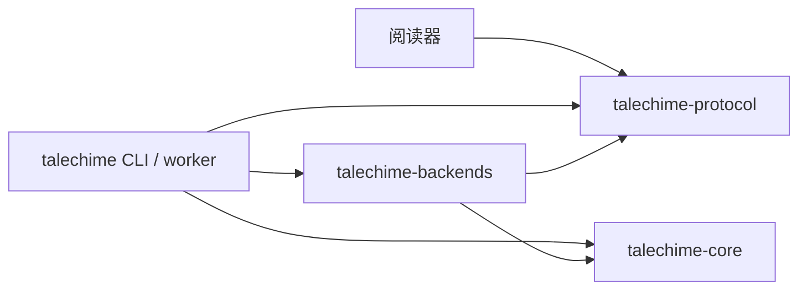

# talechime-backends

具体模型实现和资源目录。会话、播放和检查点由 `talechime-core` 管理；CLI/worker 通过 `Registry` 组装，阅读器不依赖本 crate。



## 编译组合

```sh
cargo build -p talechime                                  # MOSS 默认
cargo build --release -p talechime --features qwen-metal   # macOS: MOSS + Candle Qwen
cargo build --release -p talechime --no-default-features --features qwen-cuda # NVIDIA GPU
```

`Registry` 暴露已编译后端的能力、默认音色及显示名称，按需准备一个模型。后端扩展实现 core 的 `Backend::stream` 和 `Backend::next_segment`，无需改变播放器或阅读器。

## MOSS（Candle）

产品目录仅有 `nano-candle`（默认）与 `realtime-1.7b`。`moss` 提供 Realtime，
`moss-nano-candle` 另外提供 Nano；`moss-candle` 启用 Realtime 的基础依赖。
Nano 支持 CPU，以及显式开启的 `moss-nano-candle-metal` / `moss-nano-candle-cuda`。
Realtime 仅开放 `moss-candle-metal` / `moss-candle-cuda` GPU 设备。
两档均不提供 style、instruction 或 language；VoiceDesign 仅创建可复用参考音色。

## Qwen TTS（Candle）

适配 [TrevorS/qwen3-tts-rs](https://github.com/TrevorS/qwen3-tts-rs)，固定实现 revision `711ceee07cad92673f86de8997bdf54c30caa49f`。源码已纳入 `crates/qwen3-tts`，保留 MIT 授权和来源记录；推理库只读取本地模型，下载与校验由 worker 负责。

支持 `0.6b-customvoice`、`1.7b-customvoice`、`1.7b-base`。旧 Qwen 配置及 0.6B 目录保留；新增模型与 VoiceDesign 资源按模型 ID/revision 隔离。固定清单在 `src/qwen/resources.json` 和 `src/qwen/models/`，分别约 2.50 GB、4.52 GB、4.54 GB；VoiceDesign 约 4.52 GB，仅创建参考音色时下载。模型授权为 Apache-2.0，上游 Rust 实现为 MIT。

CustomVoice 提供九种预置音色，默认福叔 `uncle_fu`；1.7B 支持朗读风格。Base 使用导入的参考 WAV/文本及可复用编码缓存进行渐进克隆；VoiceDesign 只创建一次短参考片段，随后由 Base 播放。随机种子固定 42；GPU 二十帧、CPU 十帧一块，最多 375 帧。取消在帧及解码边界检查；只有真实 EOS 和有效 PCM 才发送 End，超限片段不写完成检查点。

Qwen 分段独立于 MOSS 的 token 预算：真实段落和标题建立硬边界；合并软换行，在 180 UTF-8 字节内优先切完整句末、分句、单词和字符边界。原文不修改，装饰线跳过，正文运算符保留。

CPU、可选 CUDA（Windows/Linux，`qwen-cuda`）和 Metal（macOS，`qwen-metal`）由 Qwen 自己的设备目录报告。各模型 manifest 直接启用同一套 Candle 0.11.0 的 GPU feature；Metal 探测位于内部 `devices/metal.rs`。GPU feature 必须按平台选择，不使用同时启用 CUDA 与 Metal 的 `--all-features`。CUDA feature 仍需 Toolkit。Auto 使用同一完整链路校准门槛；运行错误仅在 Auto 模式重建 CPU 供下次显式播放，不重放失败片段。

流式 codec 的边界连续性需要人工试听，EOS 也不能证明逐字覆盖。当前各模型实测与待验收项见 [验收记录](../../docs/records/tts-core/tts-model-tiers-acceptance.md)。

```sh
cargo run --release -p talechime-backends --no-default-features --features qwen-metal --example qwen -- <model-directory> output.wav metal '你好，欢迎收听。'
TRNOVEL_QWEN_MODEL_DIR=<model-directory> cargo test --release -p talechime-backends --features qwen real_model_streams_and_releases_cancelled_request
```

## MOSS 资源与音色

SentencePiece 分段保留 UTF-8 原文范围；每个执行拥有时长估计。推理和 codec 使用工作区
Candle，独立 owner 通过有界通道发送 PCM，关闭接收端触发取消。

Nano 资源清单为 `src/moss/nano/resources.json`；共享 prompt 与内置音色 codes 为
`src/moss/assets/nano-prompt.json`，保留 Apache-2.0 许可 `LICENSE.OpenMOSS`。
Nano 固定 revision `44502f80dbf9743528fa921cc544d662c685ebec`，资源与导入音色位于
`moss/models/nano-candle/<revision>/{tts,codec,voices}`。参考 WAV 支持 1..30 秒
非静音 mono/stereo PCM 或 float，经 sinc 重采样为 48kHz 交错 stereo，再由 Candle encoder 编码。
重复音色 ID 拒绝覆盖；Realtime 使用独立模型目录与参考音色存储。

旧 `nano`、`local-1b`、`local-1.7b` 加载时明确报错；旧配置、共享音色和模型文件留在原位置，
不扫描、不复制、不删除。变更范围和历史依据见[决策记录](../../docs/records/moss/2026-10-26-moss-tier-removal.md)。

```sh
cargo run -p talechime-backends --example moss -- RESOURCE_ROOT output.wav '你好，欢迎收听。'
cargo run -p talechime-backends --example moss_probe -- RESOURCE_ROOT TEXT_FILE OUTPUT.wav
```

普通测试不下载模型。上述探针要求显式提供本地资源，不能替代真实音频和性能验收。

## 新增原生后端

| 后端 / feature | 计算库 | 模型 | PCM / 流式 |
| --- | --- | --- | --- |
| VoxCPM2 / voxcpm[-cuda/-metal] | 工作区 Candle 0.11.0 | Q8_0 BaseLM + F16 Acoustic，3.55 GB | 48 kHz，原生流式 |
| OmniVoice / omnivoice[-cuda/-metal] | 工作区 Candle 0.11.0 | 0.6B，3.27 GB | 24 kHz，语义分段 |

推理模型在线程内创建、执行、释放；请求与音频通道容量为 1。取消通过接收通道关闭直接通知推理循环，无需 Tokio 继续调度；Drop 关闭请求并等待原生线程退出。切换模型须先停止会话、关闭音频接收端，再释放后端，避免重复占用显存。

统一音色管理保存参考 WAV、准确文字、描述及模型身份；模型专用提示由适配器懒编码并缓存。Vox 和 Omni 支持一次性设计参考再克隆。

来源与固定 revision：[Vox Candle](../voxcpm/SOURCE.md)、[OmniVoice](../omnivoice/SOURCE.md)。Vox Candle 计算库及其模型语义、权重为 Apache-2.0，Candle 依赖保留 Apache-2.0 / MIT 双许可；Omni 生成器 Apache-2.0，但 tokenizer 使用 BOSON/Higgs/Llama 许可。不得将整个组件集合标作 Apache/MIT。旧 C++ 开发对照已退役，[来源与许可证归档](../../docs/legal/retired-voxcpm-native/README.md)保留恢复说明。

对照数值 fixture、固定语料、WAV、性能和待验收项见 [验收记录](../../docs/records/tts-core/tts-model-tiers-acceptance.md)；普通测试不下载大模型。
