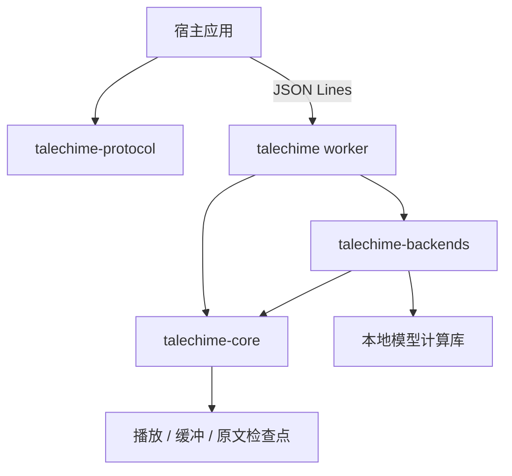
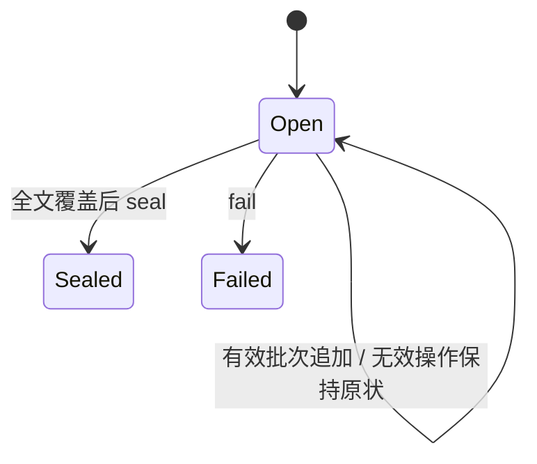

# 架构与集成

Talechime 拥有语音合成和播放；章节获取、阅读界面、角色识别及角色音色绑定由使用方拥有。

推理优化及 GPU feature 保留在模型库内；Metal 设备探测归适配器内部模块。
不再单独发布平台和 CUDA graph 辅助包。Qwen 的 codes 历史解码与 VoxCPM 的有状态图回放各自封装，
不将两种状态生命周期合并。共享边界与验证规则见 [TTS 性能优化方法](knowledge/tts-performance.md)。

Qwen 12Hz 解码的每层 K/V、卷积输入及声码器特征历史归合成会话所有，
按模型注意力窗口和卷积感受野保留有界状态，取消或销毁会话即释放。
模型持有权重、不可变常量与无会话状态的声码器 CUDA 图；图按短块帧数有界缓存，
锁覆盖回放与输出复制，图先于权重销毁。模型算术、常量缓存、有状态增量解码、
无状态图策略分别放在 `decoder_12hz.rs`、私有 `tables.rs`、`streaming.rs`、`graph.rs`。
带请求 KV 的 CodePredictor 图继续归 session。设备录制机制分别内联于两个模型的私有
`cuda_graph/replay.rs`，不进入宿主层。



## 模块

- `crates/talechime`：CLI、worker、模型准备与设备校准装配、音色命令。
- `crates/talechime-protocol`：协议 v7、配置、能力、来源身份与 UTF-8 范围，不链接音频和模型。
- `crates/talechime-cloud-tts`：独立云 TTS 客户端，当前为实验性 Fish HTTP 合成和音色 API；不依赖本地模型、播放器或宿主业务类型，不自动接入现有播放会话。
- `crates/talechime-core`：Backend / Playback 接口、会话、背压、音频预算、实际播放进度、配置和检查点。
- `crates/talechime-backends`：Registry、资源清单、参考音频、设备与具体模型适配。
- `crates/{qwen3-tts,moss-tts,voxcpm,omnivoice,cosyvoice3,indextts,kokoro}`：模型计算；发布包名统一加 `talechime-` 前缀，目录保留短名，Rust 导入名统一使用 `talechime_` 前缀。
- VoxCPM 原生 C++ 开发对照已退役；生产适配器使用 Candle，[归档来源](legal/retired-voxcpm-native/README.md)保留旧源码恢复说明。

## 所有权与故障边界

会话使用 `Rc` 和 local futures，运行在 Tokio `LocalSet`。模型在专用线程上构建、执行和销毁，通过有界通道传递文本及 PCM；音频设备留在播放线程。取消须先销毁 PCM 接收端，再关闭/等待推理线程，避免有界发送与 join 死锁。

生产完成与播放完成分开。只有显式 End 及有效 PCM 才证明一个合成片段正常结束；流断连、帧数上限或取消不能提交完成检查点。成功生成也不证明逐字朗读完整。PCM 使用不可变共享数据；播放队列独占预算许可，在实际消费后释放。

播放进度与检查点以实际播放的片段为单位。协议入口在等待控制命令时继续消费会话事件，保持有界队列背压与命令串行执行。

worker 的 stdout 只允许协议消息。宿主须排空 stderr，校验协议版本、进程实例、session ID、正文摘要和事件序号。启动或 seek 会替换会话；修改默认音色不改变活动计划；旧事件不可推进新会话进度。下一章由宿主决定，只有 completed 终态允许自动续章。

## 多音色演进边界

Backend 已有逐请求 voice/style，SessionManager 已能消费同模型多音色增量计划。CLI/JSON Lines v7 统一提交计划，单音色也是封闭计划。角色 ID 不进入合成后端。

### 朗读计划契约（T0）

`talechime-core` 根导出 `SourceSnapshot`、`VoiceSnapshot`、`SpeechSpan`、`SpeechPlan`、`PlanState`、`PlaybackPolicy` 和 `PlanError`。这些类型不创建模型、runtime、播放器或文件，也没有新的协议 DTO。

- `SourceSnapshot::new` 以现有 `text_hash` 校验完整正文，保留原始换行、Unicode 和空白；宿主须共享同一份快照。
- `VoiceSnapshot::new` 使用已准备 Backend 的能力建立固定音色集合。backend/model 必须精确一致，显式 model 与 `None` 不互相匹配；先在准备层解析默认模型。音色 ID 唯一且可用。它只冻结能力元数据，参考文件的版本保护仍须在后续执行层实现。
- `SpeechSpan::new` 创建待校验范围、音色与风格；只有被计划接受后才能视为有效。风格为逐段显式值，`None` 不继承全局配置。音色与风格规则复用配置校验，风格须受模型支持、非空白且不超过 200 字符。
- `SpeechPlan::append` 按批次原子接受连续前缀，拒绝空批次、无效 UTF-8 范围、重叠、跳跃或集合外音色；失败不改变计划。所有非空范围（包括空白）都必须被覆盖，实际执行层再决定预处理方式。
- `seal` 仅在全文覆盖后封闭输入，空章可直接封闭；`fail` 显式终止开放输入。终态禁止再追加、封闭或失败终止；已接受内容保持可查。
- `complete` 与 `single_voice` 复用增量校验路径。空章的单音色构造仍验证指定音色及风格。
- `accepted_end` 仅是计划提交进度。`Sealed` 不表示音频生成或播放完成；计划只携带 `PlaybackPolicy`，由会话执行流式或整章暂存后播放。



无模型契约示例：`cargo run --locked -p talechime-core --example speech_plan`。

### 增量多音色会话（T1）

`SessionManager::start_plan` 接收 `SpeechPlan` 与 `PlanSessionOptions`，音量、速度和恢复设置不含音色字段。入口验证当前 Backend 的模型、音色及风格能力，再替换旧会话；无效计划、恢复位置或播放设置不取消旧会话。恢复位置必须在已接受的 UTF-8 前缀内。`Streaming` 达到预缓冲后播放，`AfterChapterReady` 通过 T2 磁盘暂存执行。

控制方法 `append_plan`、`seal_plan`、`fail_input` 均校验 session ID 和活动状态。追加/封闭完成即确认输入接受，不等待合成；分析失败通过 `fail_input` 中止生成与播放，等待已有检查点事务并产生 `input_failed` 错误及唯一 failed 终态。stop 仍是 cancelled；旧 ID 的迟到追加、封闭或失败不能影响新会话。

生产者在每个声音范围内调用模型分段，选择对应音色并更新时长学习。它共享同一 Backend 和连续播放队列，不在音色边界增加停顿或重新加载权重。范围未到达时等待通知，暂停仍只允许有界预取。等待分析时允许排空已完整生成前缀的短尾音频，不把它当成 EOF；完成必须等输入封闭、生成正常结束且所有音频实际播放。

`plan_progress` 返回输入状态、accepted_end、generated_end、played_end 与 waiting_for_input。生成终点仅在完整模型片段结束后更新，播放终点沿用安全的片段检查点语义，不估算逐字进度。等待输入与音频缓冲可通过本地进度区分，本阶段不增加协议事件。

朗读副本清除选定的不可见格式字符及非空白控制字符，控制空白保留词边界，CR/LF 保持原样；原文快照、摘要和 UTF-8 字节范围不变。分段边界与执行层跳过校验共用清洗后的静默行判断。

空白、仅含已清除字符的行及独立装饰行可以作为无音频标记排队，只有前面音频实际消耗后才能推进检查点；后端不能无错误地省略普通正文。空章开放输入也要等待 seal。`seek_plan` 复制固定音色安排到新 ID，从原文字节重新生成，并保留音量、速度和用户暂停；开放计划可以在新 ID 上继续追加。活动计划的音色安排固定，调整音量/速度使用 `configure_playback`，重新选角则启动新计划。

单音色便利方法只构造封闭计划，复用同一生产者；会话只保留计划启动和计划 seek，不依赖全局 Config。会话依然运行在宿主 LocalSet，事件消费者需并行排空有界事件通道，避免控制操作等待发送时阻塞。模型参考资源的修订保护由适配器现有机制及后续装配层负责，VoiceSnapshot 不持有文件租约。

无模型执行示例：`cargo run --locked -p talechime-core --example plan_session`。使用确定性 Backend/Playback、临时检查点和后台事件消费者；不播放真实音频、不读写用户目录。CLI/worker 通过库入口执行这些计划，不恢复对齐。

计划应先验证正文摘要、UTF-8 范围、顺序及覆盖，再在每个音色边界内进行模型分段。不得把语义标注片段直接等同于模型 token 片段，也不得跨音色边界合并。首版可限制同一 backend/model，复用权重与参考缓存；逐句重建 worker 或更新全局配置会清空预缓冲，不适合作为正常角色调度。

CastGlean 将 CRLF/CR 规范化为 LF；集成必须把同一份规范化快照交给标注、朗读和高亮，不能直接套用到另一份原文的字节范围。未知与歧义归属的音色回退由宿主明确配置。

### 整章生成后播放（T2）

生成和声音切换复用 T1 的唯一生产者；整章模式及时释放生成通道 PCM 的预算许可，逐条写盘，不等待播放器消费。因此边分析边生成可等待后续范围；即使播放暂停，也能准备超过原有 30 秒队列容量的整章。只有正常 Finished（输入已 seal）后，同步文件并扫描校验完整覆盖、顺序、UTF-8 范围、PCM 格式和记录完整性，才设置 `PlanProgress::chapter_ready` 并启动读回。生成或分析失败不播放部分暂存。

暂存私有格式为 `TCHSTG01`：顺序记录 Start/Audio/End/Skipped/Finished，范围记录是原文索引，PCM 为 little-endian f32，记录带类型、长度和 FNV-1a 校验码。校验码用于发现意外损坏，不是安全认证；本格式不是公共交换协议。每段必须有有效 PCM 和对应 End，最后须覆盖本次恢复字节到全文末尾，拒绝截断、未知格式及尾随数据。读回重新校验记录，失败停止播放并保留安全检查点。

`StagingOptions` 限制每执行文件总大小（含记录头，默认 1 GiB）及记录数（一百万），单记录不超过现有单 PCM 块限制（30 秒、16 MiB）。编码/解码只持有固定数量的有界块及其序列化缓冲，不将整章 PCM 或索引放入内存；临时编码内存额外于播放队列的 16 MiB 预算。读回用相同 Budget，消费后归还许可；待播放原文标记最多 64 条，队列满时允许短前缀排空，避免大量微小片段在达到时长预缓冲前互相等待。I/O 使用受跟踪的 spawn_blocking，不移动 Backend、Playback 或 Rc 到 I/O 线程。

父目录下使用固定受管根 `talechime-staging-v1/` 与随机私有执行目录。根锁序列化识别/创建，执行持有独立所有权锁；下次创建时只删除标记正确、未锁定且仅含已知普通文件的遗留目录。未知文件、符号链接和活动执行保留；未完成所有权标记的异常遗留不会自动认领。文件句柄先关闭再删除目录，兼容 Windows。音频在完成、失败或 stop 后删除，受管根与标记保留；不扫描其他用户路径。

stop 等待在途检查点与暂存 I/O；Drop 只能尽力取消，不能宣称已完成异步清理。seek 保留限额/父目录和暂停状态，先取消旧执行再从安全原文位置新建暂存、重新生成。无持久音频缓存、失败生成恢复或暂存复用。生成期间不推进 played_end，也不发 SegmentStarted/Finished；准备成功后按真实播放推进检查点及 Completed。

`SessionError::Staging(StagingError)` 区分 I/O、容量与结构错误，现有事件载体返回 `staging_failed / chapter_staging`；协议 v7 / CLI 已接入两种策略。无模型例子：`cargo run --locked -p talechime-core --example plan_session -- --after-chapter`。

### 统一 Rust 装配（T3）

`talechime/src/lib.rs` 提供薄 facade，Engine 用显式 ModelOptions 准备 Registry，直接合成和可选 Listening 分开。core 的 SynthesisStream 复用唯一 producer，不依赖播放器/配置/检查点；预算由 SpeechAudio 持有直到消费释放，限量收集失败不返回截断 PCM。SessionManager 增加可选检查点装配，旧构造器仍带持久检查点，既有 CLI 行为保留。

Listening 在宿主 LocalSet 持有 SessionManager，通过 16 项有界控制队列和 oneshot 确认接收 Send 控制句柄；Backend、Playback 和 Engine 保持本地 Rc。close 关闭观察者后使用 core 的无事件关闭路径，避免慢/退出消费者阻塞清理；显式 stop 保留可靠 cancelled 事件和可复用装配。Drop 只请求清理，预约由 owner 持有到全部任务/I/O 释放，不能提前开始另一执行。producer 的完整生命周期也纳入会话关闭等待；跨线程取消直接流通过 AbortHandle 和完成通知，不移动模型。

Engine 同时只接受一项直接合成或一个 Listening owner。直接流完成/失败/显式取消后可复用；丢弃流先请求取消，准备 owner 等其资源释放后才解除 Busy。MOSS Nano 的初始化接收端先关闭，再关闭请求通道并 join 原生线程，算法/模型不变。自定义后端的外部所有权仍由宿主管理。

当前支持宿主现有/自建 LocalSet 和宿主明确创建的线程，不自动管理后台会话线程。库沿用模型 feature，并用 cli feature 分离 executable 与终端参数依赖；具体播放器由 facade 的 playback feature 控制，core 不依赖 rodio 或 HTTP 库；CLI/worker 已直接装配库的 ListeningSession，使用宿主原有事件队列。详细使用、事件背压和生命周期限制见 [Rust 库入口](library.md)。

### 计划协议与应用装配（T4）

按当前项目决定直接升级 JSON Lines v7，不建立旧版本适配或扩展协商。start 的 payload 是 PlanRequest；append/seal/fail_input/get_progress 复用领域计划与控制句柄。单音色没有独立 wire start 路径。DTO 转换集中在 plan_input.rs，正文摘要、声音/风格和 UTF-8 覆盖规则只在 core 校验。

ListeningSession 是执行 owner，Listening 是该 owner 与库自建事件接收端的便利组合。CLI/worker 直接把现有有界事件 sender 交给 Engine，不创建转发任务、额外事件队列或 flush 协议。关闭 owner 通过独立取消信号唤醒 actor，等待生产和暂存清理；正常 stop 的终态直接留在宿主事件队列中。

配置音色/风格只为未来计划提供默认值，活动计划的声音安排固定；播放音量/速度可以独立更新。模型/设备变更取消活动执行并释放已准备 owner。CLI --plan 要求与文件相同的正文且已封闭；--after-chapter 为单音色选择整章暂存策略。宿主 runtime/线程、现有设备选择与模型准备策略保持明确所有权。

先完善 Talechime 通用 API，CastGlean 完成后再共同接入 TRNovel。当前未修改另两个仓库，也未承诺真实模型听感、资源租约保护或完整音频导出。

## 可选内容门禁

计划执行与直接 PCM 流共用 producer。开启回读时，producer 有界收集实际 TTS 片段，经 Verifier 主识别/跨家族复核后先发布报告，再发布接受的 PCM；只对共同确认异常重合成同一片段。报告-only 也收集片段，但不阻止内容异常的交付。AfterChapterReady 在这一阶段之后暂存，全章成功才进入播放。原生 ASR 各有请求容量为 1 的 owner，取消会终止请求并在显式关闭时等待在途工作。报告与 PCM 保持原有有界背压，不在事件转发层另建后台队列。契约及模型组见[回读校验](readback.md)。

## 固定参考合成

每个 SegmentRequest 只携带当前文字、音色、风格、seed 和参数；producer 不保留生成 PCM 作为后续条件。
各后端复用所选音色的固定 codes/features/prompt，不从上一段重新提取音色。语义组段和单次生成内部的
KV、卷积及 codec 状态保持模型原生语义。取消、背压、原文范围和实际播放检查点不变。
策略表与官方依据见[固定参考合成](reference-synthesis.md)。交付侧仍仅做原有边界静音裁剪和有界响度对齐，不补静音。

### 生成参数与 seed

能力目录以 `ParameterSpec` 逐模型声明生成参数（名称/类型/范围/默认），`PlanRequest.params`
与 `PlanSessionOptions.params` 在会话启动时按目录校验，未声明或越界显式拒绝；协议 v7
内为加法式字段，无协商层。seed 由生产者统一派生：`Auto` 每次尝试独立随机（门禁重试换新），
`Pinned(u64)` 按 hash(seed, 合成序号, attempt) 派生以复现。会话 `speed` 在模型声明原生
`speed` 参数且宿主未显式设置时自动路由到生成期无损变速，sink 置 1.0；运行期改速按比例
换算不叠加。逐段 style 由 `SpeechSpan.style` 携带：Qwen 1.7B CustomVoice（指令）、
VoxCPM2（上游 `(description)text` 前缀）、OmniVoice
（instruct 词表校验）。MOSS 两档均不声明风格、instruction 或 language。
各目录与真模型结论见[参数记录](records/tts-core/params-exposure-2026-10-10.md)与
[风格记录](records/tts-core/style-exposure-2026-10-10.md)。
### 音色资产层

音色库（`~/.talechime/voices-v2/`，`VoiceLibrary`）是设计/导入音色的唯一事实源：每条音色
= 原始参考 WAV + 准确转写 + 描述与来源标注，与模型资源目录彻底分离，可单文件导出搬运。
各模型的 per-model `VoiceStore` 降级为可再生物化缓存：按库音色的内容指纹
（转写+描述+WAV 的 sha256）和缓存内容摘要写入相邻 `.library` 标记，缺失或损坏即重物化；
只替换归属明确的缓存，同名且未标记的用户音色报冲突并原样保留。
旧 `<resources>/voices/` 目录不扫描、不迁移、不删除。

设计引擎实现 core 的 `VoiceDesigner` 契约（描述→参考录音，future drop 即取消，
输入约束在加载权重前校验），以静态登记表接入，与 Backend/Registry 同构：Qwen 与 MOSS
的专用设计模型仅按需准备；VoxCPM/OmniVoice 复用已就绪的朗读模型。自动选择策略优先
零额外下载的引擎；`VoiceStudio` 的自动层是显式层的薄封装，两层共一条内部路径。

库音色 id 的解析顺序：模型能力目录内建音色 → `custom:` 模型本地音色 → 音色库 id
（物化后改写为 `custom:<id>`）。Rust API、计划 `SpeechSpan.voice` 与 CLI `--voice`
共用异步物化入口；`VoiceSnapshot` 持有别名，计划统一解析首次及后续 Append 的 span。
协议 v7 加法式扩展：`DesignVoice` 命令（进度复用 `ModelProgress`）、`VoiceReady`
完成事件、`ListVoices`/`RemoveVoice`。设计、模型准备与播放互斥；等待资源的命令按有界队列排队，活动播放的控制仍可执行。

MOSS 只保留 `nano-candle` 与 `realtime-1.7b`。未指定模型时，能力目录、设备选择、
准备路径与校准 revision 解析到 `nano-candle`（已编译时）；只启用 `moss` 的构建默认 Realtime。
旧 `nano`、`local-1b`、`local-1.7b` ID 加载时明确报错，不重写配置或迁移用户资源。
Nano 使用官方 voice-clone user reference 模板，Realtime 使用所选固定参考；两者每请求均独立生成。
Nano 音色使用其独立 revision 目录，由 Candle encoder 编码；Realtime 音色独立保存。
VoiceDesign 仅作为辅助参考生成器，不进入产品模型目录。移除依据见[决策记录](records/moss/2026-10-26-moss-tier-removal.md)。
Qwen `1.7b-voicedesign` 遵循同一规则：`voices design` 按需准备并产出参考录音，
能力目录不登记该模型，选它做朗读明确报错；产物进音色库而非任何模型目录。
Qwen 0.6B / 1.7B Base 复用 Base ICL 编码，OmniVoice 复用 VoiceClonePrompt，VoxCPM2
使用固定原始录音与准确转写建立单参考；参考张量均由原生 owner 持有。

## 适配器登记与基础设施边界

Registry 通过静态登记表查找适配器。每个适配器拥有模型目录、设备能力、资源修订和加载/恢复机制。`ResolvedModel` 冻结已解析的模型身份；CLI 与 Engine 均调用它的 `prepare(PrepareOptions, progress)`，不在应用层按模型名选择恢复加载实现。自动校准保留三次预热、五次测量和现有阈值，显式设备失败不回退。

`PrepareOptions` 显式选择设备、自动校准、自动恢复和校准音色。Engine 默认 CPU、关闭校准/恢复；CLI 开启自动选择所需策略。Auto 先选 CPU（没有 CPU 才选首个加速设备），校准缓存按确切模型身份与资源修订隔离。查询目录不准备或下载模型。

core 保留 `Playback`、配置、检查点和有界暂存。facade 的 `playback` feature 提供默认音频设备，cli 自动启用它；无 playback feature 仍可直接合成或注入宿主播放器。HTTP 下载及续传锁归 backends 私有资源层，不向 core 泄露 HTTP 错误类型。

分段只通过 `next_segment(SegmentationRequest)`，请求携带文本、音色与执行拥有的时长估计。producer 在执行开始及音色切换时重置估计，只有完整有效片段结束后学习；不同执行共享模型也不共享分段学习状态。模型专有分段规则继续由适配器拥有。

历史目录扫描、数据转换和旧配置驱动会话入口已删除；程序不改动旧目录，当前数据格式和 v7 计划协议保持不变。

下载进度回调不阻塞 hf-hub 的读取路径：`FileProgressBridge` 更新 watch 的最新高水位，`Downloads::ensure` 内的转发 future 在队列有容量时发送累积字节；结束前补发最终值，失败只报告实际进度。转发不使用游离任务，随下载取消一起释放，进度订阅断开不改变下载结果。宿主可自行合并 UI 更新频率，不应把进度消费者反压传播到模型下载回调。

### 模型下载传输边界

`Downloads` 在适配器共享层内消费固定 revision 的 hf-hub fork，默认 `DownloadTransport::Auto`：元数据声明 Xet 时优先使用，端点不支持或网络失败时回退 HTTP；调用方也可显式选择 Http 或 Xet。网络客户端和缓存布局不进入宿主协议。回调、最新进度转发、范围调度和请求超时分别管理；UI 背压不传播到网络读取。

上游 hf-hub 1.0.0 自动选择 Xet、没有单文件关闭开关；当前使用独立 fork 的固定 Git revision，范围和发布限制见 [hf-hub 来源](knowledge/hf-hub-fork.md)。最初选择 HTTP 的诊断依据是同一真实 MOSS Realtime 权重的对照：Xet 120 秒文件重建进度为零并曾记录 CDN TLS 握手 EOF（进一步确认此时仍有网络接收，见[诊断记录](records/downloads/xet-mirror-diagnosis-2026-11-05.md)）；HTTP 120 秒收到约 6.9 MB，续传累计约 58.6 MB。此证据只说明当前链路上的故障边界，不证明完整模型下载或模型推理通过。宿主速度/ETA 归宿主聚合层，此库继续输出真实资源字节。

资源准备最多并行两个文件，每文件默认两个缺失范围任务、进程共享四个执行槽；Xet 在范围内使用官方自适应块并发。HTTP 与 Xet 共用 4 MiB 断点，乱序块按实际偏移写入，仅记录每片已确认的连续前缀；未补齐的离散片段允许重新请求。旧临时文件没有断点标记时不按长度推断进度。

`DownloadOptions` 与凭据/缓存配置分开；drop future 停止并补存断点，确认 `checkpoint_failed()` 为 false 才可确认暂停。取消、校验失败、磁盘错误不触发 HTTP 回退；Xet 初始化 15 秒、取得执行槽后首片段 30 秒、后续片段 90 秒，等待执行槽和最终哈希校验不纳入无进度判定。私有数据源、覆盖计算和断点类型不进入宿主协议。最新验证见[Xet 自动选择与回退](records/downloads/xet-auto-fallback-2026-11-05.md)。

## 待确认音色候选

`VoiceCandidate` 封装经过同一资产/WAV 校验的参考与只读元数据，构造不写文件。
`VoiceStudio::design_candidate` 只使用已准备设计资源并返回候选，不下载、不写正式音色库；
显式 `prepare_design` 沿用调用方 Registry 的下载设置。用户确认后由宿主调用
`VoiceLibrary::save_candidate`，同一候选重复提交返回相同资产；直接设计入库入口组合相同生成路径。
候选可通过 `Engine::install_candidate` 适配到模型缓存，正式音色列表保持不变。
`Engine::load` 先检查资源就绪，再沿用调用方 Registry 装配；`prepare_in` 是显式允许准备资源的入口。
宿主负责候选身份、暂存预算、用户确认和媒体读取，基础库不引用桌面业务类型。

资源获取方式由 `ResolvedModel::resource_preparation()` 明确返回 Download 或 Native（显式计划及完整发布），
不能通过缺失字节数推断准备方式；Native 配方也可直接下载已验证成品，转换需求由计划明确返回。

宿主先设计候选并试听，最后显式提交的组合示例：

```rust,no_run
# async fn example(studio: &talechime::VoiceStudio, engine: &mut talechime::Engine,
# tx: tokio::sync::mpsc::Sender<talechime::Event>) -> Result<(), Box<dyn std::error::Error>> {
let candidate = studio.design_candidate(talechime::DesignOptions::auto("温和旁白"), tx).await?;
let voice = engine.install_candidate(&candidate).await?;
let pcm = engine.synthesize_pcm("新的试听文字。", &voice, None, 16 * 1024 * 1024).await?;
// 宿主播放 pcm，用户确认后才调用下面的提交；本例不代表自动确认。
let asset = studio.library().save_candidate(&candidate)?;
# let _ = (pcm, asset);
# Ok(()) }
```

## 原生资源准备边界

`native_preparation` 为固定资源配方提供计划、协作取消、阶段进度和原子发布基础；`ResolvedModel::native_preparation_plan` 仅对已登记配方返回计划，`prepare_native_resources` 执行确认指纹对应的配方。计划计算在受跟踪 worker 上读取并校验缓存摘要；缺失下载量与含暂存的峰值空间分别表达。网络继续使用同一个 `Downloads`，没有外部脚本入口。`PreparationControl::cancel` 后应等待调用返回，不能直接丢弃未来并宣称资源已释放。模型特定转换归各后端，资源就绪与真实推理分开验收。

Kokoro 两变体、CosyVoice3 和 IndexTTS 均已登记固定配方。维护方完成原生转换与逐张量对照后发布缺少的成品组件，默认运行时只下载/复用成品，不要求用户重复转换。原生源配方保留为显式开发构建路径，没有自动回退。来源、真实输入与验收边界见[2026-11-05 核验](records/resources/native-preparation-2026-11-05.md)。

原生准备 API 的阶段、取消与发布边界见[接口说明](native-resource-preparation.md)。

原生准备的受控工作区统一处理组件缓存与进度。后端只声明组件名称及其转换函数，不能注册任意远端脚本；每次转换回调收到固定输入视图、暂存目标和取消控制。组件摘要验证后可跨失败重试或 Kokoro 变体复用，整个模型仍以独立版本目录原子发布。准备租约覆盖 worker 退出和暂存清理，Registry 构造不会恢复执行。清理与提交后持久化错误语义见 [原生资源准备](native-resource-preparation.md)。


### HeyGen 云语音边界

`talechime-cloud-tts::heygen` 与 `fish` 并列，直接提供显式模型、音色查询和有界原始字节流，不接入 Registry、本地音色库、CLI/worker 或播放器。请求 PCM16/MP3 格式，校验服务端格式头；HTTP 正常结束只代表传输结束，不是内容或播放完成。调用方持有响应，取消/drop 释放本地资源，不保证撤销计费。字段与使用边界见 [cloud crate](../crates/talechime-cloud-tts/README.md#heygen-provider)。
