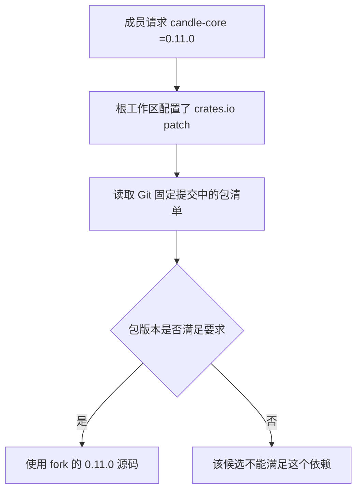
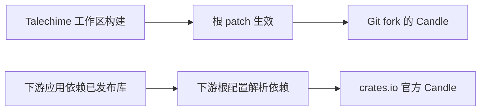

# Cargo patch 从零讲起：版本、Git 提交与发包后的依赖

日期：2026-10-20

在 Talechime 里，我们对 Candle 做了性能优化，但依赖声明仍然是 `candle-core = "=0.11.0"`。代码来自自己的 Git fork，版本却还是官方版本号；把库发布到 crates.io 后，用户又不会自动获得这些优化。

这几件事并不矛盾。理解它们，需要把“需要什么版本”“从哪里拿源码”和“谁在构建最终程序”分开看。

## 1. 先认识 Cargo 中的几个对象

**crate** 是 Rust 的编译单元。**package** 是由一个 `Cargo.toml` 描述的包，可以包含库 crate、二进制 crate 等目标。日常说“发布一个 crate”，通常指把 package 发布到注册表。

**crates.io** 是默认的包注册表。**Git 仓库**是另一种源码来源；一个仓库也可以同时包含多个 package，Candle 就属于这种情况。

**workspace** 把多个 package 放在一起管理。根目录的 `Cargo.toml` 可以集中声明依赖、覆盖规则，并共享 `Cargo.lock`。

这些概念解释了为什么一份配置可以同时出现版本号、仓库地址和包名：它们各自回答不同的问题。

## 2. 版本号是包声明的，不是根据代码计算的

假设一个包的清单包含：

```toml
[package]
name = "candle-core"
version = "0.11.0"
```

这份源码就声明自己是 `candle-core 0.11.0`。Fork 后修改实现，只要没有修改清单里的版本号，它声明的版本仍然是 `0.11.0`。

Cargo 不会比较它与官方发布包的代码，再自动为它生成新版本号。相同的包名和版本号，也不意味着不同来源的源码完全相同。

依赖里的版本字符串则是一个约束：

```toml
[dependencies]
candle-core = "=0.11.0"
```

这里的 `=` 表示精确要求 `0.11.0`。如果写成 `"0.11.0"`，默认采用 caret 规则，在这个例子中允许 `>=0.11.0, <0.12.0`，并非精确固定版本。

因此要区分：包自己的 `version` 是声明；依赖中的 `version` 是对候选包的要求。

## 3. patch 把另一份源码交给解析器

Talechime 的根配置包含：

```toml
[workspace.dependencies]
candle-core = "=0.11.0"
candle-nn = "=0.11.0"
candle-transformers = "=0.11.0"
candle-metal-kernels = "=0.11.0"

[patch.crates-io]
candle-core = { git = "https://github.com/yexiyue/candle", rev = "2266099d92265112ecc0d56ecee1761e3cc2ac00", package = "candle-core" }
candle-nn = { git = "https://github.com/yexiyue/candle", rev = "2266099d92265112ecc0d56ecee1761e3cc2ac00", package = "candle-nn" }
candle-transformers = { git = "https://github.com/yexiyue/candle", rev = "2266099d92265112ecc0d56ecee1761e3cc2ac00", package = "candle-transformers" }
candle-metal-kernels = { git = "https://github.com/yexiyue/candle", rev = "2266099d92265112ecc0d56ecee1761e3cc2ac00", package = "candle-metal-kernels" }
```

子包通过 `candle-core = { workspace = true }` 等声明继承集中配置。单独写在 `[workspace.dependencies]` 中的依赖，不会自动添加到每个成员里。

`[patch.crates-io]` 的意思是：给当前工作区解析 crates.io 依赖时，提供这些替代包。它不会修改或上传 crates.io 上的官方包，也不是在下载后自动执行一份 diff。

| 字段 | 回答的问题 |
| --- | --- |
| `=0.11.0` | 候选包必须满足什么版本要求？ |
| `git` | 替代包的源码在哪个仓库？ |
| `rev` | 使用仓库中的哪个固定提交？ |
| `package` | 使用该仓库中哪个 package？ |

这里 `package` 与左侧名称一致，可以省略；显式写出有助于说明对应关系。对包使用别名时，这个字段可以指定其真实名称。

Cargo 读取固定提交里的包清单，发现它仍然声明 `0.11.0`，满足 `=0.11.0`，于是可以使用它。这里无需先把 fork 发布到 crates.io。



如果 fork 改成 `0.12.0`，它就不能满足 `=0.11.0`。Cargo 可能继续使用符合条件的官方包，也可能在其他约束下解析失败；patch 不会取消版本检查。

如果约束允许多个版本，也不能认为“写了 patch 就一定会用”：候选版本、其他依赖约束和现有锁文件都会影响解析。最终应检查实际结果。

## 4. 为什么根目录的 patch 能影响间接依赖？

假设应用依赖 `voxcpm`，而 `voxcpm` 又依赖 Candle。根工作区对 crates.io 的 patch 既能影响应用直接声明的 Candle，也能影响依赖图里符合来源和版本条件的间接依赖。

这正是集中覆盖的用途：不用逐个修改所有依赖者的清单。

但这个范围有边界：它针对配置指定的来源，不会把所有不同 Git 来源、所有不兼容版本的同名包都强行合并。Cargo 只读取根工作区的 patch；依赖包自己携带的 patch 不会接管使用者的解析。

Talechime 同时覆盖四个 Candle 包，是为了保持相关依赖来源一致。尤其 `candle-metal-kernels` 若一条路径来自 registry、另一条路径来自 Git，即便版本号相同，也可能同时出现两份不同来源的包。项目的具体约定见 [Candle 来源说明](../legal/candle/SOURCE.md)。

## 5. Cargo.lock 记录的是实际选择

`Cargo.toml` 表达要求，`Cargo.lock` 记录解析结果。当前项目里的条目如下：

```toml
[[package]]
name = "candle-core"
version = "0.11.0"
source = "git+https://github.com/yexiyue/candle?rev=2266099d92265112ecc0d56ecee1761e3cc2ac00#2266099d92265112ecc0d56ecee1761e3cc2ac00"
```

版本和来源同时出现：包的版本是 `0.11.0`，实际代码来自指定 Git 提交。

`rev` 在清单中固定提交；锁文件记录完整依赖解析，两者作用不同。`cargo build --locked` 要求构建不能修改锁文件，并不代表无需联网，也不会自动证明某个优化分支实际运行了。

可以在自己的项目根目录检查：

```sh
cargo tree --locked -i candle-core
cargo tree --locked -d
```

第一条查看谁依赖 Candle 以及所选包的来源信息；第二条帮助发现重复包。如果存在多个候选而命令要求消除歧义，按 Cargo 提示指定完整包标识。构建时应使用与目标程序相同的 feature 和 target 条件。

## 6. 发到 crates.io 后，patch 会跟着走吗？

不会自动跟着走。

把 Rust 库发布到 crates.io，发布的是供下游构建的源码包，不是已经链接好 Candle 的程序。下游应用会根据自己的根配置和依赖图重新解析、编译依赖。

你的根工作区 patch 不会成为下游应用的覆盖规则。即使别人通过 Git 依赖你的库，依赖仓库里的 patch 也不会自动生效。你的锁文件同样不会替下游应用锁定整张依赖图。

以一个没有自行覆盖 Candle 的下游应用为例：



因此，库若调用了 fork 独有的公开 API，就可能出现“仓库里编译成功，发布验证或下游编译失败”。Talechime 当前要求 fork 保持公开 API 不变，正是为了让发布库仍可使用官方 Candle。

API 兼容只说明调用接口可用；它不保证两份实现具有相同的性能或数值表现。

## 7. 为什么二进制用户却能获得优化？

因为二进制交付的是已经构建好的程序。

如果发行构建在保留 patch 的 Talechime 工作区中完成，且包含相关后端及计算路径，fork 的实现就会参与编译。用户下载这个程序后，无需重新解析 Cargo 依赖。

| 使用方式 | 是否获得 fork 实现 |
| --- | --- |
| 在保留 patch 的 Talechime 工作区构建 | 是，相关依赖使用 fork |
| 下载由上述配置构建的二进制 | 是，相关实现已编译进程序 |
| 在自己的应用中依赖 crates.io 上的计算库 | 默认使用官方 Candle |
| 通过 Git 依赖 Talechime 的某个库 | 仍由应用根配置决定，不继承依赖的 patch |
| 在自己的应用根工作区添加同样的 patch | 满足解析条件时使用 fork |

“包含实现”还不等于“必然提速”。例如 Metal 内核优化只在相应设备和算子路径运行时才可能产生收益；CPU 用户不会因为程序包含 Metal 代码就获得该优化。性能收益需要单独测量。

## 8. 库用户怎样主动使用 fork？

把第 3 节完整的 `[patch.crates-io]` 区块放到**自己应用的根工作区** `Cargo.toml` 中，然后重新解析并检查依赖图。不要只复制 `[workspace.dependencies]`，那部分是 Talechime 自己的集中依赖声明。

如果现有锁文件没有切换到期望来源，可先查看 Cargo 的 unused patch 提示和版本约束，再考虑执行：

```sh
cargo update -p candle-core
```

这条命令会修改锁文件，必要时也会调整关联依赖。执行后审查 `Cargo.lock` 的变化，并用 `cargo tree` 确认四个包的实际来源，再用自己的 feature 组合构建验证。不要把手工修改锁文件当作覆盖配置的替代品。

要使用其他提交，应在确认版本和 API 约束后统一调整相关包的 `rev`。当前文章中的提交是写作时的项目快照，不代表未来始终应使用它。

## 9. 想让所有库用户默认获得优化，有哪些选择？

**把优化合入上游。** 上游发布后，让库依赖包含补丁的版本。需要确保版本下限或精确约束确实包含补丁；仅提高宽松约束的下限前，还应考虑下游已有的解析结果。这条路能减少长期维护的 fork。

**将 fork 用独立包名发布到 crates.io。** 让库直接依赖这些发布包，并处理好 Candle 家族内部依赖、feature、公开类型和许可证。不同来源或包名的 Candle 类型不能假设可以互换，这是一套需要维护的发行体系。

**让应用作者自行添加 patch。** 库继续兼容官方 Candle，需要 fork 的应用显式选择。使用门槛较低，但不能保证每个下游都采用。

直接把库依赖改成 Git 地址可以服务于源码或私有分发场景，但 crates.io 不接受未移除的 Git 依赖。采用 `git + version` 多来源声明也不能把 fork 强制传递给 crates.io 用户：发布包使用 registry 版本，仍需保持兼容。

## 10. 回到 Talechime 的选择

当前策略是：源码工作区统一使用固定提交的 fork，二进制构建可以包含优化；发布到 crates.io 的库保持官方 Candle 兼容。需要同样优化的库用户，在应用根目录显式添加 patch。

这让性能实验与库发布能够并行，但也要求分别验证两条路径：带 patch 的工作区构建，以及使用官方 registry Candle 的发布包构建。前者成功不能代替后者，依赖来源检查也不能代替真实性能测量。

## 参考资料

- [Cargo Book：覆盖依赖与 patch](https://doc.rust-lang.org/cargo/reference/overriding-dependencies.html)
- [Cargo Book：依赖版本与多来源声明](https://doc.rust-lang.org/cargo/reference/specifying-dependencies.html)
- [Cargo Book：Cargo.toml 与 Cargo.lock](https://doc.rust-lang.org/cargo/guide/cargo-toml-vs-cargo-lock.html)
- [Talechime Candle 来源、许可与发布策略](../legal/candle/SOURCE.md)
- [Talechime 开发与验证](../development.md)
