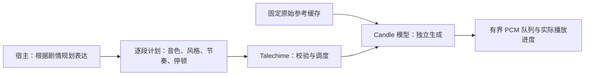

# 独立生成与长文本表达：Candle 实施计划

调研日期：2026-10-14。状态：候选选型与实施路线，尚未启动新模型移植；本文不代表新增产品能力或真实模型验收通过。

## 目标与已有证据

目标是让长篇听书同时保持旁白音色、合理语速和剧情表达，并减少上一段生成音频持续回灌所造成的误差传播。

本轮用户试听反馈为：固定锚点音色稳定，但逐句表达容易单调；VoxCPM 双参考效果较好；Qwen 音色变化较小，但听到语速加快；MOSS 出现音色变化，且部分应加速的句子仍保持首段的慢节奏。这些是特定语料和配置下的主观反馈，不是所有模型或平台的普遍结论。

这里的“独立生成”指各段不使用上一段生成音频作为滚动参考。各段仍共享固定原始音色参考和宿主提供的表演计划。完全无上下文的逐句生成不能自动保证整章情绪和节奏连贯。

## 候选及 Candle 可行性

以下难度是源码与论文调研后的工程判断，尚未完成本项目编译或数值验证。可用权重、社区 Rust 实现和完整 Candle 实现是不同状态。

| 候选 | 调研状态 | 主要工作与边界 | 优先级 |
| --- | --- | --- | --- |
| IndexTTS 2.5 | 2026-08 发布，公开推理代码与权重；可作为原生 Candle 移植候选 | 覆盖参考编码、说话人编码、文本到语义、Zipformer 声学生成、BigVGAN 和文本前端。已有 IndexTTS Rust 项目主要使用 ORT，不能作为 Candle 完成证明 | 主要质量路线，先过试听门槛 |
| TED-TTS | ACL 2026，公开实现基于 IndexTTS-2，无新增模型权重 | 增加注意力观测、段内情绪切换和时长控制；迁到 IndexTTS 2.5 须重新验证，不是假定兼容的插件 | 底座跑通后按需推进 |
| Fun-CosyVoice 3.0 | 有社区 Candle 实现与转换权重 | 社区实现依赖自定义 Candle revision，默认提供 ONNX 参考前端；须审计完整度、模型版本和数值一致性，适配本仓库统一依赖 | 优先做可复用性探针 |
| LACI | 2026-09 论文，适用于 Qwen3-TTS 与 VoxCPM2；论文称代码将在发表时开源 | 暴露指定注意力头，保存和恢复生成状态，局部施加掩码。主要针对漏读、重复和幻觉，不直接保证语速或情绪连贯 | 现有 Qwen 的可靠性增强 |
| MagpieTTS-LF | 2026-06 论文，使用历史文本、编码状态和注意力先验 | 先实现 Magpie 底座再移植跨块状态；属于有状态分块生成。论文主要验证英语，不能直接外推中文小说效果 | 借鉴机制，暂缓完整移植 |
| Fish Audio Drama 3 | 技术报告于 2026-10-13 提交，已有公开权重 | 混合注意力、MoE、音频 MTP 解码与量化支持；35B 总参数、3B 激活参数不等于 3B 权重显存。按规模判断不适合作为 12GB GPU 的首轮本地目标 | 暂不实施 |

IndexTTS 2.5 的说话人参考和情绪条件分别输入。源码中的 `duration_factor` 调整声学生成目标长度，可用于节奏实验，但不应视为严格秒级时长保证。TED-TTS 的局部时长控制是另一套推理策略，不能混为同一功能。

Candle 是推理框架，不会自动执行任意 PyTorch 模型。每条路线都需要核验权重映射、前后处理、设备算子和完整生成逻辑。当前仓库固定 Candle core/nn/transformers 0.11.0；不得为复用社区项目直接引入另一套 Candle 或未经验证地整体升级。

## 阶段一：先验证听感收益

使用现有《蛊真人》实验语料与同一旁白参考，先以官方实现建立开发对照。Python 仅用于开发和验收，不成为生产运行依赖。

对照组：

1. IndexTTS 2.5：固定参考、普通独立生成。
2. IndexTTS 2.5：固定参考、按剧情规划每段情绪和节奏。
3. CosyVoice 3：固定参考、逐段表达指令。
4. TED-TTS：同一剧情表演计划，加入段内情绪与时长控制。
5. 用户认可的 VoxCPM 双参考作为听感基准。

保持原文、参考音频和对照切点一致。模型内部切分不一定相同，应记录实际切分、权重 revision、参数、种子和输出采样率。相同种子不代表不同模型具有相同随机轨迹。

交付完整音频、情绪转折片段、句间接缝片段和机器可读报告。报告记录每段时长、实际语速、回读错误、峰值显存、首音频延迟和 RTF；语速统计区分静音与有效发声，不能仅以总时长推断加速。

继续条件：用户能听出表达改善，音色、接缝和读字完整度没有明显退步。未通过的候选停止完整移植投入，保留结果及限制说明。

## 阶段二：审计 CosyVoice Candle 实现

1. 固定社区源码 revision、许可证、上游模型版本及转换权重来源。
2. 审计社区 Candle 分支与上游差异，列出必要模块和新增算子。
3. 列出各推理组件实际采用的 Candle、ONNX 或其他计算路径。
4. 将必要代码适配到统一的 Candle 0.11.0，生产库不依赖 PyO3。
5. 在 Windows CUDA 上验证短句、参考克隆、情绪和速度指令。

交付独立 Rust 探针、组件覆盖表和上游数值对照。只有完整推理链均由 Candle 执行，才标记为完整 Candle 实现。若需阶段性 ONNX 前端，应明确标记混合实现，并单独评估现有 ORT 固定版本的兼容性。

继续条件：数值差异可解释，实际中文输出通过回读与试听，参考条件在多次请求中稳定，显存满足目标设备。

## 阶段三：移植通过试听门槛的 IndexTTS

如果阶段一显示 IndexTTS 的收益值得投入，按以下组件推进：

1. 配置、权重转换、分词和中文文本前端。
2. 固定参考的音色及语义编码，建立与资源哈希绑定的缓存。
3. 文本到语义生成，验证采样、停止条件和缓存。
4. 语义到声学特征及目标长度调节。
5. BigVGAN 声码器与 PCM 输出。
6. 情绪参考、情绪向量与文本情绪控制。

逐组件对照上游固定输入输出，先验证浮点路径，再考虑量化或自定义加速。文本情绪控制所需的额外模型应计入资源和显存；不能只按主生成模型参数量估算成本。

交付独立模型计算 crate、固定资源清单、来源声明和真实模型验收记录。完整短句通过后再验证长篇，不能仅凭输出有声 PCM 判断移植正确。

## 阶段四：接入 Talechime 的逐段表演计划

当前 `SpeechSpan` 支持逐段音色和 `style`，生成参数主要处于会话级。逐段速度、情绪强度或目标时长尚需设计通用契约，不能认为现有接口已全部覆盖。

实施要求：

- 宿主拥有章节、剧情分析、角色及音色绑定；Talechime 不引入 TRNovel 或 CastGlean 业务类型。
- 先定义通用逐段控制、能力声明和校验，再映射到各模型；模型不支持的控制显式拒绝。
- 独立生成模式共享原始参考缓存，上一段生成音频不进入下一段参考。
- 表演参数、实现 revision 和参考资源身份进入缓存键，避免不同计划复用错误音频。
- 继续使用绑定不可变正文摘要的 UTF-8 字节范围；语义范围与模型切分分别处理。
- 保持唯一计划入口。协议变更先评估 v7 加法兼容性，不新增旧命令或兼容协商路径。
- 保持 LocalSet、专用推理 owner、有界通道、取消及实际播放完成语义。

交付模型适配器、能力目录、计划控制与缓存验证。新增后端默认不替换现有用户选择；是否作为推荐默认值由真实验收决定。

## 阶段五：按剩余问题选择增强方法

| 剩余问题 | 后续工作 | 验证重点 |
| --- | --- | --- |
| 句内情绪仍平 | TED-TTS | 情绪转折位置、时长误差、读字完整度及调参敏感性 |
| Qwen 漏读、重复或幻觉 | LACI | 注意力头选择、故障检测、回退恢复、重试上限和取消 |
| 句间韵律断裂 | MagpieTTS-LF 类跨块状态机制 | 历史状态预算、重置条件、恢复行为及中文收益 |

LACI 首先在实验路径验证，不在每步复制全部注意力张量；评估观测开销和回退缓冲预算。引入 Magpie 类状态时应明确标记为有状态生成，不能继续称作完全独立的实现。

## 最终验收与推进顺序

短片段验收后，再执行连续 20–30 分钟中文听书，记录滚动音色相似度、逐段语速、漏读、接缝、显存和 RTF。音色指标、回读结果和用户试听共同判断，单一平均指标不作为放行依据。评估 CPU 可用性，CUDA 与 Metal 分别记录编译和实机验证边界，不由单个平台成功推断其他平台质量。

普通测试不下载模型。实现改动运行格式检查、相关测试、Clippy 与 rustdoc；真实模型数值、音频和性能验收单独存档。模型、小说、用户音频和实验产物保持 Git 忽略，第三方许可证与固定来源保留。

建议顺序：**试听筛选 → CosyVoice Candle 审计 → 移植听感胜出的 Index／CosyVoice → 接入逐段表演计划 → 按需增加 TED 或 LACI**。各阶段通过后再估算下一阶段工期，不同时完整移植所有候选。

## 调研来源

- [Candle 官方项目](https://github.com/huggingface/candle)：框架与 CPU/CUDA/Metal 计算路径。
- [IndexTTS 官方项目](https://github.com/index-tts/index-tts)、[2.5 推理源码](https://github.com/index-tts/index-tts/blob/main/indextts/infer_v2_5.py)、[技术报告](https://arxiv.org/abs/2601.03888)。
- [IndexTTS Rust 项目](https://github.com/8b-is/IndexTTS-Rust)：社区 ORT 路线参考，非原生 Candle 完成证明。
- [TED-TTS 论文](https://arxiv.org/abs/2601.03170)、[官方实现](https://github.com/Simon-leong/TED-TTS)。
- [CosyVoice 官方项目](https://github.com/QwenAudio/CosyVoice)、[社区 Candle 实现](https://github.com/SpenserCai/cosyvoice3.rs)、[社区依赖声明](https://github.com/SpenserCai/cosyvoice3.rs/blob/main/Cargo.toml)。
- [LACI：Taming Long-form Text-to-Speech](https://arxiv.org/abs/2609.16989)。
- [MagpieTTS-LF](https://arxiv.org/abs/2606.18485)。
- [Fish Audio Drama 3 技术报告](https://arxiv.org/abs/2610.18010)、[模型卡](https://huggingface.co/fishaudio/drama-3)。

外部 main 分支链接用于调研导航；实际实施必须记录固定 commit 与权重 revision。许可适用范围以选定版本的代码及模型许可为准。
