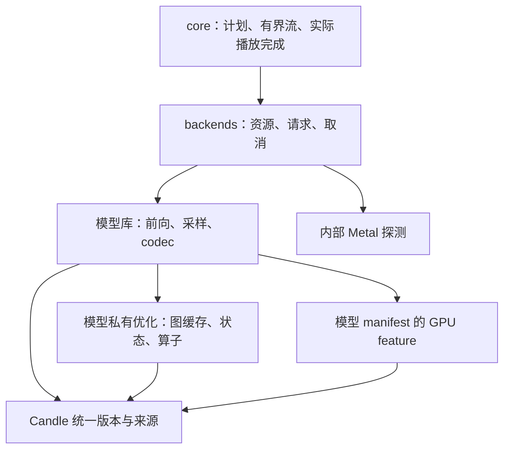

# TTS 性能优化方法

本指南提炼 IndexTTS、Qwen 和 VoxCPM 的已验证经验。当前实现以源码为准，设备数据与
失败实验保留在 records；某个模型的收益不作为其他后端的默认收益。优化顺序为：确认
正确行为、固定测量协议、定位热点、单独验证候选、删除未通过候选、再调整共享边界。

## 当前优先级与测试设备

当前主线为[已有后端双设备性能优化 #5](https://github.com/yexiyue/talechime/issues/5)。
固定原始音色参考与可选 VoxCPM2 双参考另见[低优先级议题 #4](https://github.com/yexiyue/talechime/issues/4)，
不因规划记录改变现有库默认。固定参考复用与滚动自链必须分开描述。

| 测试机器 | 硬件与系统来源 | 分开验收的执行路径 |
| --- | --- | --- |
| Windows 本机 | Windows 11，Ryzen 7 9700X，RTX 5070（约 12 GB 显存）；2026-10-18 查询驱动 616.56 | CUDA；CPU 或混合分派需另外标明 |
| MacBook Pro | Apple M4 Pro，12 CPU 核（8P+4E）、16 GPU 核、24 GB 统一内存；已有实测记录为 macOS 26.6.2（25G83） | Metal GPU；CPU Accelerate/BLAS 分开测量 |

Mac 规格来自既有实机报告，此次 Windows 文档更新没有执行 Mac 复测。AMX 属于
Accelerate 的底层加速机制，不另列为已独立验收的推理设备；启用 Accelerate 不等于
逐算子确认使用 AMX。新一轮测试重新采集环境，历史驱动/系统版本不代表当前另一台机器。

每个性能表必须注明机器与实际路径，不能只写“本机”或“GPU”。同一机器也不能混算
Metal、CPU Accelerate 与纯 Rust CPU 的结果；跨设备不累计收益、不承诺逐位一致，
共享依赖解析或编译通过不能代替对应设备的实机性能验收。

## 四项设计原则与模块边界

这里采用 KISS、DRY、YAGNI、SOLID 四项原则；SOLID 的五项约束一起用于检查职责与依赖。

| 原则 | 本仓库的具体约束 |
| --- | --- |
| KISS | 默认路径明确；失败实验删除代码和开关，只在记录中保留证据；不让多层策略选择掩盖实际计算路径 |
| DRY | 统一依赖版本、来源和平台 feature；同一状态的 snapshot/restore 共用遍历；有两个真实使用者且语义相同才提取共享算子 |
| YAGNI | 不预建跨模型 GraphBackend、通用 KV 框架或单实现 trait；可复用经验先写文档，不强行变成代码 |
| SOLID | 模型负责算术，专用模块负责缓存和设备生命周期，适配器负责资源与取消，core 负责有界流和播放；优化实现必须满足原输入、输出、错误与终止契约 |

SOLID 的检查落点：单一职责按所有权拆模块；扩展路径通过已有小接口接线；替换 eager
时必须保持数值和状态契约；接口只暴露消费者需要的能力；设备模块不依赖宿主配置或
业务类型。没有多实现需求时，闭包和具体类型足以表达依赖，不为 DIP 增加无用 trait。

Qwen 的 `synthesis/streaming/decoder.rs` 保留有限 codes 历史，并事务式交付新 PCM；
VoxCPM 的 `cuda_graph/decoder.rs` 回放 AudioVAE 的卷积历史和 overlap。它们不是相同的
状态模型，不合并。固定缓冲 recorder（录制、输入覆盖、输出回拷、流与缓冲生命周期）
现分别保留在 Qwen 与 VoxCPM 的私有 `cuda_graph/replay.rs`，不单独发布辅助 crate。
这两份底层实现具有共同来源，修改时须检查另一份；模型级缓存键、状态保活、取消与失败策略
仍归各模型的私有模块（Vox CFM/decoder、Qwen `code_predictor/graph.rs`）。
GPU feature 由模型 manifest 直接启用并按目标平台选择，Metal 探测归 backends 内部模块。

## 基线与官方对照

每次记录代码 revision/dirty diff 摘要、权重 revision/清单摘要、参考音频摘要、文本、
精度、设备、seed、实际生效的采样参数、线程数、chunk 大小、帧上限、依赖 feature。
记录官方实际导入源码路径和 revision；不能只记录某个旁边 checkout 的 HEAD。

先逐阶段比对条件拼接、位置/RoPE、mask/KV、采样、codec 布局、参考前缀裁剪和 EOS。
官方也可能有设备 bug：Qwen 的官方 MPS 空历史 repetition penalty 曾读取异常缓冲，
应最小复现并单独标记修正对照，不能让 Rust 模仿异常或删除旧证据。
相同 seed 不代表 PyTorch 与 Rust 使用相同随机序列。CPU、CUDA、Metal 的数学等价
也不意味着逐位一致，尤其是归约、量化、卷积和不同累加精度。

## 分开测量与剖析

- 先编译 release，再串行运行独立进程。GPU 基准期间不编译、不并行推理。
- 明确计时边界：模型加载/参考准备是否计入；导出音频放在计时外；异步设备在计时
  入口和出口同步。host tracing span 只表示 API 墙钟，不能直接解释为 kernel 独占耗时。
- 测量框架自身的预热合成用的是**另一段文本**，序列长度与被测文本不同。
  比较每步成本前必须先打印被比较轮次的实际目标长度/段长，否则会把
  “文本更长”误读成“第二次调用变慢”。OmniVoice 的 `prepare_reference`
  用 9 字参考语料（target_len 48）预热，而被测语料是 target_len 130，
  2.6× 的 forward 差异全部来自序列长度，不是进程级退化。
- 正式输出保持型比较优先用 ABBAABBA 八进程，各一轮预热、五轮热测；逐进程先取均值，
  再报 mean-of-means、进程均值区间及逐轮数据，不挑最快一轮。预热单列，不计入统计。
- NVIDIA 可用时记录实际时钟、功率、温度、P-state、限频原因和其他进程；锁频/电源操作
  检查退出码并在 finally 恢复实际原设置。不支持锁频时记录限制，不伪称已锁频。
- 尽量独占 GPU；桌面进程仍驻留时如实记录。Windows 电源计划需验证实际生效 GUID，
  不能仅凭调用过命令声称高性能。macOS 的统一内存峰值不当作独占显存。
- 同时报合成秒数、音频秒数、RTF、首 PCM 延迟、chunk 数和间隔、结束原因；帧上限和
  失败不计为成功完成。不同输出时长或采样策略的比较不标为保持输出的加速。
- 初筛可少跑，但只能作筛选。优化保留不设置默认的整链改善百分比；按下节评估局部与
  整链收益、证据可信度和维护成本。纯简化可在无性能收益时保留，但必须标明动机和严格回归。

频率、外部进程与温度只能用观测关联辅助归因。证据不足就记“未定位”，不把一次 RTF
变化归为代码退化。新增运行时修改不得混入环境归因实验。

## 优化保留判断

- 某个算子或阶段有可复现的显著改善，即使单项整链提升较小，也值得保留评估；
  不因整链未达到某个百分比而自动撤回。整链变化落在噪声范围内时，明确写成
  “局部改善已验证，整链提速尚未证明”，不能把局部收益包装为整链收益。
- 同时记录局部绝对耗时、相对改善、调用频率和整链结果。固定形状、dtype、输入和
  计时边界，结合重复测量、进程均值范围与环境干扰判断收益是否可信。
- 综合收益、实现复杂度、维护成本、内存和其他阶段的影响决定是否保留；若存在回退，
  必须说明范围与权衡。没有可信局部或整链收益的提速候选仍应撤回。
- 允许逐项积累已验证的局部优化。组合后重新测量整链与回归，检查收益重叠及资源竞争；
  不直接相加各项改善百分比，也不把预期累计收益当作已经完成的性能验证。

取消默认性能百分比门槛不放宽输出、数值、音质、取消或生命周期的验证要求。
历史记录中的 10% 等判据只描述当轮决策，不再作为后续优化的默认保留条件。

## 准确性与公共行为门禁

| 修改类型 | 最低证据 |
| --- | --- |
| 复制、缓存、图回放 | 固定输入 eager/优化逐位比较；不同噪声/steps/cfg；多请求、取消后复用；完整 codes、PCM、长度、EOS 比较 |
| 改变归约/布局/算子 | 独立参考的小张量测试，加真实权重逐阶段误差；若改变 codes/EOS/PCM，必须按数值变化重新立门槛与试听 |
| 采样正确性修复 | 同分 top-k/top-p、累计恰好等于 p、原词表 ID、空历史、多行、实际词表宽度；旧 seed 改变不能包装为输出保持优化 |
| 流式 decoder | 固定 codes、参考前缀、短尾块、跨块上下文、样本覆盖；失败时状态是否推进；取消/重试/下一请求重置 |
| 依赖或共享 feature | 组合启用后端的测试与链接；CPU、CUDA、Metal 分别记录，不用逐包通过替代组合回归 |

WAV 字节哈希用于相同 writer 的严格复现；另存 F32LE、codes 和元数据便于区分容器差异。
旧 WAV 对比脚本已随 `tools/` 删除（Git revision `e591c94` 可取回）。新证据须保存 float32 PCM 摘要；需数值误差/SNR 时显式使用经过验证的独立比较工具，不把相同 seed 当作音频等价。
ASR 回读只能辅助覆盖检查，不能替代听感，也不能从有限误差推断无音色变化。
模型自然 EOS 才算正常生成完成；播放完成仍由播放器实际消费决定。图优化不能越过
有界队列，也不能把取消当成 EOS。普通测试使用夹具，真模型测试显式启用且不下载。

## 选择优化方向

先检查重复的参考计算、每步主机往返、固定 mask/位置张量重建，再检查小算子分派、
图与卷积实现，最后考虑改变浮点累加顺序的算子重写。CPU 对小张量可能更快：
IndexTTS codec 的结果不能推广到所有阶段，采样前的设备迁移可能改变后续轨迹。

Qwen 语义采样当前使用一次 F32 logits 回传后的统一 CPU 排名策略；不要凭“全 GPU”
更先进就恢复排序/散射方案。Metal 小词表测试曾通过而 3072 真实词表失败。CodePredictor
声学 argmax 和 code 缓冲保持在设备上；语义采样的随机分布与声学贪心必须分开处理。
顺序 F32 CDF 与旧 GEMM cumsum 的累加舍入不同：Windows 曾在 3072 词表、seed 53
选出相邻 token，不能把有限 Mac 夹具等价称为跨平台普遍保证。旧 CDF 的严格算法对照
使用可精确累加的概率；一般概率遵守当前明确的顺序 F32 阈值规则。
Qwen Metal depthwise 的窗口 matmul 只适用已验证的卷积条件；CUDA 先测 stock/cuDNN
真实路径，不继承 Metal 分派阈值。Accelerate feature 合并会影响同进程其他 CPU 后端。

macOS 的所有 Candle 模型库默认通过 target 依赖启用 Accelerate，包括独立 CPU
构建；后续 macOS CPU 实验以此为基线。此规则不改变 ORT provider，也不适用于
Windows/Linux 的 AMD CPU。BLAS 切换可能改变浮点结果，不承诺所有模型逐位一致；
feature/链接与普通测试通过不等于全部模型真实音频验收，实际算子也不一定使用 AMX。
默认接线与 OmniVoice 线程初筛见[记录](../records/omnivoice/omnivoice-cpu-accelerate-defaults-2026-10-23.md)：
默认与此前显式 Accelerate 的完整 codes 和 96 个短文本 WAV 一致；线程实验末尾
出现外部编译，未确认新整链收益，不修改全局线程策略。

## CUDA Graph 的所有权规则

1. 先选固定形状、无 host 读回、无图内取消的边界。动态 KV 长度、设备 offset 和采样
   是额外问题，不能从 CFM 的成功推出 LM 能直接 capture。
2. 输入/输出使用图外持久缓冲；复制、capture、launch 使用同一个被 recorder 持有的流。
   连续 view 仍可能有 storage offset，复制逻辑长度并校验 shape/dtype/设备。
3. Candle h2d cache 的 guard 内预热，再录制。capture 本身不执行，首次返回实际 warmup
   结果；有状态 decoder 的预热、快照、恢复与回放必须精确推进一次。
4. 图内临时分配/释放配对；把捕获输出复制到持久缓冲，再在 end_capture 前释放临时输出。
   AUTO_FREE_ON_LAUNCH 在下一次 launch 前释放遗留分配，不能误认为上次结束时已释放。
   Vox 已用公开 API 完成，无须先改 allocator 或引入私有 mempool。图在 capture 之后
   读写的一切都必须**预先分配**：capture 内分配且被主机状态保留的张量（如 Concat
   缓存增长的 K/V）构成未配对节点，驱动可在实例化或回放时以 INVALID_VALUE 拒绝。
5. 图依赖的 schedule、权重、状态、流必须活到图销毁之后。LRU eviction 和 steps 切换
   是生命周期测试的一部分；模型字段销毁顺序要保证图先于其引用数据释放。
6. 输出可能别名 recorder scratch，在下一回放前消费；需要保留就复制。profiling eager
   与正常 graph 性能分开；取消在帧前后检查，不使健康图永久失效。
7. RAII 收尾失败 capture。无状态图可在确认上下文可用时 eager 回落；有状态 launch
   失败且不能证明未推进时，终止当前请求，不能重复算该帧。下一请求先重置状态。
8. 回放不重跑 Rust 簿记（`reset`、`current_len`、计数器）。可回放区域的判据是
  **不变式**：每次回放把图内稍后读取的每个字节都重写。Qwen CP 每帧重写全部 16 个
  KV 位置，因此无需图内重置；AudioVAE 的卷积历史不被每帧重写，只能改为图内更新
  的持久状态，否则按第 7 条终止请求。
9. recorder 必须支持被录区域的输出 dtype。Qwen 输出 `[15] U32`；只支持浮点的
   recorder 会逼出“转浮点再转回”的数值-changing 绕路，宁可先扩共享机制。
10. 图与被捕获状态归**每次生成**所有：完整合成的每次调用、流式的每个 session。
    不得放进全局模型的可变缓存，也不得放在每次帧新建的临时值里。完整合成即使
    每调用捕获一次，也在同一次调用的所有帧上摊销。
11. `profiling` feature 下停用图：逐步 span 会把 replay 压成一次 launch，trace
    失真。基准用无插桩 release 构建。

低层最小复现通过后再决定 fork：不能把未缓存 h2d、未配平输出分配、错误流或历史
张量释放误判为 Candle 缺陷。真实 CUDA/cuDNN 版本和实机证据独立记录。

## 依赖与发布

所有消费者用 workspace Candle 0.11.0；core/nn/transformers/metal-kernels patch 到同一
固定 fork revision。CUDA cudarc 与 Candle core 必须是同一 0.19.10 包实例。
直接使用 driver API 的依赖关闭 cudarc 默认 feature，只启用 std/driver，库加载方式与
可选 CUDA 库由 Candle 的 feature 决定，避免额外启用 runtime/fallback-dynamic-loading。
其他隔离依赖的旧 cudarc 不因此强行升级。检查完整 `cargo metadata` 和目标 feature
依赖树，特别是 macOS Metal；只检查 Windows CPU 树看不到 Metal kernels 重复来源。
源码与测试都用 `cfg(all(feature, target_os))`，不只在 manifest 门控依赖。

fork 来源、许可、补丁、上游链接和退出方法见 [Candle 声明](../legal/candle/SOURCE.md)。
当前 fork 没有功能补丁；下游发布解析 registry，必须做 publish dry-run，不把工作区
patch 下能编译当作发行可用。确需 fork 独有公开 API 时，受影响库停止发布至上游合并。
不为解决无关包的 registry 发布顺序而临时改版本或更改发布脚本。

## 已验证实例与拒绝项

[OmniVoice decoder 1×1 GEMM](../records/omnivoice/omnivoice-decoder-pointwise-2026-10-23.md)
仅在 decoder 显式选择 dense Metal F32 的通道优先矩阵乘法，省去 im2col 和输出布局复制：
固定 130 帧 codes、ABBA、每进程 1 预热 + 5 热轮，176.20→161.85 ms（-8.15%）；
1/7/130/179 帧及短/长 codes、F32/PCM16 WAV 逐字节一致。整链观测约 -0.37%，
低于进程波动，未确认整链提速。Snake 缓存缺少稳定收益证据而撤回，不能把撤回归因于
未达到某个默认百分比；BTC GEMM 候选更慢，未保留。7-tap 仅做诊断。

后续 [OmniVoice 贪心 confidence 与转型实验](../records/omnivoice/omnivoice-scoring-2026-10-23.md)
保留 Metal 贪心的 argmax 索引 gather：三进程 1025 词表选择 60.23→36.63 µs
（-39.2%），同形状完整 scoring 探针约 -1.6%，短/长 codes 与 F32/PCM16 WAV 一致；
尚无可信整链提速结论。两种 logits 转型布局候选慢约 2.3%/4.3%，未进入生产路径。

OmniVoice 的上一轮增量记录见 [Metal 原生 GQA](../records/omnivoice/omnivoice-native-gqa-2026-10-23.md)：
固定 Candle 已支持直接传入 8 个 KV 头；移除 Metal 上的 repeat_kv 后，短/长文本
完整 codes、F32/PCM16 WAV 逐字节一致。同 feature 无编译活动子集 3.845→3.200 s
（约 -16.8%，A 两进程、B 一进程）；完整 ABBA 有一个外部编译干扰进程，
保留原始数据并区分口径，不能把子集写成完整无干扰基准。

免拷贝注意力经[独立审计与同期官方对比](../records/omnivoice/omnivoice-official-comparison-audit-2026-10-23.md)
完成保留：三路 ABCCBA，每进程 1 预热 + 3 热轮，a43e46a 3.02383 s → 候选
2.67203 s（-11.63%），官方 MPS F16 路径 3.23450 s。输出保持一致，限于该短文本条件。
历史驱动的编译监控路径匹配错误已纠正，旧微基准的过度归因已撤回；不能把单个
GEMM 推广为整个 forward 瓶颈，也不能由输入前缀不变推导深层 K/V 可缓存。

免拷贝后的[后续热点与 7-tap 初筛](../records/omnivoice/omnivoice-next-hotspots-2026-10-23.md)
排除了通用 unfold 展开再 GEMM 的两个候选：真实权重、合成激活、三独立进程，
卷积输出逐位相同，但含展开/偏置及后续 Snake 的局部耗时均变慢，未改生产路径。
该结果不能推广为专用 im2col 内核没有优化空间，也不能用组件计时推导整链收益。

后续[原生 7-tap 展开与输出布局实验](../records/omnivoice/omnivoice-native-conv7-2026-10-23.md)
直接调用固定版本 im2col 做阶段分离。保持原生展开、GEMM 直接输出 NCL 的离线
Candle 补丁将固定 codes 解码 162.68→154.64 ms（-4.94%），短/长完整输出一致；
项目依赖与生产路径未改。整链 ABBA 遇外部编译而中止，不确认整链提速；专用 NCL
展开反而慢 9.77%，贪心 mask 视图无稳定收益，均未进入生产。

[OmniVoice CPU 完整链路](../records/omnivoice/omnivoice-cpu-full-chain-2026-10-23.md)
另测 F32 / CPU：Accelerate 两进程均值 8.390 s、官方 CPU 6.103 s，RTF 1.577 / 1.130；
四个进程均无构建活动观测。独立默认 CPU 的两组有外部构建活动，不报精确 A/B 提速。
Mac 全模型发行配置已通过 Qwen/CosyVoice 合并启用 Accelerate，不能把独立包的
feature 差异当作发行包新增收益。诊断的主要成本在 stage0 forward；正常配置未改，
仅修复 CPU 阶段探针误执行不受 Accelerate 支持的 F16 GPU canary。

其后的 [CPU 注意力布局优化](../records/omnivoice/omnivoice-cpu-attention-2026-10-23.md)
仅对 Accelerate CPU F32、连续 K、head_dim=128 省掉 K 转置物化，让 BLAS 读转置视图。
同期原版/候选/官方 ABCCBA，六进程均无编译活动观测：8.258→7.235 s（-12.39%），
官方 CPU 为 6.120 s，候选仍慢 18.21%。短/长完整 codes 和 28 个 WAV 逐字节一致；
其他维度的已知位差由回退规避。CPU Flash 在该形状更慢且改输出；投影权重预转置
存在短形状位差且 down projection 更慢，均未接入生产；该轮分组 GQA 仅为离线候选。

随后 [CPU 分组 GQA](../records/omnivoice/omnivoice-cpu-gqa-2026-10-23.md) 对限定的
Accelerate F32 / 128 head dimension / 2:1 GQA / seq>=8 配置启用 Q 头分组合并行维，
省掉 K/V repetition，保持 score/mask/softmax 语义。三进程局部 1.014→0.835 ms
（-17.59%），短/长完整 codes 与 28 个 WAV 逐字节一致，因此按局部收益保留。
两轮整链对照受到外部编译活动影响，未确认新的整链增量比例，也未更新对官方排名。

再后的 [CPU K/V 权重布局](../records/omnivoice/omnivoice-cpu-kv-layout-2026-10-23.md)
仅为不可变 Accelerate F32 / 1024×1024 K/V 权重持有连续转置；连续 rank2–4、
flattened rows>=8 的输入走缓存布局，其余回退。三个独立进程的实际权重局部探针中，
K/V 投影降低 21.21%，包含简化后续布局物化降低 18.13%；短/长完整输出保持一致。
按局部收益保留，但新增 224 MiB 权重，缓存成本落在首次懒加载而非单独 load 指标。
整链对照有外部编译干扰，未确认整链增量或追平官方；不能把局部百分比外推到整链。

[CPU confidence 与输出头筛查](../records/omnivoice/omnivoice-cpu-scoring-2026-10-23.md)
将既有 Metal 贪心 confidence gather 扩到连续 CPU F32，复用 argmax 索引，省掉第二次
词表 max 扫描；随机采样仍取分布最大 confidence。不增加缓存或修改公共 API。
三个无构建活动观测的进程中，1025 词表选择 943→482 µs（-48.87%），完整 scoring
4.241→3.768 ms（-11.16%），短/长完整 codes 和 28 个 WAV 保持一致。
无构建活动观测的整链 ABBA 均值为 6.975→6.947 s，但范围重叠、正反顺序差异方向
不一致，不确认稳定的整链改善或对官方的新排名；按局部收益和低维护成本保留。
输出头先裁剪目标区间仅留离线探针：收益随形状改变，1 帧筛查明显更慢，接入还需
额外维护 CFG、ragged batch 和完整调试 logits 的索引语义，本轮未改生产输出头。

[CPU MLP 合并](../records/omnivoice/omnivoice-cpu-mlp-2026-10-23.md) 随后对不可变、连续的
Accelerate F32 / hidden1024 / FFN3072 / SiLU 权重启用单次 gate/up 投影，拆分视图沿用
原激活、乘法和 down。合并 buffer 的两段行视图承担短输入/非连续输入的回退，避免
持有原版和合并版两份权重；seq<8、其他布局/rank/几何/dtype/设备或可变权重回退。
三进程完整 MLP 组件 3.248→3.169 ms（-2.43%），短长完整 codes 与 28 个 WAV 一致。
初版无构建活动观测的整链均值降低约 0.75%，但范围重叠；最终加载检查版复测受构建
干扰，未确认稳定整链增量或追平官方。加载临时拷贝、拆分视图延长激活寿命的代价另记。
显式拆分连续化、合并权重预转置和 SiLU×up 自定义操作无可信完整 MLP 收益，均只留离线。

[CPU 真实输入归因](../records/omnivoice/omnivoice-cpu-real-input-2026-10-23.md) 以 `23722ed`
重新对照：整链 RPPR 为 Rust 7.021 s / 官方 6.236 s，但音频长度、seed 派生和宿主后处理
不同，仅作产品比较。同真实张量的三进程层重放确认：MLP 激活 0.578 / 0.199 ms，
固定 130 帧 decoder RPPR 为 445.209 / 111.566 ms，普通卷积与布局是下一轮优先项。
Accelerate BLAS 与 SiLU 向量路径已启用，官方同输入层实际调用 CPU Flash；没有证据表明
CPU 已到硬件上限。本轮只保留离线诊断，短/长完整 codes 和 28 个 WAV 保持一致。

当前两条链路的设备/精度、受限路径、官方对照与数值边界统一见
[OmniVoice 优化现状](omnivoice-performance.md)。后续审查已修复非连续 K/V 权重回退、
decoder 归因入口与生产不一致、诊断 canary 跨设备全局缓存的问题；历史计时保持原日期口径。

随后 [CPU decoder 1×1 卷积](../records/omnivoice/omnivoice-cpu-pointwise-2026-10-24.md)
对受限的 Accelerate F32、连续、方阵通道和 8 倍时间长度复用直接 NCL GEMM，避开
im2col 与输出布局复制；长度 13 的数值位差由回退保护。固定 130 帧 decoder ABBA
419.901→345.533 ms（-17.71%），短长完整 codes 和 28 个 WAV 一致。
整链首组和唯一补组的观测均值分别改善 0.34% / 2.01%，存在顺序反向及组间波动，
不确认稳定整链增量；按可重复的 decoder 收益和低维护成本保留，没有改 7-tap 或 stage0。

[CPU 真实 MLP 布局筛选](../records/omnivoice/omnivoice-cpu-mlp-layout-2026-10-24.md)
复用 9 个真实 step/layer 输入，重新投影以恢复 gate/up 的生产非连续视图。
gate、up、两者显式连续化都保持位级输出，但三进程完整 MLP+残差分别慢约
2.35–2.70%、2.02–2.19%、4.70–5.08%，因此只保留离线探针。
Accelerate 的逐行 SiLU 调用存在布局成本，不等于显式复制成连续缓冲就能获得净收益。
本轮生产路径未改，没有新的整链或官方排名结论。

随后 [CPU decoder 7-tap 布局](../records/omnivoice/omnivoice-cpu-conv7-2026-10-24.md)
只对受限的 dilation=1、Accelerate F32 方阵通道和 8 倍时间长度，将窗口改为 NCL 并直接
输出 NCL。实际 helper 的三进程完整 conv→Snake→1×1→残差消费者改善约 56%–70%；
固定 130 帧完整 decoder ABBA 为 356.828→297.541 ms（-16.62%）。
窗口和输出物化的成本差距明显大于两种 GEMM 几何的差距，不是简单漏开 Accelerate。
仍物化完整 7 倍窗口，不称作零复制；dilation=3/9 和其他配置保留原路径。
局部与整链收益分开判断，不将历史不同轮次的百分比直接相加。
短长完整 codes 和全部 28 个 F32/PCM16 WAV 逐字节一致；整链首组及唯一补组的观测改善
为 0.46% / 1.23%，仍有组间波动和反向配对，不确认稳定整链增量或新的官方排名。

| 案例（测试设备 / 路径） | 结论与证据范围 |
| --- | --- |
| CosyVoice3 首轮 Windows CPU / RTX 5070 CUDA | 建立准确转写、单实例基线；DiT/MLP 图及组合端到端不足 10%，转置 view 更慢且改变 PCM，均撤回。保留 recorder 输出复制预热修复；HiFT 转换摘要与生产清单不同，未通过资源准备门禁，不能宣称新增整链提速 |
| VoxCPM AudioVAE 图扩展（Windows / RTX 5070 CUDA） | CFM-only 0.29465 → 加 decoder 0.21639，正式八进程改善 26.56%，264/264 WAV 一致；桌面 GPU 进程驻留，非完全独占 |
| VoxCPM LocalEncoder 图（Windows / RTX 5070 CUDA） | 约 7.5–7.9%，未达 10% 门槛，删除运行时实现 |
| VoxCPM 分组 GQA / K transpose view（Windows / RTX 5070 CUDA） | 小收益或变慢，且改变 PCM/部分 EOS 长度，拒绝；不能说去 contiguous 必然更快 |
| VoxCPM 静态 KV LM 原型（Windows / RTX 5070 CUDA） | primitive 通过但 Q8 BaseLM 真模型严格对照失败；原因未证明，不作为上游缺陷或已完成能力 |
| OmniVoice 0.6B 性能基线（M4 Pro / Metal 与 CPU） | 当前主线首个真实模型基线：Metal 短句 RTF 1.1110、长文 1.1763（3 进程 × 1 预热 + 5 热测），CPU 短句 5.2418、长文 5.8359（筛选协议）；`num_step` 诊断显示每步约 0.17 s，步循环占合成时间约 92–93%；**只做基线，未做优化**，试听与 ASR 回读 pending，见 [OmniVoice 性能记录](../records/omnivoice/omnivoice-performance-2026-10-22.md) |
| OmniVoice 0.6B 热点定位与官方对照（M4 Pro / Metal vs 官方 MPS） | 官方 `k2-fsa/OmniVoice` rev `08be0b4` 同权重同 seed：短句 RTF 0.635 vs 我们 1.111，每步 forward 96.6 vs 157 ms；长文两边持平（官方 1.163–1.279 vs 我们 1.176）。差距定位在手写 attention（含 mask 广播 2.57 ms/层 vs 融合 SDPA 0.39 ms/层）与非融合 rms_norm（170–196 vs 12.6 µs/次），GEMM 与 MPS 持平不是瓶颈；**只做定位，未改生产路径**，消融与 SDPA 均未做 ABBA 验收，试听与 ASR 回读 pending，见 [OmniVoice 热点与官方对照](../records/omnivoice/omnivoice-hotspot-and-official-2026-10-22.md) |
| OmniVoice 0.6B 融合 SDPA + 融合 rms_norm 优化（M4 Pro / Metal） | 探索期开关版做 8 进程 ABBA（1 预热 + 5 热测），短语料 RTF 1.0884 → 0.7832（**-28.04%**，区间 [5.5759, 5.9801] vs [4.0152, 4.3096] 不重叠），换最终代码的独立二进制重跑 -26.64%；长语料约 -28.6%。融合 SDPA 走 candle `ops::sdpa`（仅 Metal，CPU 保留手写路径，CPU 输出与改动前逐字节一致），融合 rms_norm 在随机 F16 张量实验中与展开路径对 f64 参考误差相近（max_abs 0.001643），不等于完整 HF parity；device 端 top-k 实测 argsort 仅 0.20 ms/step（占 0.18%），按 KISS/YAGNI 不做。**离散输出已改变**（code 差异 80.7%）：样本对微小扰动敏感，但不能据此否定所有优化保持逐位一致的可能性；真实权重逐阶段比较、人工试听和 ASR 回读仍待完成；试听与 ASR 回读 pending，且短句 RTF 0.783–0.827 仍慢于官方的 0.635，见 [OmniVoice 融合优化与验收](../records/omnivoice/omnivoice-optimization-2026-10-22.md) |
| OmniVoice 固定 codes 解码与 Accelerate 实验（M4 Pro，2026-10-23） | 相同 8×130 codes、三进程各 1 预热 + 5 热轮：Metal 597 ms、CPU 默认 667 ms、CPU + Accelerate 478 ms、官方 CPU 135 ms；各路径对官方 PCM 的 SNR 约 117 dB。本模型非零 padding 使五层反卷积错过 Candle GEMM + col2im 快路径；零 padding 后裁剪候选将 Metal 解码初筛降到 180 ms（约 -70%，SNR 118 dB）。交错整链 4.090→3.728 s（-8.85%），无编译观测的 ABBA 复核 4.190→3.813 s（-9.00%）；用户认可该收益后，按本次例外仅对 dense Metal F32 合格布局/参数启用，其他路径不变。真实权重波形 SNR 118 dB，60 组独立 f64 参考测试覆盖裁剪边界；未 push/合并/发布，不能把解码收益外推为整链提速，见 [剩余差距实验](../records/omnivoice/omnivoice-backend-experiments-2026-10-23.md) |
| Qwen 设备帧缓冲简化（M4 Pro / Metal） | 严格 PCM/codes 一致，未证明提速；保留理由是数据流更简单 |
| Qwen 采样边界修复（M4 Pro / Metal；Windows CPU 边界复核） | 修正 nucleus 同分与累积规则；改变旧输出，属于准确性修复，另建基线 |
| Qwen CUDA CodePredictor 一次 cat 打包（Windows / RTX 5070 CUDA） | 输出严格一致，但 ABBA 初筛完整慢 1.04%、流式快 0.46%，收益不明确，撤回；后续优先评估固定 15 步图 |
| Qwen CUDA CodePredictor 帧图（Windows / RTX 5070 CUDA） | 正式 ABBA 八进程完整 3.0840→1.9113 s（-38.0%，RTF 0.653→0.405）、流式 3.6529→2.4353 s（-33.3%，RTF 0.774→0.516）、首 PCM 0.7688→0.5663 s（-26.3%），区间均不重叠；60 份 codes/PCM/WAV 与 eager 逐字节一致；CUDA 默认开，`QWEN_CP_GRAPH=0` 关闭 |
| Qwen 12Hz 解码器常量与输入审查（Windows / RTX 5070 CUDA） | 修复 CP eager 对照误启图、表缓存按字节限制、旧统计仅取末轮；CUDA 用整数算术取模恢复原 I64 输入范围，避免绑定 Talker 的 3072 词表。表 LRU 最多 4 项/8 MiB，图显式保活常量 |
| Qwen CUDA 流式解码图（Windows / RTX 5070 CUDA） | CP 图两侧开启、同一二进制、ABBA 八进程各 1 预热 + 5 热轮：流式 2.4240→2.1140 s（减少 12.8%，RTF 0.514→0.448），进程均值范围不重叠；240 份产物逐字节一致；完整/首 PCM 无明确变化。图仅缓存最多 4 种 1–64 帧短块，模型内串行回放并复制输出，`QWEN_DECODE_GRAPH=0` 关闭 |
| Qwen 1.7B Base CUDA 独立验收（Windows / RTX 5070 CUDA） | 固定清单权重在 `~/.talechime`，重新编码 2048 维参考；12 进程三配置、各 1 预热＋5 热轮，eager→两图：完整 2.8463→1.8713 s（−34.3%）、流式 3.3973→2.0698 s（−39.1%，RTF 0.498）；解码图相对仅 CP 再减流式 13.8%；360 份产物各类逐字节一致。用户已确认 4.16 s 短句与 17.44 s 旁白/对话流式样本听感无问题；仅限这些 Base 样本，未复测 CustomVoice/VoiceDesign |
| Qwen CUDA Talker 补齐探针（Windows / RTX 5070 CUDA） | 12 组合成 BF16 注意力输入（31→32、35→64、127→128）本机输出逐位一致；不代表真实隐藏态、动态 KV/RoPE 或完整生成等价。生产 Talker 未改动，现有扩展接口不足时才考虑 fork |

复现细节与人工验收范围见 [VoxCPM 扩展审查](../records/voxcpm/voxcpm-review-extension-2026-10-18.md)、
[CosyVoice3 Windows 调查](../records/cosyvoice3/cosyvoice3-windows-performance-2026-10-19.md)、
[Qwen 性能审查](../records/qwen/qwen-performance-review-2026-10-18.md)、
[Qwen Metal 优化](../records/qwen/qwen-performance-optimization-2026-10-18.md)、
[Qwen CUDA 调研](../records/qwen/qwen-cuda-performance-2026-10-18.md)、
[Qwen CP 帧图](../records/qwen/qwen-cp-graph-2026-10-18.md)、
[Qwen CUDA 图分区评估](../records/qwen/qwen-cuda-graph-partition-2026-10-18.md)、
[Qwen 解码图与审查](../records/qwen/qwen-decoder-graph-2026-10-18.md)、
[Qwen 1.7B CUDA 独立验收](../records/qwen/qwen17-cuda-acceptance-2026-10-18.md)、
[IndexTTS 性能记录](../records/indextts/indextts-candle-performance-2026-10-17.md)、
[OmniVoice 性能记录](../records/omnivoice/omnivoice-performance-2026-10-22.md)、
[OmniVoice 热点与官方对照](../records/omnivoice/omnivoice-hotspot-and-official-2026-10-22.md)、
[OmniVoice 融合优化与验收](../records/omnivoice/omnivoice-optimization-2026-10-22.md)、
[OmniVoice 剩余差距实验](../records/omnivoice/omnivoice-backend-experiments-2026-10-23.md)、
[CosyVoice3 性能记录](../records/cosyvoice3/cosyvoice3-performance-2026-10-17.md)。
旧官方/C++ RTF 使用不同协议，不与这些数值直接排名。后续后端按本文流程建立自己的基线。
