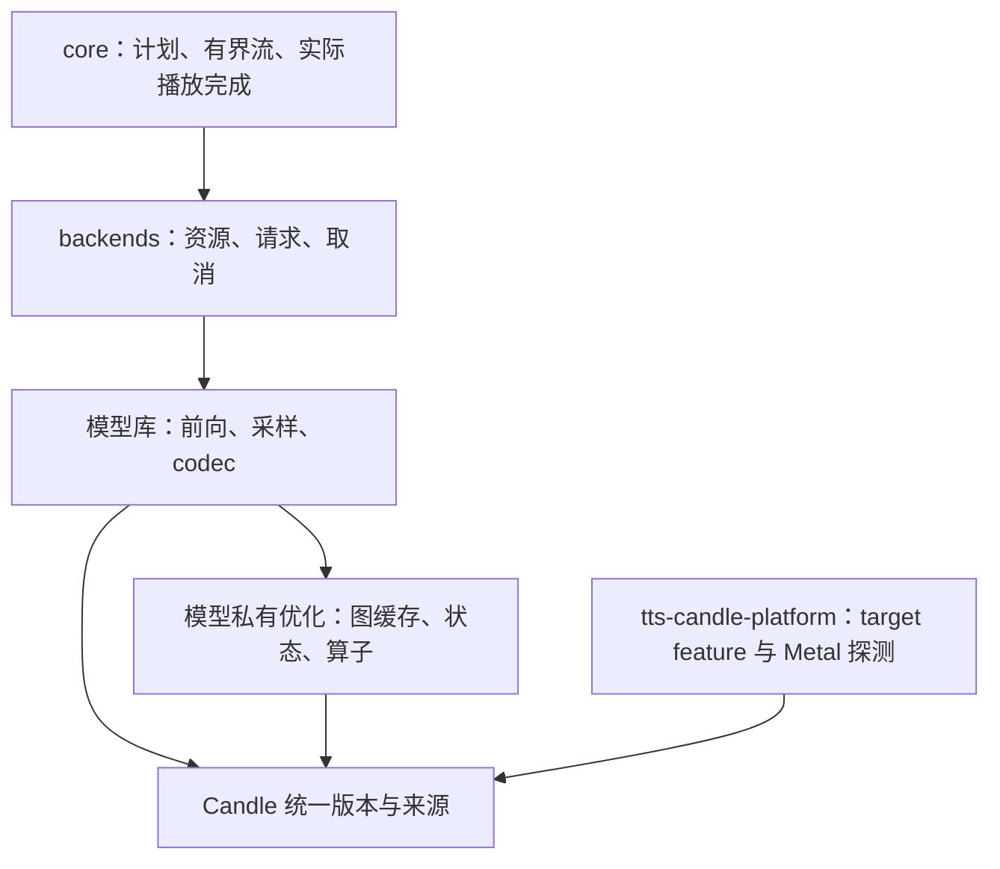

# TTS 性能优化方法

本指南提炼 IndexTTS、Qwen 和 VoxCPM 的已验证经验。当前实现以源码为准，设备数据与
失败实验保留在 records；某个模型的收益不作为其他后端的默认收益。优化顺序为：确认
正确行为、固定测量协议、定位热点、单独验证候选、删除未通过候选、再调整共享边界。

## 四项设计原则与模块边界

这里采用 KISS、DRY、YAGNI、SOLID 四项原则；SOLID 的五项约束一起用于检查职责与依赖。

| 原则 | 本仓库的具体约束 |
| --- | --- |
| KISS | 默认路径明确；失败实验删除代码和开关，只在记录中保留证据；不让多层策略选择掩盖实际计算路径 |
| DRY | 统一依赖版本、来源和平台 feature；同一状态的 snapshot/restore 共用遍历；有两个真实使用者且语义相同才提取共享算子 |
| YAGNI | 不预建跨模型 GraphBackend、通用 KV 框架或单实现 trait；可复用经验先写文档，不强行变成代码 |
| SOLID | 模型负责算术，专用模块负责缓存和设备生命周期，适配器负责资源与取消，core 负责有界流和播放；优化实现必须满足原输入、输出、错误与终止契约 |

SOLID 的检查落点：单一职责按所有权拆模块；扩展路径通过已有小接口接线；替换 eager
时必须保持数值和状态契约；接口只暴露消费者需要的能力；设备模块不依赖宿主配置或
业务类型。没有多实现需求时，闭包和具体类型足以表达依赖，不为 DIP 增加无用 trait。

Qwen 的 `synthesis/streaming/decoder.rs` 保留有限 codes 历史，并事务式交付新 PCM；
VoxCPM 的 `cuda_graph/decoder.rs` 回放 AudioVAE 的卷积历史和 overlap。它们不是相同的
状态模型，不合并。固定缓冲 recorder（录制、输入覆盖、输出回拷、流与缓冲生命周期）
已由第二个真实使用者促成提取到 `crates/candle-cuda-graph`，只做设备机制；模型级
缓存键、状态保活、取消与失败策略仍归各模型的私有模块（Vox CFM/decoder、Qwen
`code_predictor/graph.rs`）。`tts-candle-platform` 继续只承担 target feature，
不承担推理，也不吞并 recorder。

## 基线与官方对照

每次记录代码 revision/dirty diff 摘要、权重 revision/清单摘要、参考音频摘要、文本、
精度、设备、seed、实际生效的采样参数、线程数、chunk 大小、帧上限、依赖 feature。
记录官方实际导入源码路径和 revision；不能只记录某个旁边 checkout 的 HEAD。

先逐阶段比对条件拼接、位置/RoPE、mask/KV、采样、codec 布局、参考前缀裁剪和 EOS。
官方也可能有设备 bug：Qwen 的官方 MPS 空历史 repetition penalty 曾读取异常缓冲，
应最小复现并单独标记修正对照，不能让 Rust 模仿异常或删除旧证据。
相同 seed 不代表 PyTorch 与 Rust 使用相同随机序列。CPU、CUDA、Metal 的数学等价
也不意味着逐位一致，尤其是归约、量化、卷积和不同累加精度。

## 分开测量与剖析

- 先编译 release，再串行运行独立进程。GPU 基准期间不编译、不并行推理。
- 明确计时边界：模型加载/参考准备是否计入；导出音频放在计时外；异步设备在计时
  入口和出口同步。host tracing span 只表示 API 墙钟，不能直接解释为 kernel 独占耗时。
- 正式输出保持型比较优先用 ABBAABBA 八进程，各一轮预热、五轮热测；逐进程先取均值，
  再报 mean-of-means、进程均值区间及逐轮数据，不挑最快一轮。预热单列，不计入统计。
- NVIDIA 可用时记录实际时钟、功率、温度、P-state、限频原因和其他进程；锁频/电源操作
  检查退出码并在 finally 恢复实际原设置。不支持锁频时记录限制，不伪称已锁频。
- 尽量独占 GPU；桌面进程仍驻留时如实记录。Windows 电源计划需验证实际生效 GUID，
  不能仅凭调用过命令声称高性能。macOS 的统一内存峰值不当作独占显存。
- 同时报合成秒数、音频秒数、RTF、首 PCM 延迟、chunk 数和间隔、结束原因；帧上限和
  失败不计为成功完成。不同输出时长或采样策略的比较不标为保持输出的加速。
- 初筛可少跑，但只能作筛选。保持输出型性能候选默认要求改善至少 10%、两组进程均值
  区间不重叠，再正式保留；纯简化可在无性能收益时保留，但必须标明动机和严格回归。

频率、外部进程与温度只能用观测关联辅助归因。证据不足就记“未定位”，不把一次 RTF
变化归为代码退化。新增运行时修改不得混入环境归因实验。

## 准确性与公共行为门禁

| 修改类型 | 最低证据 |
| --- | --- |
| 复制、缓存、图回放 | 固定输入 eager/优化逐位比较；不同噪声/steps/cfg；多请求、取消后复用；完整 codes、PCM、长度、EOS 比较 |
| 改变归约/布局/算子 | 独立参考的小张量测试，加真实权重逐阶段误差；若改变 codes/EOS/PCM，必须按数值变化重新立门槛与试听 |
| 采样正确性修复 | 同分 top-k/top-p、累计恰好等于 p、原词表 ID、空历史、多行、实际词表宽度；旧 seed 改变不能包装为输出保持优化 |
| 流式 decoder | 固定 codes、参考前缀、短尾块、跨块上下文、样本覆盖；失败时状态是否推进；取消/重试/下一请求重置 |
| 依赖或共享 feature | 组合启用后端的测试与链接；CPU、CUDA、Metal 分别记录，不用逐包通过替代组合回归 |

WAV 字节哈希用于相同 writer 的严格复现；另存 F32LE、codes 和元数据便于区分容器差异。
`tools/tts/compare_wav.py` 可检查 float32 WAV，包括 extensible 格式，报告 hash/误差/SNR。
ASR 回读只能辅助覆盖检查，不能替代听感，也不能从有限误差推断无音色变化。
模型自然 EOS 才算正常生成完成；播放完成仍由播放器实际消费决定。图优化不能越过
有界队列，也不能把取消当成 EOS。普通测试使用夹具，真模型测试显式启用且不下载。

## 选择优化方向

先检查重复的参考计算、每步主机往返、固定 mask/位置张量重建，再检查小算子分派、
图与卷积实现，最后考虑改变浮点累加顺序的算子重写。CPU 对小张量可能更快：
IndexTTS codec 的结果不能推广到所有阶段，采样前的设备迁移可能改变后续轨迹。

Qwen 语义采样当前使用一次 F32 logits 回传后的统一 CPU 排名策略；不要凭“全 GPU”
更先进就恢复排序/散射方案。Metal 小词表测试曾通过而 3072 真实词表失败。CodePredictor
声学 argmax 和 code 缓冲保持在设备上；语义采样的随机分布与声学贪心必须分开处理。
顺序 F32 CDF 与旧 GEMM cumsum 的累加舍入不同：Windows 曾在 3072 词表、seed 53
选出相邻 token，不能把有限 Mac 夹具等价称为跨平台普遍保证。旧 CDF 的严格算法对照
使用可精确累加的概率；一般概率遵守当前明确的顺序 F32 阈值规则。
Qwen Metal depthwise 的窗口 matmul 只适用已验证的卷积条件；CUDA 先测 stock/cuDNN
真实路径，不继承 Metal 分派阈值。Accelerate feature 合并会影响同进程其他 CPU 后端。

## CUDA Graph 的所有权规则

1. 先选固定形状、无 host 读回、无图内取消的边界。动态 KV 长度、设备 offset 和采样
   是额外问题，不能从 CFM 的成功推出 LM 能直接 capture。
2. 输入/输出使用图外持久缓冲；复制、capture、launch 使用同一个被 recorder 持有的流。
   连续 view 仍可能有 storage offset，复制逻辑长度并校验 shape/dtype/设备。
3. Candle h2d cache 的 guard 内预热，再录制。capture 本身不执行，首次返回实际 warmup
   结果；有状态 decoder 的预热、快照、恢复与回放必须精确推进一次。
4. 图内临时分配/释放配对；把捕获输出复制到持久缓冲，再在 end_capture 前释放临时输出。
   AUTO_FREE_ON_LAUNCH 在下一次 launch 前释放遗留分配，不能误认为上次结束时已释放。
   Vox 已用公开 API 完成，无须先改 allocator 或引入私有 mempool。图在 capture 之后
   读写的一切都必须**预先分配**：capture 内分配且被主机状态保留的张量（如 Concat
   缓存增长的 K/V）构成未配对节点，驱动可在实例化或回放时以 INVALID_VALUE 拒绝。
5. 图依赖的 schedule、权重、状态、流必须活到图销毁之后。LRU eviction 和 steps 切换
   是生命周期测试的一部分；模型字段销毁顺序要保证图先于其引用数据释放。
6. 输出可能别名 recorder scratch，在下一回放前消费；需要保留就复制。profiling eager
   与正常 graph 性能分开；取消在帧前后检查，不使健康图永久失效。
7. RAII 收尾失败 capture。无状态图可在确认上下文可用时 eager 回落；有状态 launch
   失败且不能证明未推进时，终止当前请求，不能重复算该帧。下一请求先重置状态。
8. 回放不重跑 Rust 簿记（`reset`、`current_len`、计数器）。可回放区域的判据是
  **不变式**：每次回放把图内稍后读取的每个字节都重写。Qwen CP 每帧重写全部 16 个
  KV 位置，因此无需图内重置；AudioVAE 的卷积历史不被每帧重写，只能改为图内更新
  的持久状态，否则按第 7 条终止请求。
9. recorder 必须支持被录区域的输出 dtype。Qwen 输出 `[15] U32`；只支持浮点的
   recorder 会逼出“转浮点再转回”的数值-changing 绕路，宁可先扩共享机制。
10. 图与被捕获状态归**每次生成**所有：完整合成的每次调用、流式的每个 session。
    不得放进全局模型的可变缓存，也不得放在每次帧新建的临时值里。完整合成即使
    每调用捕获一次，也在同一次调用的所有帧上摊销。
11. `profiling` feature 下停用图：逐步 span 会把 replay 压成一次 launch，trace
    失真。基准用无插桩 release 构建。

低层最小复现通过后再决定 fork：不能把未缓存 h2d、未配平输出分配、错误流或历史
张量释放误判为 Candle 缺陷。真实 CUDA/cuDNN 版本和实机证据独立记录。

## 依赖与发布

所有消费者用 workspace Candle 0.11.0；core/nn/transformers/metal-kernels patch 到同一
固定 fork revision。CUDA cudarc 与 Candle core 必须是同一 0.19.10 包实例。
直接使用 driver API 的依赖关闭 cudarc 默认 feature，只启用 std/driver，库加载方式与
可选 CUDA 库由 Candle 的 feature 决定，避免额外启用 runtime/fallback-dynamic-loading。
其他隔离依赖的旧 cudarc 不因此强行升级。检查完整 `cargo metadata` 和目标 feature
依赖树，特别是 macOS Metal；只检查 Windows CPU 树看不到 Metal kernels 重复来源。
源码与测试都用 `cfg(all(feature, target_os))`，不只在 manifest 门控依赖。

fork 来源、许可、补丁、上游链接和退出方法见 [Candle 声明](../legal/candle/SOURCE.md)。
当前 fork 没有功能补丁；下游发布解析 registry，必须做 publish dry-run，不把工作区
patch 下能编译当作发行可用。确需 fork 独有公开 API 时，受影响库停止发布至上游合并。
不为解决无关包的 registry 发布顺序而临时改版本或更改发布脚本。

## 已验证实例与拒绝项

| 案例 | 结论与证据范围 |
| --- | --- |
| VoxCPM AudioVAE 图扩展 | CFM-only 0.29465 → 加 decoder 0.21639，正式八进程改善 26.56%，264/264 WAV 一致；桌面 GPU 进程驻留，非完全独占 |
| VoxCPM LocalEncoder 图 | 约 7.5–7.9%，未达 10% 门槛，删除运行时实现 |
| VoxCPM 分组 GQA / K transpose view | 小收益或变慢，且改变 PCM/部分 EOS 长度，拒绝；不能说去 contiguous 必然更快 |
| VoxCPM 静态 KV LM 原型 | primitive 通过但 Q8 BaseLM 真模型严格对照失败；原因未证明，不作为上游缺陷或已完成能力 |
| Qwen 设备帧缓冲简化 | 严格 PCM/codes 一致，未证明提速；保留理由是数据流更简单 |
| Qwen 采样边界修复 | 修正 nucleus 同分与累积规则；改变旧输出，属于准确性修复，另建基线 |
| Qwen CUDA CodePredictor 一次 cat 打包 | 输出严格一致，但 ABBA 初筛完整慢 1.04%、流式快 0.46%，收益不明确，撤回；后续优先评估固定 15 步图 |
| Qwen CUDA CodePredictor 帧图 | 正式 ABBA 八进程完整 3.0840→1.9113 s（-38.0%，RTF 0.653→0.405）、流式 3.6529→2.4353 s（-33.3%，RTF 0.774→0.516）、首 PCM 0.7688→0.5663 s（-26.3%），区间均不重叠；60 份 codes/PCM/WAV 与 eager 逐字节一致；CUDA 默认开，`QWEN_CP_GRAPH=0` 关闭 |

复现细节与人工验收范围见 [VoxCPM 扩展审查](../records/voxcpm/voxcpm-review-extension-2026-10-18.md)、
[Qwen 性能审查](../records/qwen/qwen-performance-review-2026-10-18.md)、
[Qwen Metal 优化](../records/qwen/qwen-performance-optimization-2026-10-18.md)、
[Qwen CUDA 调研](../records/qwen/qwen-cuda-performance-2026-10-18.md)、
[Qwen CP 帧图](../records/qwen/qwen-cp-graph-2026-10-18.md)、
[IndexTTS 性能记录](../records/indextts/indextts-candle-performance-2026-10-17.md)、
[CosyVoice3 性能记录](../records/cosyvoice3/cosyvoice3-performance-2026-10-17.md)。
旧官方/C++ RTF 使用不同协议，不与这些数值直接排名。后续后端按本文流程建立自己的基线。
