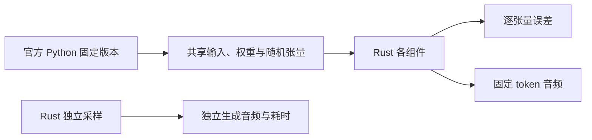

# CosyVoice3 本机对照与修复

后续审查与修复见 [审查记录](cosyvoice3-review-2026-10-17.md)，包含终态/API、验收工具及声源真除法修复。

日期：2026-10-17。设备：Apple M4 Pro，24 GiB 内存。当前实现为独立的
`crates/cosyvoice3` 计算库，尚未注册到 Talechime Backend/CLI 能力目录。

## 来源与对照方法

- [官方 CosyVoice](https://github.com/FunAudioLLM/CosyVoice/tree/074ca6dc9e80a2f424f1f74b48bdd7d3fea531cc)：固定提交 `074ca6dc9e80a2f424f1f74b48bdd7d3fea531cc`。
- [社区 cosyvoice3.rs](https://github.com/SpenserCai/cosyvoice3.rs/tree/0da2fdcc61c9e47e2239e1cd977e00f47cab924c)：固定提交 `0da2fdcc61c9e47e2239e1cd977e00f47cab924c`；模型代码在其 Candle fork `6058747`。
- 官方模型：ModelScope `FunAudioLLM/Fun-CosyVoice3-0.5B-2512`。模型权重与模型自身许可不随代码分发。
- 官方 Python：Python 3.11、PyTorch/torchaudio 2.7.1、ONNX Runtime 1.24.4、x-transformers 2.11.24；完整环境入口为 `tools/tts/cosyvoice3-reference-requirements.txt`。
- 本项目：Candle 0.11.0、ORT rc.13；没有修改 Candle/ORT 的版本或底层算子。

组件实验使用官方类初始化的合成权重，并把相同权重、输入和输出导出为 safetensors。
LLM 保留发布模型的 14 query heads / 2 KV heads 比例，验证首步及第二步 KV cache；
DiT 使用 batch=2、112 帧跨多个 chunk，验证普通及流式掩码。
这是模型无关的数值验证，不能替代真实权重和音频验收。

真实模型实验使用官方 `asset/zero_shot_prompt.wav` 及其转写
“希望你以后能够做的比我还好呦。”，目标文本为“你好，欢迎使用叙铃。”。
官方生成 71 个语音 token、2.84 秒音频。Rust 数值实验共享官方 token、CFM 初始噪声、
声码器初相和噪声，避免把随机轨迹差异误判成模型实现误差。独立生成另用 Rust seed 42；
它与 PyTorch multinomial 不共享随机轨迹，不能逐样本比较两条独立生成音频。



## 组件结果（CPU float32）

下表是相同输入下相对官方的最大绝对误差。社区数据来自固定 fork 原样构建的本机探针，
没有把 fork 移植到本项目的新 Candle 再当作上游结果。

| 组件 | 社区 Rust | 本项目修复后 |
| --- | ---: | ---: |
| Whisper 128 mel | 5.20918 | 1.15633e-5 |
| Matcha 80 mel | 1.46866e-4 | 1.46866e-4 |
| Kaldi fbank | 7.43866e-5 | 7.43866e-5 |
| 16k → 24k sinc 重采样 | 5.96046e-8 | 5.96046e-8 |
| DiT 普通路径 | 1.59973e-5 | 1.13994e-6 |
| DiT 流式掩码路径 | `[112,1,112]` 广播失败 | 1.19209e-6 |
| LLM 首步 logits | 未运行此项 | 2.38419e-7 |
| LLM 第二步 logits | 未运行此项 | 4.76837e-7 |
| F0 预测器 | 未运行此项 | 0 |
| torch CPU randn 120 万元素 | LCG 源码不匹配，未测此项 | 0 |

组件阈值由各算子设定，比较器拒绝形状不一致、非有限值及超阈值；不只打印误差。
RNG 另覆盖 1/7/15/16/17/31/32/33 长度，防止只验证整 16 块掩盖尾部算法错误。
当前逐位一致是本机 arm64 CPU 结果；其他 CPU SIMD 路径应共享导出的噪声。

## 真实权重结果（修复后；Rust CPU float32 对官方 CPU float32）

本节为 2026-10-17 下午重跑：修掉两处真实缺陷（见「修复与根因」）后，四个样例的
`共享官方 mel → Rust HiFT` 全部通过。仍失败的门禁均有 f64 锚点证据支持
「实现语义等价、残差是 checkpoint 自身的 f32 混沌放大」，按约定保留失败状态，
没有放宽阈值。样例：baseline（“你好，欢迎使用叙铃。”）、long（多逗号长句
184 token / 7.36 s）、short（“快出发！”16 token / 0.64 s）、longprompt
（13.7 s 参考音频 117 token / 4.68 s）。

| 阶段（阈值） | baseline | long | short | longprompt |
| --- | ---: | ---: | ---: | ---: |
| LLM 首步 logits（3e-3） | 2.77e-5 ✅ | 1.88e-5 ✅ | 2.24e-5 ✅ | 2.00e-5 ✅ |
| DiT 首次 estimator（3e-3） | 3.23e-3 ❌ | 4.26e-3 ❌ | 4.67e-3 ❌ | 1.12e-2 ❌ |
| 完整 Flow mel（1e-2） | 3.72e-3 ✅ | 1.08e-2 ❌ | 1.97e-3 ✅ | 7.67e-3 ✅ |
| 共享官方 mel → HiFT PCM（3e-3） | 3.26e-4 ✅ | 1.98e-3 ✅ | 8.86e-6 ✅ | 5.78e-4 ✅ |
| 共享 token → Rust Flow → HiFT PCM（1e-2） | 3.77e-1 ❌ | 5.77e-1 ❌ | 1.03e-2 ❌ | 8.64e-1 ❌ |

Metal（baseline）：estimator 2.81e-3 ✅、mel 1.86e-3 ✅、共享 mel PCM 3.33e-4 ✅、
token→PCM 1.62e-1 ❌。共享 mel PCM 从上一轮的 1.29e-3 降到 3.3e-4。

### 修复与根因（按发现顺序）

1. **DiT estimator 偏差 = checkpoint 块 17/18 的 f32 混沌，不是移植缺陷。**
   逐 block 对照（`dit_probe`）显示误差在 0–16 层平滑增长（rmse 4e-5→8e-5），
   块 17/18 跳变 3×/10×。实测这两层 attention 的 |q|max≈780、|k|max≈890、
   logits 上达 1.57e6、熵≈0.002（近似硬 argmax）——f32 对 1e6 量级 logit 的
   舍入就有 ±0.06，近并列的 softmax 权重因此翻转。三项证据链：
   替换实验（官方块输入喂 Rust 块：attn_norm 输出 1e-6 一致，attention 输出差
   0.73，即同一输入也混沌）；f64 锚点（Rust f64 vs 官方 f64 = **7.63e-6**，
   语义等价；官方自身 f32 vs f64 = **3.16e-3**，与 Rust f32 vs 官方 f32 的
   3.23e-3 同一量级——两边 f32 都在各自噪声底上）。
2. **token→PCM 放大机制 = F0 相位漂移。** 把 Rust mel（与官方差 3.7e-3）喂
   **官方 Python HiFT**：PCM max 0.378 / RMSE 0.022，与 Rust 侧 0.375 同量级
   ——放大是模型行为而非移植缺陷。链条：mel 差 3.7e-3 → F0 差最大 1.76 Hz →
   累积相位漂移 0.58 rad → 波形漂移。1e-2 的逐样本门禁低于该模型自身的
   f32 决定论底，按约定保留失败并以此归因。
3. **权重转换的 weight_norm 融合公式与 torch 运行时不一致（真实缺陷，已修）。**
   手写 `g·v/linalg.norm(v)` 与 torch `aten::weight_norm` 核在 f32 下差 ~2e-6。
   官方推理先把 f0 predictor 转 f64（parametrization 以 f64 重算融合权重），
   而 f32/f64 两种融合本身又差 5.7e-6。修复：转换脚本改用
   `torch._weight_norm`，且 `f0_predictor.*` 以 **f64 融合并按 f64 存储**
   （Rust 端 F0 本来就以 f64 CPU 加载），其余 hift 层按 f32 融合（与官方
   f32 运行时逐位一致）。修复后 **F0 与官方逐位相等（0.0）**。
4. **SineGen2 相位 cumsum 精度（真实缺陷，已修）。** candle CPU `cumsum` 对
   f32 是顺序累加，torch CPU 语义是 **f64 累加、逐前缀和转回 f32**（与 numpy
   f64 累加逐位一致，实测 0.0）。368 帧上顺序 f32 会漂 ~1e-4，经 ×480 相位
   上采样放大为 4.7e-2 rad。修复：`cumsum_f32_torch`。长样例共享 mel PCM 从
   2.61e-2 降到 1.98e-3（低于官方自身 f32-vs-f64 底 2.92e-3）；`source` 级
   3.96e-5（官方自底 5.06e-5）、`si_0` 级 9.79e-2（官方自底 1.02e-1）。
5. 附带修复：f64 诊断路径下 attention 掩码标量建在 Metal 设备导致
   F64→F32 转换不存在；改在 CPU 构造再搬运。

补充指标（1024 FFT / 240 hop / 80-bin torchaudio mel log10 特征平均绝对差）：
baseline 修复后共享 mel PCM 7.3e-5、token→PCM 0.0057。频谱指标只作描述，
不抵消未通过的逐样本门禁。官方对自身（f32 vs f64）在长样例共享 mel 路径的
PCM 自噪声底为 2.92e-3——`real_hift_pcm` 的 3e-3 门禁正好压在该底上，
短句通过、长句贴底，这是解释而不是放宽的理由。

Rust 独立 LLM 采样 seed 42（不共享官方 token）也已生成 2.44 秒有限 PCM。
最终单独运行一次，加载 0.640 秒、生成 3.334 秒、RTF 1.367。此前一次为 3.281 秒；
没有进行预热后多轮性能基准，且官方走 CPU、Rust 走 Metal，不能据此声称实现速度胜负。

Whisper Tiny 的辅助回读把官方与 Rust 的“叙铃”都识别为“系列”；官方还被识别为
“你好 关于使用系列”，Rust 独立生成识别为“你好 欢迎使用系列”。此模型未能对专名
建立可靠证据，因此本轮未确认逐字正确率或主观听感。

### 对照环境发现

初始 Python ORT 1.31 对同一 campplus 模型、相同的居中 fbank，输出相对 Rust ORT 1.24
最大偏差 0.44256、余弦相似度 0.99266。将同一份 Rust 特征送给 Python ORT 1.24.4，
与 Rust 引擎最大偏差约 5.5e-6；所以最终统一到 1.24.4，重新生成官方 fixture。
未为此更改工作区 ORT 版本。旧版本结果保留在 `runs/cv3-real/`，最终结果在
`runs/cv3-real-ort124/`，元数据记录了实际 ORT 版本。

官方 estimator 使用复用的 Euler 输入缓冲。导出 hook 必须在调用当时 `clone()`：
单纯 detach/cpu 会保留别名，让首步输入被后续 solver 步覆盖，产生虚假的大数值偏差。
本轮同时修复了这个对照工具缺陷、非连续张量保存和 logits 维度捕获问题。

## 修复与简化

- LLM 分开保存 KV head 数与 query/KV 分组数，纠正 K/V reshape；采样前统一成一维 logits。
  首步与单 token 解码复用同一条生成路径，并公开给 teacher-forcing 对照。
- 删除错误的手写 GELU 公式，使用 Candle 的 tanh GELU；流式 mask 显式广播，并保留 padding mask。
- 输入拼接在进入 Linear 前变成连续布局，修复 Metal batch=2 CFG 的矩阵乘法错误。
- RNG 小于 16 个元素使用 ATen double 标量路径；非整块尾部重抽最后 16 个元素；
  vector 路径保持 f32 算术。普通测试用独立 PyTorch oracle。
- F0 权重和推理都放 CPU f64；返回 GPU 前先在 CPU 转回目标 dtype。
- **权重转换的 weight_norm 融合改用 `torch._weight_norm`，且 `f0_predictor.*` 按 f64
  融合存储**（官方推理先把 f0 predictor 转 f64、parametrization 以 f64 重算融合；
  f32/f64 两种融合差 5.7e-6，手写公式再差 ~2e-6，经 f0 预测器放大为可听 PCM 漂移）。
  修复后 F0 与官方逐位相等。
- **SineGen2 相位 cumsum 改为 f64 累加逐前缀和转 f32**（`cumsum_f32_torch`，与
  torch CPU cumsum 逐位一致）；candle 顺序 f32 会漂 ~1e-4，×480 上采样后成 5e-2 rad。
- 零样本克隆保留准确参考转写；要求正确的 `<|endofprompt|>`；导出完整 fast tokenizer graph，
  移除丢失预处理、解码与特殊 token 的裸 BPE 回退。
- 前端按官方 `floor(mel_frames/2)` 截齐 token/特征；ONNX 使用实际 int32 token 输出，
  campplus 按位置绑定输入，避免猜测输入名。
- 语速在 mel 上做 `floor(T/speed)` 线性插值后再进 HiFT，移除方向错误且改变音高的 PCM 重采样。
- 移除重复重采样、无用临时变量、未使用的声码器噪声分支及直接 ndarray 依赖；
  固定 CFM 噪声改为 `OnceLock<Vec<f32>>`，不再用可中毒的全局 Mutex。
- 短参考音频、无效采样参数/语速、零 solver 步数和不匹配的 prompt 形状显式报错。
  LLM 撞到 token 上限不再伪装成成功完成。
- LLM 生成重构为增量单一路径（`start_incremental`/`next_token`），非流式 `inference`
  是其包装；流式与非流式不再各持一份采样逻辑。

## 复现

所有权重、Python 环境、输入音频、fixture、日志和产物均位于 git 忽略的 `runs/`。
普通 Rust 测试不下载模型。准备参考环境与固定版本仓库后：

```sh
uv venv runs/cv3-venv --python 3.11
uv pip install --python runs/cv3-venv/bin/python -r tools/tts/cosyvoice3-reference-requirements.txt
PYTHONPATH=runs/reference/CosyVoice:runs/reference/matcha runs/cv3-venv/bin/python tools/tts/cosyvoice3_components.py --out runs/cv3-components
cargo run --release --locked -p cosyvoice3 --example compare -- runs/cv3-components
runs/cv3-venv/bin/python tools/tts/cosyvoice3_convert_weights.py --input runs/cv3-model --output runs/cv3-converted --official_repo runs/reference/CosyVoice
PYTHONPATH=runs/reference/CosyVoice:runs/reference/matcha runs/cv3-venv/bin/python tools/tts/cosyvoice3_reference.py --model_dir runs/cv3-model --prompt_wav runs/reference/CosyVoice/asset/zero_shot_prompt.wav --prompt_text 'You are a helpful assistant.<|endofprompt|>希望你以后能够做的比我还好呦。' --text '你好，欢迎使用叙铃。' --out runs/cv3-real-ort124
cargo run --release --locked -p cosyvoice3 --features ort,metal --example compare_frontend -- runs/cv3-converted runs/cv3-real-ort124 runs/reference/CosyVoice/asset/zero_shot_prompt.wav
cargo run --release --locked -p cosyvoice3 --features ort,metal --example compare_model -- runs/cv3-converted runs/cv3-real-ort124 metal
cargo run --release --locked -p cosyvoice3 --features ort,metal --example synthesize -- runs/cv3-converted runs/cv3-real-ort124 metal
```

额外样例与诊断探针（本轮新增）：

```sh
# 多样例 fixture：long / short / longprompt
PYTHONPATH=runs/reference/CosyVoice:runs/reference/matcha runs/cv3-venv/bin/python tools/tts/cosyvoice3_reference.py --model_dir runs/cv3-model \
  --prompt_wav runs/reference/CosyVoice/asset/zero_shot_prompt.wav \
  --prompt_text 'You are a helpful assistant.<|endofprompt|>希望你以后能够做的比我还好呦。' \
  --text '今天天气真不错，我们一起去公园散步吧。顺便买点水果，晚上回家做沙拉，再来一壶热茶。' --out runs/cv3-case-long
PYTHONPATH=runs/reference/CosyVoice:runs/reference/matcha runs/cv3-venv/bin/python tools/tts/cosyvoice3_reference.py --model_dir runs/cv3-model \
  --prompt_wav runs/reference/CosyVoice/asset/zero_shot_prompt.wav \
  --prompt_text 'You are a helpful assistant.<|endofprompt|>希望你以后能够做的比我还好呦。' \
  --text '快出发！' --out runs/cv3-case-short
PYTHONPATH=runs/reference/CosyVoice:runs/reference/matcha runs/cv3-venv/bin/python tools/tts/cosyvoice3_reference.py --model_dir runs/cv3-model \
  --prompt_wav runs/reference/CosyVoice/asset/cross_lingual_prompt.wav \
  --prompt_text 'You are a helpful assistant.<|endofprompt|>在那之后完全收购那家公司，因此保持管理称的一致性，利益与极将加入架主的自残保持一致。这就是我们有时不买下全部的原因。' \
  --text '夜色渐深，远处传来几声犬吠。' --out runs/cv3-case-longprompt

# 逐 block / 替换实验 / f64 锚点
PYTHONPATH=runs/reference/CosyVoice:runs/reference/matcha runs/cv3-venv/bin/python tools/tts/cosyvoice3_dit_probe.py --model_dir runs/cv3-model --fixture runs/cv3-real-ort124 --out runs/cv3-dit-probe --f64_out
cargo run --release --locked -p cosyvoice3 --features ort --example dit_probe -- runs/cv3-converted runs/cv3-real-ort124 runs/cv3-dit-probe cpu        # f32 逐层
cargo run --release --locked -p cosyvoice3 --features ort --example dit_probe -- runs/cv3-converted runs/cv3-real-ort124 runs/cv3-dit-probe cpu f64    # f64 vs 官方 f64
cargo run --release --locked -p cosyvoice3 --features ort --example dit_probe -- runs/cv3-converted runs/cv3-real-ort124 runs/cv3-dit-probe cpu detail 18  # 单块替换实验

# HiFT 逐级 / F0 / SineGen2 逐步（对 runs/cv3-case-long）
# 重新导出同一 long fixture，并附带实际官方 HiFT/source 的中间张量。
PYTHONPATH=runs/reference/CosyVoice:runs/reference/matcha runs/cv3-venv/bin/python tools/tts/cosyvoice3_reference.py --model_dir runs/cv3-model --prompt_wav runs/reference/CosyVoice/asset/zero_shot_prompt.wav --prompt_text 'You are a helpful assistant.<|endofprompt|>希望你以后能够做的比我还好呦。' --text '今天天气真不错，我们一起去公园散步吧。顺便买点水果，晚上回家做沙拉，再来一壶热茶。' --out runs/cv3-case-long --vocoder_stages
cargo run --release --locked -p cosyvoice3 --features ort --example hift_probe -- runs/cv3-converted runs/cv3-case-long
cargo run --release --locked -p cosyvoice3 --features ort --example f0_probe -- runs/cv3-converted runs/cv3-case-long
cargo run --release --locked -p cosyvoice3 --features ort --example sine_probe -- runs/cv3-converted runs/cv3-case-long

# 流式：官方块 fixture + 两条链路（链路 A 固定 token，链路 B 真实 LLM）
PYTHONPATH=runs/reference/CosyVoice:runs/reference/matcha runs/cv3-venv/bin/python tools/tts/cosyvoice3_stream_reference.py --model_dir runs/cv3-model --fixture runs/cv3-real-ort124 --out runs/cv3-real-ort124/stream
cargo run --release --locked -p cosyvoice3 --features ort,metal --example stream_probe -- runs/cv3-converted runs/cv3-real-ort124 metal
cargo run --release --locked -p cosyvoice3 --features ort,metal --example stream_demo -- runs/cv3-converted runs/cv3-real-ort124 metal full
cargo run --release --locked -p cosyvoice3 --features ort,metal --example stream_demo -- runs/cv3-converted runs/cv3-real-ort124 metal lifecycle
```

省略最后一个 `metal` 参数可走 CPU；feature 的存在不自动选择 GPU。
组件日志 `runs/cv3-compare.log`、社区日志 `runs/cv3-community-results.log`、
真实权重日志 `runs/cv3-real-compare-ort124.log`、前端日志 `runs/cv3-frontend-compare-ort124.log`。
社区原样构建探针保留在 `runs/community-probe/`，依赖固定 fork 的本地路径。

## 流式实现与验证（阶段 B，同日）

### 官方行为核验（`cosyvoice/cli/model.py`，CosyVoice3Model）

- token hop 从 25 起每发出一块 ×2，封顶 100（`stream_scale_factor=2`）；首块 hop 加
  `prompt_token_pad = ceil(prompt_len/25)*25 - prompt_len`。官方把 hop 状态记在共享
  model 对象上、跨请求泄漏（上一流式请求后一直停在 100）；本项目按“新模型”语义
  每会话独立从 25 开始——这是与官方代码的有意分歧，已记录。
- 出块条件 `tokens - offset >= hop + pre_lookahead(3)`；块求解包含这 3 个预读 token，
  但 `finalize=false` 的 flow 调用把它们作为 context（输出恰好覆盖本 hop，无重叠）。
- CV3 `token2wav`：mel cache 单调累积整段 mel，每块用 `finalize=false` 的 HiFT
  **重解码全部累积 mel**，只发射 `speech_offset` 之后的尾部；末块 `finalize=true`。
  该 O(n²) 重算是官方语义，未做缓存优化。`finalize=false` 的输出长度 =
  `(T - 8)` mel 帧（f0 预读 3 + conv_pre 预读 4 + 尾部 1）。
- LLM 静音 token 上限：自上一个非静音 token 起，累计 >5 个 FSQ 静音/呼吸 token
  （固定 11 个 ID）后丢弃。
- `speed != 1.0` 仅限非流式（官方 assert）。
- 官方自身流式 vs 非流式（同 token）：baseline max 0.998、long 1.504、xlong 1.360、
  short 0.0（16 token 从不进入流式块）。差异集中在块状注意力前缀与接缝附近，
  音频尾部与非流式逐位一致——这是模型固有的流式近似，不是实现缺陷。

### 实现（`crates/cosyvoice3/src/streaming.rs`）

- `TokenStreamDecoder`：flow + HiFT + 官方块调度，token 源无关（固定 token 探针或
  LLM 均可驱动）；`StreamingTts` 在其上加 LLM KV cache 增量生成与静音上限。
- 拉取式：`next_pcm()` 一次调用最多一次 flow+HiFT 解码，LLM 步进只进行到下一 hop。
  PCM 不超前消费者生成；token/mel 历史仍随时长增长，受固定噪声表容量约束，
  不能据此宣称总内存为 O(1)。drop 会话停止后续调用。
- LLM 重构为单一生成路径：`start_incremental`/`next_token`（`IncrementalState`），
  `inference()` 是它的包装；流式与非流式共享。
- flow `inference` 增加 `finalize` 参数实现官方 `token[:, :-3] + context` 拆分。
- 状态区分：正常完成（`final_chunk`）、长度上限（`hit_token_limit` 标志，不伪装成
  成功）、失败（`Err`，终态不可重试）、消费者退出/取消（drop）。最后一块之后返回 `Ok(None)`。

### 链路 A：固定官方 token → Rust 流式（`stream_probe`，对官方流式逐块）

四个样例（块数/hop 序列）：baseline 2 块（38→final）、long 3+final（38/50）、
short 1 块（仅 final，等于非流式）、xlong 5+final（38/50/100/100/100，442 token/17.7s）。

- 所有块长度与官方**逐块相等**（含 finalize 尾块）。
- 每块 mel RMSE 1.4e-4–2.5e-4（f32 混沌底；错一帧偏移会给 ~1+）。
- PCM RMSE 随时长增长：2.7e-2@2.8s、4.1e-2@7.4s、6.7e-2@17.7s（相位漂移）；门禁为
  长度全等 + mel RMSE≤1e-3 + PCM RMSE≤0.1（结构化接缝/hop 缺陷会到 0.15+）。
- 替换实验：官方 HiFT 吃 Rust chunk-0 mel 得 0.3859/0.0267，与 Rust 侧逐位相同
  ——PCM 差全部来自已归因的 mel 混沌放大。
- Metal（baseline）：mel RMSE 1.4e-4/2.7e-4，SNR 13.9/15.5 dB，首块 2.07s。

### 链路 B：Rust LLM 增量 token → 流式 PCM（`stream_demo`）

- Metal：首块 32,640 样本（1.36s 音频）在 **2.64s** 到达，总生成 5.37s——首块比整段
  结束早 2.7s，真实流式而非“生成完切块”。RTF 2.24（每请求新建会话，含加载后冷启动）；
  CPU RTF 8.5。音频见 `runs/cv3-real-ort124/rust-stream.wav`。
- 同 seed 连续两个请求逐位相同——无跨请求缓存污染。
- 生命周期（LocalSet + 容量 1/2 的有界通道，推理对象留在生产者任务内）：首块后消费者
  退出→会话 drop、停止生成；审查修复后，首块前已关闭的接收端不会构建模型或启动推理。
  生产者先预留队列容量再生成，每块之间主动让出 LocalSet；同步在途推理仍不能被抢占。
  慢消费者 300ms/块，通道上限 1；累计模型历史和临时工作区另行增长。
- 计算量随长度增长（官方重算语义）：CPU 上块解码 8.4s（首块）→22.8s（长样例末块）。

## 能力边界

增量文本输入、Talechime Backend/CLI/worker 协议接入、播放器会话、音色注册与
正文预处理仍未实现。流式语速组合按官方边界拒绝（仅非流式支持 speed）。
独立生成音频应继续做回读与主观试听；数值对照不能证明所有文本都读全、发音正确。

## 验证与产物

- `cargo fmt --all -- --check` 通过。
- `cargo test --locked -p cosyvoice3 --features ort,metal`：29 个单元测试通过
  （新增：SineGen2 cumsum f64 回归、hop/pad/常量核对），doc tests 通过。
- `cargo clippy --locked -p cosyvoice3 --all-targets --features ort,metal -- -D warnings` 与
  无 feature 变体均通过。
- `RUSTDOCFLAGS='-D warnings' cargo doc --locked --no-deps -p cosyvoice3 --features ort,metal` 通过。
- `cargo test --locked --workspace --lib`：427 通过 0 失败。
- 五个 Python 工具 `py_compile` 通过；参考导出、权重转换、组件对照、流式 fixture
  导出均实际运行。
- CPU 组件对照（18 项）和真实 ONNX 前端全部通过；真实权重对照中
  `real_estimator`（4 样例）、long 样例 `real_flow_mel`、`real_tokens_to_pcm`
  （4 样例）按上文归因保留失败状态。
- 未运行 CUDA 编译、跨平台运行、整库发行或播放器会话验收。

最终音频：`runs/cv3-real-ort124/official.wav`、`rust-shared-mel.wav`、
`rust-shared-tokens.wav`、`rust-generated.wav`、`rust-stream.wav`（流式）。
辅助频谱数值保存在同目录 `waveform-metrics.json`；流式块/元数据在各样例
`stream/` 子目录。

本次下载权重的 SHA-256（完整清单保存在 `runs/cv3-model-sha256.txt`）：

| 文件 | SHA-256 |
| --- | --- |
| llm.pt | `69f43bd545131c30e98947fb360ea8b4dc9916d8e83dded7757c7ea4f5a24970` |
| flow.pt | `a6fab32a7825e5b0bc855ddd948f8db9370b0a786fbc249caa4595e95b608e4b` |
| hift.pt | `b279d7641eb97ae55b3b540cfba4f953c26492a2df758328a89a4d007ab87a65` |
| cosyvoice3.yaml | `f5a6b2c6f05139d0f18861a1fe506f751e787026b77c05f7e8fef9f8a4405965` |
