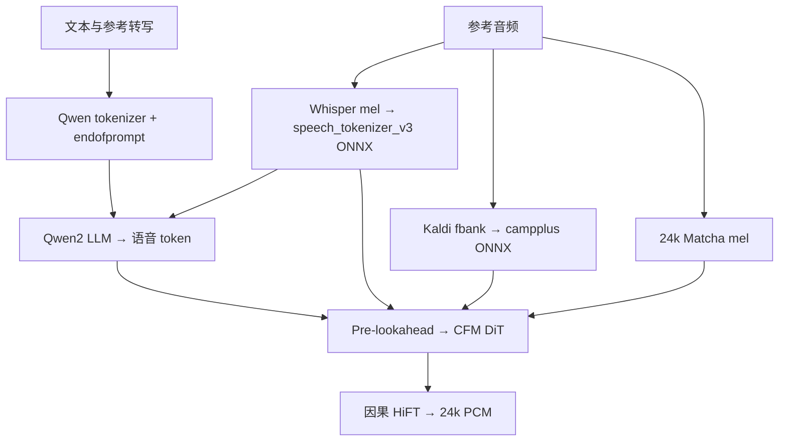

# Fun-CosyVoice 3.0 Rust 复刻调研与社区实现审计

调研日期：2026-10-17。状态：源码级调研与审计完成；`crates/cosyvoice3` 移植进行中。本文是
[independent-tts-candle-plan.md](../plans/independent-tts-candle-plan.md) 阶段二的审计交付物。本文保留最初源码审计结论；后续本机组件、真实权重对照与修复见
[本机对照记录](cosyvoice3-local-parity-2026-10-17.md)。严格整链波形等价尚未通过。

## 固定来源

| 来源 | 版本 | 许可 |
| --- | --- | --- |
| 官方 Python 仓库 FunAudioLLM/CosyVoice | commit `074ca6dc9e80a2f424f1f74b48bdd7d3fea531cc` | Apache-2.0 |
| 官方模型 FunAudioLLM/Fun-CosyVoice3-0.5B-2512（ModelScope） | cosyvoice3.yaml 抓取于 2026-10-17 | 模型许可以发布页为准 |
| 社区 Rust 实现 SpenserCai/cosyvoice3.rs | commit `0da2fdcc61c9e47e2239e1cd977e00f47cab924c` | MIT OR Apache-2.0 |
| 社区 candle fork SpenserCai/candle `cosyvoice_support` | rev `6058747`，merge-base 上游 `43be23c`（0.9.2-alpha.2，2026-01-03） | Apache-2.0 OR MIT |
| x-transformers（DiT RoPE 真值） | 2.11.24（官方 requirements 固定） | MIT |
| Matcha-TTS（feat_extractor 真值） | main（子模块指针，mel 数学未随版本变化） | MIT |

本地参考克隆位于 `runs/reference/`（git 忽略）。第三方声明见 `docs/legal/cosyvoice3/`。

## 官方推理链路（CosyVoice3.0，2512 版）

固定模型规格：LLM 为 Qwen2 896 维、24 层、GQA 14/2，speech embedding/decoder
词表 6761；speech token 6561 种、25 Hz。Flow 是 80→1024→80 的预读层、
2 倍上采样、1024 维 22 层 16 头 DiT、10 步 cosine Euler、CFG 0.7；
其 seed-0 初始噪声表为 `[1,80,15000]`。HiFT 使用 CPU f64 F0 预测器，
8 个谐波，`[8,5,3]` 上采样与 hop=4，16 点 iSTFT、幅度 exp 后限幅 100、
phase=sin、PCM 限幅 ±0.99。

流式：token_hop_len=25（训练 static_chunk_size），flow pre_lookahead 3 token，DiT chunk 掩码
static_chunk_size=50 mel 帧；`finalize` 语义贯穿 flow/hift。非流式单次调用等价于 finalize=True。

## ONNX 可用性（决定 ORT 路线边界）

| 组件 | 官方 ONNX | 说明 |
| --- | --- | --- |
| speech_tokenizer_v3.onnx | 模型目录自带 | 输入 whisper 128-mel + 长度；输出 FSQ token |
| campplus.onnx | 模型目录自带 | 输入 kaldi fbank[1,T,80]（去均值后）；输出 192 维 spk 嵌入 |
| flow.decoder.estimator | 官方导出脚本 `cosyvoice/bin/export_onnx.py`（opset 18, 动态 seq_len） | 需用官方 PyTorch 自行导出；TRT 部署同源 |
| llm / hift | 无官方导出 | AR+KV cache 与因果声码器 ONNX 化属自研导出工程，本轮不做 |

结论：**前端辅助件（tokenizer/spk）与 CFM estimator 走 ORT 有官方依据；LLM 与声码器走
Candle 复刻**。"Candle DiT vs ORT estimator ONNX" 用相同输入做逐张量对照，是最强的双路径
数值验证点。

## 社区实现审计结论

社区项目主体是 PyO3 胶水（src/model.rs 722 行），全部模型代码在其 candle fork 的
`candle-transformers/src/models/cosyvoice/`（约 6000 行）。**fork 相对上游 merge-base 完全没有
修改 candle-core / candle-nn**，仅新增该模块并给 candle-onnx 的 AveragePool 加了 ceil_mode；
因此适配本仓库 Candle 0.11.0 是纯 API 适配（rope/repeat_kv/interpolate1d/conv_transpose1d 等
0.11.0 均已存在），不需要补底层算子。我们改用 `ort`（rc.13）运行官方 ONNX，candle-onnx 的
ceil_mode 改动无需引入。

模块覆盖与逐文件审计（相对官方 Python）：

| 模块 | fork 状态 | 审计结论 |
| --- | --- | --- |
| llm（cosyvoice3_lm.rs） | 完整 | 常量/序列拼接/停止条件/长度规则与官方一致；采样用无种子 `rand::random()`（官方经 torch RNG，本就不可跨框架逐位复现，需可注入种子）；官方 ignore_eos 是 eos 掩码 + 单次采样，fork 是重试循环（语义近似） |
| flow embeddings/dit | 完整 | RoPE 与 x-transformers 2.11.24 真值一致（部分旋转前 64 维、interleave、rotate_half）；TimestepEmbedding/AdaLN/InputEmbedding/CausalConvPositionEmbedding 一致。**流式 chunk 掩码形状有 bug**（[T,1,T] 对 [B,H,T,T] 广播必炸，流式路径未跑通） |
| flow_matching | 完整 | CFG batch-2、cosine t_span、Euler 结构一致。**两处硬伤**：(1) 默认 inference_cfg_rate=0.0（注释"调试暂关"），官方 yaml 是 0.7；(2) 固定噪声用 glibc LCG 生成，注释声称匹配 torch seed-0 randn——不成立，需 MT19937+ATen normal_fill 或 Python 导出 fixture |
| pre_lookahead | 完整 | 预读右 pad/context、因果左 pad、残差、×2 上采样一致 |
| vocoder generator/f0 | 完整 | conv_pre look-right=4、上采样/源下采样/ResBlock 布局一致；post 段 leaky_relu 用 0.01（正确区分 loop 内 0.1）。**偏差**：f0 未按官方转 float64（官方注释"精度关键"）；magnitude 用 log 域 clamp(-10,5) 替代官方 exp 后 clamp max=100；x+si 相加前 min-len 截断掩盖形状错位（应断言相等） |
| vocoder source_module | 完整 | SineGen2 定相位/定噪声结构对齐（官方这些缓冲不进 state_dict，数值本就逐次运行不同，需可注入种子）。**硬伤**：rad_values 下采样用平均池化，官方是 F.interpolate linear（align_corners=False），相位轨迹有偏 |
| vocoder stft/istft | 完整 | 16 点 DFT 矩阵 + OLA + Σwindow² 归一化结构对齐 torch。**偏差**：源信号 STFT 居中 pad 用零填充，官方 torch.stft 默认 pad_mode='reflect' |
| frontend audio.rs | 完整 | matcha mel（librosa slaney 滤波器 + reflect pad 720 + sqrt(re²+im²+1e-9) + log clamp 1e-5）对齐；kaldi fbank（povey^0.85、逐帧去直流、预加重 replicate、HTK mel）对齐；sinc 重采样对齐 torchaudio 语义。**硬伤**：whisper mel 缺 `maximum(log, max-8)` 与 `(log+4)/4` 归一化，居中 pad 用零而非 reflect |
| 前端 ONNX | candle-onnx | 我们改用 ort；AveragePool ceil_mode 修复随之不需要 |
| 流式编排（model.py token2wav 分块） | 未实现 | fork 只做整段 finalize=True 路径；流式 chunk/缓存语义留待后续 |
| 文本归一化 | wetext-rs | 官方 ttsfrd(闭源)/wetext 兜底 + zh/en 分段；首轮按 wetext 语义对齐，中文正则清理需逐条对齐 frontend.py |

权重转换（fork scripts/convert_weights.py，Apache-2.0）：llm.pt 键重命名（`llm.model.model.*`→
`llm.*`）、flow 键 `decoder.estimator.*`→`dit.*`、hift weight_norm 参数化融合（g·v/‖v‖）。
脚本本身可复用，转换后 fp32 safetensors + config.json。

## 本仓库移植决定

1. 新建 `crates/cosyvoice3`（计算库，模式同 voxcpm）：Candle 实现全部三大件；`ort` feature
   提供官方 ONNX 前端（campplus/speech_tokenizer_v3）与 estimator 对照路径。
2. 修复上述全部审计偏差，按官方 yaml 取值（cfg 0.7、source_resblocks [7,7,11] 等）。
3. 固定噪声实现 MT19937 + ATen normal_fill（torch CPU randn 逐位兼容，可用 Python fixture
   验证）；SineGen2 噪声/初相支持种子注入。
4. LLM 采样器支持显式种子（探针复现需要；与 Python 不可逐位一致，如实记录）。
5. 非流式 finalize=True 全链路先行；流式 chunk 编排（token_hop 25 + pre_lookahead + hift
   cache）列为后续，不阻塞数值对照。
6. 数值验收路径：官方 PyTorch（本地参考克隆 + ModelScope 权重）导出各级中间张量 fixture →
   Rust 探针逐级比对（tokenizer 前端 → llm 输入嵌入/单步 logits → flow mu/DiT 输出 → hift
   mel→pcm）。 estimator ONNX 与 Candle DiT 同输入对照。
7. 模型/音频/fixture 全部进 git 忽略目录（runs/、models/）；普通测试不下载模型。

## 风险与开放问题

- f0 float64 在 Metal 无 f64 支持：按官方注释在 CPU f64 上执行 f0 预测器（小模型，代价可接受）。
- `<|endofprompt|>` 硬校验：tokenizer 词表来自模型目录 CosyVoice-BlankEN，移植需以其
  tokenizer.json 为准（add_special_tokens 的特殊 id 已含其中）。
- 段落级文本归一化（split_paragraph 60–80 token、标点清理）属编排层，放探针/适配器，不进计算库。
- 上述结论均待真实权重数值验收；发现新偏差时更新本文。
