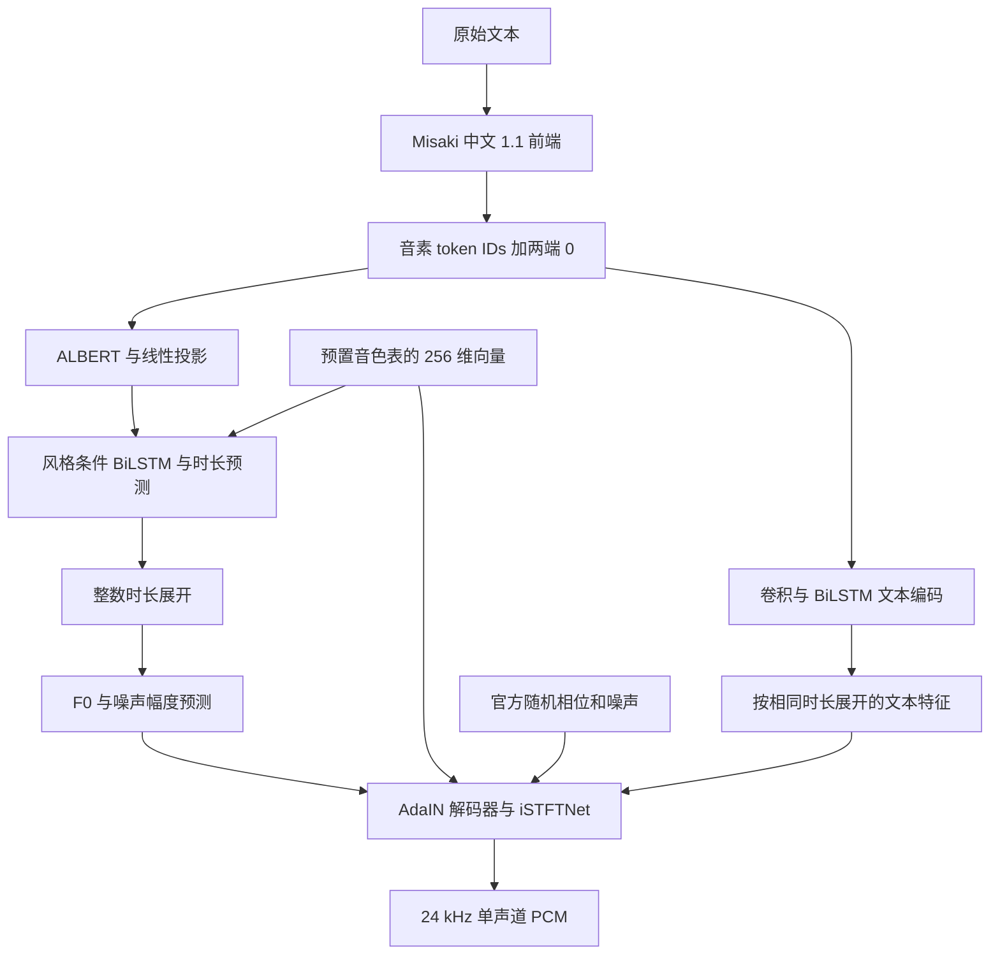

# Kokoro 官方复刻可行性与 CPU 基线

2026-10-27。范围：直接研究并运行 hexgrad 官方 Python / PyTorch 实现，评估原生
Talechime 模型库的复刻路径。不以第三方 Rust 实现、旧 `kokoro-tts` 或社区 ONNX
导出作为正确性基准。本轮未实现 Rust 模型，也未恢复生产后端。

## 结论

可以复刻官方推理：公开的网络代码、中文权重、配置和预置音色足以构建独立实现，
不需要重新训练模型。先复刻官方声学计算并逐阶段对照，再移植官方中文前端；
不以前次挂起的 g2pW 训练作为复刻前置条件。

本轮已运行官方 CPU 前向，导出中间张量与实际随机输入，并验证在本条样本上
将 weight normalization 固化为普通权重后 PCM 逐位一致。尚无 Rust 与官方的
数值、性能或听感等价结论；CPU、Metal、CUDA 须分别验收。

## 固定官方来源

| 对象 | 来源及 revision |
| --- | --- |
| 官方推理库 | [hexgrad/kokoro](https://github.com/hexgrad/kokoro/tree/dfb907a02bba8152ca444717ca5d78747ccb4bec)，`dfb907a02bba8152ca444717ca5d78747ccb4bec`，源码版本 0.9.4 |
| 官方 G2P | [hexgrad/misaki](https://github.com/hexgrad/misaki/tree/fba1236595f2d2bf21d414ba6e57d25256afada3)，`fba1236595f2d2bf21d414ba6e57d25256afada3`，源码版本 0.9.4 |
| 中文模型 | [hexgrad/Kokoro-82M-v1.1-zh](https://huggingface.co/hexgrad/Kokoro-82M-v1.1-zh/tree/01e7505bd6a7a2ac4975463114c3a7650a9f7218)，`01e7505bd6a7a2ac4975463114c3a7650a9f7218` |

实际导入的 `kokoro.model/modules/istftnet` 与 `misaki.zh/zh_frontend/tone_sandhi`
文件均逐文件 SHA-256 验证与上述 checkout 相同，记录于本机 `provenance.json`；
不是仅记录一个没有参与执行的旁边 checkout。

| 原始文件 | bytes | SHA-256 |
| --- | ---: | --- |
| `kokoro-v1_1-zh.pth` | 327247856 | `b1d8410fa44dfb5c15471fd6c4225ea6b4e9ac7fa03c98e8bea47a9928476e2b` |
| `config.json` | 3228 | `bc333efa5ce4ceff433c8c8e5d027a1eca0166001e4e4a62bea2d26ff7a46890` |
| `voices/zf_001.pt` | 523331 | `9bdc9a87e13e9bb1ea3e7803259c2ecbfebaeeb2ff80b5d0c76df1a464c1c962` |

官方模型卡及两个代码仓库标注 Apache-2.0。实际移植时仍保留上游来源、修改说明、
许可证以及派生自 StyleTTS2 / PaddleSpeech 等文件的原始声明；词典数据逐项保留来源。
这里评估的是使用已发布权重复现推理，不是复现官方训练数据与训练结果。

## 网络与产品能力

以官方 [`model.py`](https://github.com/hexgrad/kokoro/blob/dfb907a02bba8152ca444717ca5d78747ccb4bec/kokoro/model.py)、
[`modules.py`](https://github.com/hexgrad/kokoro/blob/dfb907a02bba8152ca444717ca5d78747ccb4bec/kokoro/modules.py) 和
[`istftnet.py`](https://github.com/hexgrad/kokoro/blob/dfb907a02bba8152ca444717ca5d78747ccb4bec/kokoro/istftnet.py) 为准。

- 约 82M 参数；非 AR，也不执行 StyleTTS2 风格扩散采样。主要工程量是 ALBERT
  参数共享、双向 LSTM、AdaIN、卷积/转置卷积、激励源和 STFT/ISTFT。
- 配置为 178 个 token 槽、512 上下文位置；两端各放一个 0，正文最多 510 个有效
  token。ALBERT 隐层 768、12 个注意力头、12 次层计算，需遵守其参数共享规则。
- 时长为 `round(sum(sigmoid(logits)) / speed).clamp(min=1)`。必须对照
  PyTorch 的舍入语义；很小的浮点差异也可能改变整数时长与最终 PCM 长度。
- 实测 `zf_001` 音色表形状 `[510, 1, 256]`；官方 pipeline 根据音素字符串长度
  选择 `pack[len(ps)-1]`。前 128 维给声学解码，后 128 维给韵律预测。
- 官方提供的是预置风格向量；本路线没有公开参考音频风格编码器可直接照搬，
  不能据此承诺零样本音色克隆或自然语言情绪指令。
- BiLSTM 和时间归一化使用整段上下文，官方接口按段返回 PCM。首次接入应报告
  非原生流式；分段连续播放与模型原生流式是不同能力。
- iSTFTNet 配置 `n_fft=20`、`hop=5`、上采样 `[10, 6]`。忠实复刻以默认
  `TorchSTFT` 为基准，不静默改用 `disable_complex=True` 的替代实现。

## 中文前端与已有问题

官方 [Misaki 1.1 前端](https://github.com/hexgrad/misaki/blob/fba1236595f2d2bf21d414ba6e57d25256afada3/misaki/zh_frontend.py)
使用 `cn2an`、jieba 分词/词性、pypinyin、large_pinyin 词典、变调及儿化规则，
最后映射到 1.1 专用注音/扩展 token，不能套用旧版 IPA 映射。
完整移植须固定词典、分词和规范化版本，而非仅把拼音转成注音。

本轮导出了八条官方前端样本的完整音素字符串及 IDs，涵盖普通中文、多音字、
人名、日期/金额、一不变调、儿化、中英混读和引号；这不是八条音频验收。
具体观察：

- `单先生和解先生来到重庆。` 输出以 `ㄉㄢ1` 开头，即姓氏“单”仍为 dān；
  “和解”也被合并为词，体现分词/多音字问题仍在官方前端。
- 本轮未配置 `en_callable`；英文 Enter / Kokoro 被替换为未知符号 `❓`，随后
  `KModel.forward` 会过滤不在 vocab 中的字符。不能把该配置称为中英混读通过。
- 弯单引号 `‘’` 在本次样本也成为未知符号。应明确未知符号策略并保持原文映射。
- 官方 `samples/make_zh.py` 明说它为复现展示样本而硬编码，并按音素长度调整
  speed，以缓解约 100 token 以上的赶读；该经验函数不是模型本身的语速公式。
- 当前 pipeline 存在超过 510 音素后截断的分支。接入 Talechime 时应完整分段并
  维持 UTF-8 原文范围，不能照抄导致正文静默丢失的包装行为。

因此先建立“官方等价”基线，再单独评估读音修复。引入 g2pW 可作为后续改进实验，
不会成为官方声学模型复刻的前置依赖，也不能与基线输出混在一起验收。

## 本机真实运行

硬件：Apple M4 Pro，12 CPU 核，24 GiB 内存；macOS 26.6.2 arm64。
Python 3.11.17、Torch 2.7.1、Transformers 4.51.3，CPU F32，4 intra-op /
1 inter-op 线程；未启用 MPS。jieba 0.42.1、pypinyin 0.55.0、
pypinyin-dict 0.9.0、cn2an 0.5.24、NumPy 2.4.6。

文本：`春天来了，院子里的花开了。`；预置音色 `zf_001`；speed 1.0；seed 7。
调用官方 `ZHG2P(version='1.1')`，随后按官方规则构造 style 与 IDs，调用
`KModel.forward_with_tokens`。本轮不运行整套 `KPipeline` 长文包装。

| 检查 | 实测结果 |
| --- | --- |
| 输入形状 | IDs `[1,43]`，style `[1,256]` |
| 生成结果 | 81000 个有限 F32 样本，24 kHz，3.375 s；峰值绝对值 0.3306534 |
| 官方同 seed 重复 | durations 与 PCM 逐位相同 |
| seed 7 与 8 | durations 相同，PCM 不同；最大绝对差 0.09405534 |
| 固化 weight normalization | durations 与 PCM 逐位相同，PCM 最大绝对差 0 |
| 固化后导出 | 599 个 state tensors，327111472 字节 tensor payload，safetensors |
| 三轮热模型前向 | 0.272634 / 0.270961 / 0.277402 s；中位 RTF 0.0807804 |

计时前已有多次完整前向；计时包括 `forward_with_tokens`，不含模型加载、G2P、
音色读取、导出和磁盘写入。只是单进程短句初筛，不是 ABBA 正式性能验收，
不与其他后端或未来 Rust 实现排名。未做人工试听、ASR 回读或长期播放。

## 对照输入和后续实施顺序

官方 `SineGen` 推理中仍调用随机初相位与 `randn_like` 噪声，且还有一个当前声码器
未使用的噪声分支会消耗 RNG。跨框架相同 seed 不能代替相同随机输入。
本轮记录了三次随机调用的原始输出；后续数值测试回放这些张量，不将噪声置零。

本机所有实验文件位于 Git 忽略目录 `target/kokoro-official-research/`，未加入
模型清单、用户资源目录或普通测试：

- `probe.py`、`requirements-frozen.txt`、两个官方 checkout 与三个原始模型文件。
- `results/provenance.json`、`report.json`、`frontend.json`。
- `results/official-f32.safetensors`：IDs、style、BERT、投影、时长编码、LSTM、
  duration logits、F0/N、文本编码、decoder encode、激励源、声码器最后卷积、
  PCM、整数时长及三组随机输入，共 21 个张量。
- `results/weights-folded.safetensors` 与 `official-zf_001.wav`。

这是本机开发证据，清理 target 后不会保留；本记录及上游固定 revision 可用于
重建实验，未把这些大文件或第三方源码提交到仓库。

建议实施分四步：

1. 独立模型库读官方转换后的 F32 权重；先接受固定 IDs/style/随机张量，逐阶段
   对照，先保证 shape、整数时长、输出长度，再报告逐阶段 max/mean error 与 PCM SNR。
2. 对照官方数据和规则移植中文 1.1 前端，覆盖分词、变调、儿化、数字、未知符号及
   超长输入。首次只承诺验收过的语言范围。
3. 接回资源清单和后端，保留整段生成、可取消、线程所有权、有界交付和原文范围；
   内置音色与不支持参考克隆的能力准确申报。不恢复历史用户目录迁移。
4. CPU 数值基线成立后再分别做 Metal/CUDA 数值、性能、取消复用、听感和内容完整性
   验收。本轮没有证明 BiLSTM 在 GPU 上的效率，不能由参数量推断加速收益。
