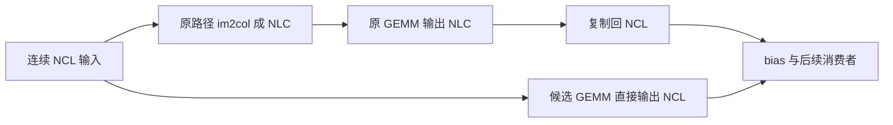

# OmniVoice CPU 1×1 卷积优化（2026-10-24）

在 `cd795ba` 的真实输入归因之后，保留 **CPU Accelerate F32 decoder 的受限 NCL GEMM 路径**。
固定 130 帧完整 decoder 的交错测量为 **419.901→345.533 ms（-17.71%）**；
短/长完整 codes、全部 28 个 F32/PCM16 WAV 均逐字节一致。
整链两组 ABBA 波动大，本轮不确认稳定的整链增量，也不声明追平官方。

[逐进程测量、二进制与源码哈希、输出对照](omnivoice-cpu-pointwise-2026-10-24.json)
与本文配套；原始日志及冻结二进制在工作树 `target/perf/omni-cpu-pointwise/`。
复用上轮 `target/perf/omni-cpu-attribution/` 的真实激活、固定 codes 和原始 decoder 输出，
完整源归档指纹保存在本轮 JSON 中。模型、激活、codes 内容及音频不提交。

## 实现与边界

固定 Candle 的 CPU Conv1d 即使 kernel=1，也会执行通用 im2col、GEMM 和输出转置复制。
当前 decoder 的 residual unit 在 1×1 卷积后要恢复 NCL，直接输出 NCL 可以避免这两次显式物化。
生产实现复用既有 Metal pointwise 路径中的矩阵乘法与 bias，增加受限 CPU 入口。
不新增依赖、公共 API、模型资源、采样调整、运行时实验开关或缓存。

CPU 入口同时要求：Accelerate、输入和权重均为 CPU F32、dense、连续布局，
输入输出通道相等且为 32/64/128/256/512，kernel/stride/dilation/groups 都为 1、padding=0，
输入通道匹配、非空，时间维至少 8 且为 8 的倍数。
其他配置和布局、其他 dtype、未启用 Accelerate、CUDA、GGUF lazy 权重等走原路径。
仅 decoder 的 `forward_decoder_pointwise` 调用选择快路径，参考音频编码继续调用原 Conv1d。
既有 Metal 路径的算术和适用范围不变，包括其非 8 倍长度的既有路径。

原 GEMM 为 `[B,T,C] × 转置权重`；最终候选为 `权重 × [B,C,T]`，改变 BLAS 的几何与转置调用。
**数学等价不足以保留**。最初扩大到任意 CPU 长度时，普通数值测试在
channels=32/batch=1/len=13 观察到 416 个值中的 100 个位差，最大绝对误差约 1.12e-8。
该不受限候选被撤回，没有放宽门槛。当前模型第一个上采样 stride=8，实际 residual 时间维
都在 8 倍长度的格点上；因此只保留上述受限路径，非对齐长度回退原实现。
普通测试保留长度 13 等回退用例，并扩展对齐长度、不同通道和 batch 的逐位对照。
有限实测不能证明其他 Apple 芯片或 BLAS 版本上所有浮点输入都逐位相同。

减少的是显式 Candle columns 和输出布局复制；BLAS 内部 packing 未单独测量，
不称作零分配，也不根据这两项就推算整链峰值 RSS。

## 候选顺序与保留判断

三种方案依次筛选，各自与原路径在同进程 ABBA 交错；复用五个 block 的真实 conv2 输入、
真实权重、残差及下一 residual unit 的 Snake 参数。局部计时包含 bias；消费者边界包含
卷积、残差和下一次 Snake。每 slot 一次预热、五组热测，每组五次调用。

1. **显式 NLC 物化，保持原 GEMM 几何**：五个真实激活逐位一致，但三个独立进程均更慢，
   撤回生产候选。最后 block 的消费者三进程原路径为 14.479/13.444/13.671 ms，
   候选为 15.251/15.293/15.350 ms。
2. **输入转置视图直接给 BLAS，输出仍复制回 NCL**：五组真实激活逐位一致，三进程局部
   消费者约改善 20%，作为有收益的筛选结果保留记录；未接入生产或单独做整链验收。
3. **直接输出 NCL**：首次真实激活筛选通过后，增加完整边界测试、8 倍长度限制，
   再使用实际生产 helper 做三进程局部复核、固定 codes 和整链验收；按重复收益及低维护成本保留。

不同筛选组的绝对耗时不直接相减；最终保留依据是最终受限实现对原路径的独立复核。
不按默认整链百分比筛掉已经验证的 decoder 收益，也不叠加不同边界的改善百分比。

## 最终局部三进程

测量设备 M4 Pro（8P+4E / 24 GB），macOS 26.6.2（25G83）；CPU F32，Candle 固定
`2266099d92265112ecc0d56ecee1761e3cc2ac00`。Rayon/VecLib/OMP 均请求 8 线程。
Accelerate 已由原基线链接及源码核验，本轮没有调整其 feature，也不声明 AMX 硬件占用率。
先编译，再串行推理；测量期间没有并行运行自己的编译或其他模型。

下表由每进程的两次同臂 slot 和五个热组均值生成，再对三个进程等权平均。

| block | 卷积+bias 原路径 / ms | 候选 / ms | 含残差与下一 Snake 原路径 / ms | 候选 / ms |
| --- | --- | --- | --- | --- |
| 0 | 1.5772 | 0.2438 | 1.7809 | 0.5477 |
| 1 | 3.3284 | 0.3638 | 4.4723 | 1.4952 |
| 2 | 6.8899 | 0.6120 | 8.7445 | 2.6757 |
| 3 | 6.5586 | 0.5287 | 8.4582 | 2.5625 |
| 4 | 9.7387 | 0.8568 | 12.4497 | 4.2730 |

最后 block 的输入为 `[1,32,124800]`。这里卷积局部约改善 91%，完整消费者约改善 66%；
消费者仍有 Snake 等其他成本。所有真实局部输出均与原路径逐位一致，未把成本移到后续布局。
这些边界嵌套，不能相加为 decoder 或整链收益。

## 完整固定 codes decoder

冻结相同 CPU feature 的原版和候选 `stage1_probe`，每个 case 独立 ABBA 四进程，
每进程 1 次首轮 + 5 热轮。首轮包含惰性加载和首次初始化，原始数据另列，不计入热均值。
两端调用同一 raw decode 入口，均包含相同 codes 到 Tensor 的准备；WAV 导出在计时外。
所有 case 四个 slot 导出的 raw F32 WAV 字节一致，热轮样本数一致。
另外用单独 ignored 验证，对全部 14 个 case 各解码两次，与上一轮完整 raw 输出逐位相同。

| case | 原路径进程均值 / ms | 候选进程均值 / ms | 本组观测耗时减少 |
| --- | --- | --- | --- |
| frames-1 | 10.662 | 10.608 | 0.51% |
| frames-130 | 419.901 | 345.533 | 17.71% |
| frames-7 | 29.497 | 24.984 | 15.30% |
| long-01 | 152.461 | 126.626 | 16.95% |
| long-02 | 330.170 | 277.486 | 15.96% |
| long-03 | 557.433 | 454.629 | 18.44% |
| long-04 | 455.391 | 375.165 | 17.62% |
| long-05 | 305.030 | 251.604 | 17.52% |
| long-06 | 213.548 | 176.669 | 17.27% |
| long-07 | 213.993 | 176.278 | 17.62% |
| long-08 | 386.583 | 318.574 | 17.59% |
| long-09 | 475.276 | 415.853 | 12.50% |
| long-10 | 470.603 | 374.991 | 20.32% |
| long-11 | 616.096 | 499.299 | 18.96% |

1 帧 case 的差异接近波动，不确认其提速；其余 case 的两臂及逐 slot 结果均保留。
长文本后段的部分 slot 同时变慢，例如 long-09 原路径两进程均值相差约 29 ms，
因此不将表中不同 case 的百分比泛化成固定的 decoder 常数，也不丢弃这些 slot。
130 帧完整 decoder 的配对结果是本轮主要阶段证据。

## 短文本整链与完整输出

每进程 1 预热 + 3 热轮，观察关闭，不启用 codes dump 或阶段同步。
首组出现反向的 slot 配对后，只补一组 ABBA；八个进程全部保留，不继续追测有利窗口。
两端使用相同默认采样、pinned seed 42、narrator、相同文本，输出均为 5.32 s。

| 组 | slot | 实现 | 热轮 / s | 进程均值 / s |
| --- | --- | --- | --- | --- |
| 首组 | 1 | 原路径 | 6.998531, 7.059409, 7.027591 | 7.028510 |
| 首组 | 2 | 候选 | 6.905191, 6.879699, 6.848920 | 6.877936 |
| 首组 | 3 | 候选 | 6.955028, 6.981195, 6.991792 | 6.976005 |
| 首组 | 4 | 原路径 | 6.875740, 6.905191, 6.836553 | 6.872495 |
| 补组 | 1 | 原路径 | 6.903670, 7.080686, 6.886851 | 6.957069 |
| 补组 | 2 | 候选 | 6.744348, 6.754566, 6.717872 | 6.738929 |
| 补组 | 3 | 候选 | 6.823237, 6.823314, 6.842784 | 6.829778 |
| 补组 | 4 | 原路径 | 6.924256, 6.812912, 6.930881 | 6.889350 |

首组两臂均值 6.950502→6.926971 s（观测 -0.34%），补组为 6.923209→6.784353 s
（观测 -2.01%）。首组一对顺序反向，两组幅度也不一致，**不确认稳定整链增量**。
过去粗段中 decoder 只占整链约 6%，所以阶段 18% 改善影响整链的量级约为 1%；
这个量级说明不能把局部百分比当作整链百分比，不是额外的整链实测收益。
未重新对照官方 Python，因此没有新的官方整链排名。

最终候选另用同一生产宿主边界验证：短/长完整 codes 与基线逐字节一致；
短 4 个、长 24 个分段及整段 F32/PCM16 WAV 全部逐字节一致，含样本数。
所有 hashes 见 JSON。没有通过改精度、采样、文本或输出长度获得收益。

## 验证与剩余范围

普通测试覆盖通道 32/64/128/256/512、batch 1/2、bias 有无、非零存储 offset、
连续及非连续输入、非连续权重、重复调用；长度覆盖 1/7/8/9/13/16/24/32/40/56/64/72/
96/128/130/160/179/256/280/480/520/960/1040；既有测试继续检查 kernel/stride/padding/
dilation/groups 和 F16 回退，以及 Metal 原路径。

验收结果：CPU release **37 passed / 5 ignored**；Metal release **50 passed / 5 ignored**；
CPU/Metal 两套 `--all-targets` Clippy（`-D warnings`）、Metal rustdoc（`-D warnings`）及格式检查通过。
普通测试不下载模型；ignored 模型验证需要显式提供本地资源。
本轮正式及筛选进程均未观察到编译活动；没有采集频率、温度、功率或带宽计数器，
不能从 ps 无编译观测断言系统绝对空闲。未重新测 Metal 整链吞吐，未在其他 Apple 芯片、
Intel Mac、AMD、CUDA 实机验收，也没有新增试听或 ASR 质量结论。

后续按原优先级继续真实 MLP 激活/布局，再检查 CPU 7-tap 的 im2col/输出物化。
本轮不把这两项或新的 attention 内核夹带到生产改动中。仅本地，不推送、合并或发布。
