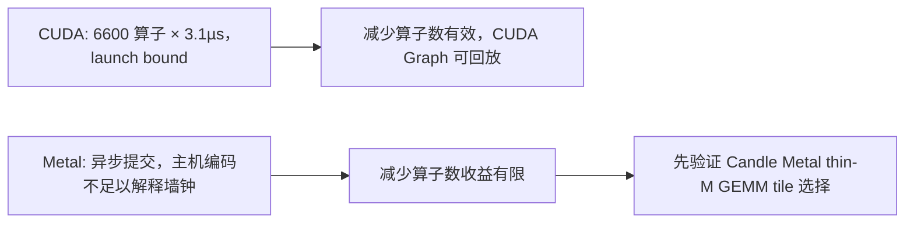
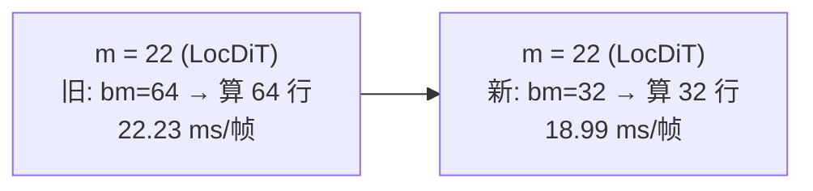
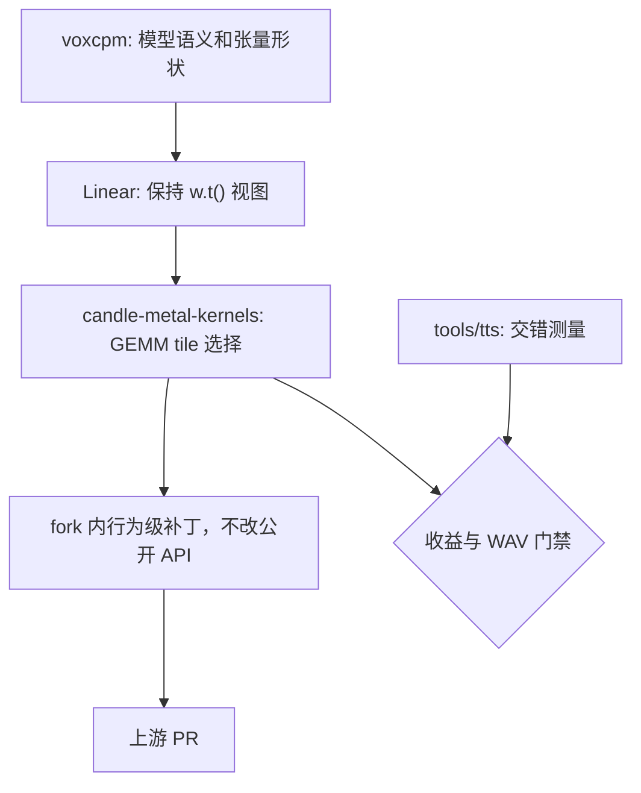

# VoxCPM macOS Metal 性能归因与测量协议（2026-10-18）

目的：把另一台电脑（Windows / RTX 5070）上已完成的 VoxCPM CUDA 优化移植到 macOS Metal，
并给出本机可复现的基线、归因和后续门槛。

关联：[三方性能对照](voxcpm-performance-comparison-2026-10-18.md)（CUDA 侧阶段 1/3/4）、
[优化审查与扩展验收](voxcpm-review-extension-2026-10-18.md)、
[macOS 历史记录](voxcpm-macos-performance.md)（2026-10-08，同步自 TRNovel）。

**本轮保留了一个改动：`candle-metal-kernels` 的 skinny-M GEMM tile 选择。**
VoxCPM LocDiT（`m = 22`）由 21.71 → 18.99 ms/帧（**-12.5%**），端到端 RTF
约 **-6.9%**，WAV 逐字节一致。这是 Candle fork 上一个 3 行的行为级补丁，
不改公开 API。同时修掉了测量工具本身的两个缺陷，否则会把这个收益误判为回归。

## 1. 环境与方法

- MacBook Pro，Apple M4 Pro（Mac16,8，12 核：8P+4E，16 GPU 核），24 GB 统一内存；
  macOS 26.6.2 (25G83)；Rust 1.99.0；`cargo build --release --locked`。
- Candle 固定 fork `bafb03db81c3eae48e63ff28d6b30f5a6576ba38`（0.11.0），
  feature `voxcpm-metal`，经 `tts-candle-platform/metal` 路由；无 CUDA 代码参与。
- 权重 `~/.talechime/resources/voxcpm/models/2b-q8_0/169f64d8…`：Q8 BaseLM 1.73 GB
  + F16 Acoustic 1.83 GB，未重新下载。参考音色 `voice_dongqing`，
  参考文本取同一 `voice.json` 的转写。
- 语料 `tools/tts/acceptance-corpus.txt`，经生产 `preprocess_text(_, 180)` 切分为
  **11 段**；seed 42、CFM 10 步、CFG 2.0、温度 1.0、帧上限 200、48 kHz PCM。
- 逐段 WAV 样本数全部是 1920 的整数倍，合计 **1456 帧 / 58.24 s**，即
  **40.0 ms/帧**（每帧 1920 样本）。后续所有每帧成本由此换算，不按段数估算。
- 设备串行使用；测量期间不编译、不并行推理、不跑第二个推理进程。

```bash
cargo build --release --locked -p talechime-backends --no-default-features \
  --features voxcpm-metal --example voxcpm_candle_probe
model=~/.talechime/resources/voxcpm/models/2b-q8_0/169f64d8b98bbaab1761e4ca3a83e6af653456cc
ref=$model/voices/voxcpm/2b-q8_0/169f64d8b98bbaab1761e4ca3a83e6af653456cc/voice_dongqing/reference.wav
VOXCPM_BENCH_ROUNDS=5 VOXCPM_BENCH_WARMUP=1 target/release/examples/voxcpm_candle_probe \
  "$model" metal target/tmp/voxcpm-metal/baseline tools/tts/acceptance-corpus.txt \
  "$ref" target/tmp/voxcpm-metal/ref-transcript.txt
```

## 2. 基线，以及一个必须先修的测量问题

同一个二进制、同一份输入，1 预热 + 5 热轮（项目既有协议）：

| round | RTF | 首 PCM ms |
| ---: | ---: | ---: |
| 0（预热） | 1.0044 | 421 |
| 1 | 1.0070 | 418 |
| 2 | 1.0060 | 407 |
| 3 | 1.0075 | 422 |
| 4 | **1.1435** | 441 |
| 5 | **1.0947** | 475 |

后两轮比前四轮慢 8%–14%。为确认这不是偶然，用 1 预热 + 12 热轮复测：

| round | 0 | 1 | 2 | 3 | 4 | 5 | 6 | 7 | 8 | 9 | 10 | 11 | 12 |
| --- | ---: | ---: | ---: | ---: | ---: | ---: | ---: | ---: | ---: | ---: | ---: | ---: | ---: |
| RTF | 1.0016 | 0.9991 | 1.0022 | **1.1390** | **1.2438** | 1.0805 | 1.0412 | 1.0033 | 1.0083 | 1.0077 | 1.0058 | 1.0027 | 1.0071 |

**结论：这是一个可复现的持续负载「离群段」，不是单调热衰减。**

- 起点：连续 Metal 生成约 **3–4 分钟**后（两次独立进程分别在 round 4 和 round 3 起）。
- 峰值：**+24.4%**（1.0022 → 1.2438）。
- 持续：约 3–4 轮（3–4 分钟）。
- **恢复：在负载不中断的情况下完全回到 1.0027–1.0083**，并在其后 6 轮保持稳定。

已排除与未排除：

| 假设 | 证据 | 判定 |
| --- | --- | --- |
| 进程内内存/分配器累积 | 2 s 采样 RSS 在 2.17–2.96 GiB 间波动，无单调增长；且离群结束后 RSS 不回落而 RTF 回落 | **排除** |
| 系统内存压力 | `memory_pressure` 空闲 65%，`vm_stat` throttled pages = 0 | **排除** |
| 第二个推理进程 | 全程 `ps` 只有一个 `voxcpm_candle_probe` | **排除** |
| 频率/功耗/温度归因 | `pmset -g therm` 无记录，`powermetrics` 需要 root，未采集 | **未定位** |
| 同机其他 GPU 客户端 | 存在 ChatGPT/Codex、VS Code、企业微信等常驻进程，无法在无授权下关闭 | **未排除** |

恢复行为与「持续功耗/热策略的暂态收紧后又松开」一致，也与一个恰好在 3 分钟处
出现的外部 GPU 竞争者一致；**本轮证据无法区分**，不臆断根因。可确认的是：
**它可复现、量级超过本轮任何优化候选，且与算法无关。**

**对本项目的直接影响**：既有 macOS 记录使用的正是「1 预热 + 5 热轮」协议
（见 [macOS 历史记录](voxcpm-macos-performance.md)），该协议的 round 4–5 落在离群段内，
因此**历史 macOS 数字不能作为基线，也不能与本轮数字直接比较**。同样，任何在
本机沿用该协议的 A/B 都会把漂移误读成收益。

**处置**：新增 `tools/tts/voxcpm_perf_macos.py`，沿用 Windows 的 ABBA 交错与
「≥10% 且两组区间不重叠」门槛，但改为**每臂一个短进程、臂间交替、进程间冷却**
（默认 2 热轮 + 20 s 冷却）。CUDA 的 `nvidia-smi -lgc` 锁频在 macOS 没有等价物，
不伪造该步骤。

## 3. 成本归因（`VOXCPM_BENCH_PROFILE=1`，只用于归因，不计入吞吐）

profile 会在模块边界同步，因此这些数字**包含边界排队**，彼此可比、与吞吐不可直接相减。
下表按 round 1 的 11 段求和后除以 1456 帧：

| 模块 | 每帧 ms | 占比 | 说明 |
| --- | ---: | ---: | --- |
| CFM（LocDiT，9 次评估/帧 × 12 层） | 22.23 | 55.4% | 第一成本项 |
| AudioVAE 解码 | 6.50 | 16.2% | |
| BaseLM + FSQ（28 层 Q8） | 5.90 | 14.7% | |
| Prefill | 2.33 | 5.8% | 每段一次 |
| ResidualLM（8 层 Q8） | 2.05 | 5.1% | |
| LocalEncoder（LocEnc，12 层） | 1.75 | 4.4% | |

与 CUDA 侧的模块占比一致（CFM 61.9% / BaseLM 14.4% / AudioVAE 13.3%），
**所以「CFM 是第一成本项」在两个平台上都成立，但它的成因不同**——见 §4。

## 4. 为什么 CUDA 的方法在 Metal 上不成立

CUDA 侧的根因是 **kernel launch bound**：约 6600 算子/帧、约 3.1 µs/算子，
因此「减少算子数 ≈ 减少时间」，并由此拿到 CFM 图回放 −30.6%、AudioVAE 图 −26.6%。

Metal 的实测结构完全不同：

| 观测 | 数值 | 含义 |
| --- | ---: | --- |
| 派发下限（8 元素 f16 add，异步流水线，末尾一次同步） | **1.49 µs/算子** | 纯主机端编码成本 |
| 整进程平均 CPU | 18.4% | 主机不是瓶颈，GPU 是 |
| 每帧算子数（沿用 CUDA 侧逐层计数） | ~6600 | 主机编码约 9.9 ms/帧 |
| 每帧实际耗时 | 40.0 ms | 主机编码量约为墙钟的 25% |

这些数字说明主机编码不足以解释 40 ms/帧；Candle Metal 也是异步提交，主机编码可与
GPU 执行重叠。它们**不是** GPU 时间线测量，因此只能推断“主要瓶颈在 GPU 执行”，
不能精确称为“75% 是 GPU 权重读取”。进一步按权重字节核算
（形状取自 GGUF：`locdit.n_embd=1024`，FFN 4096，16/2 头，权重按 `(out, in)` 存储）：

| 模块 | 每帧权重字节 | 每帧耗时 | 有效带宽 |
| --- | ---: | ---: | ---: |
| CFM / LocDiT | 108 层次 × 34.6 MB = **3.74 GB** | 22.23 ms | **168 GB/s** |
| LocalEncoder / LocEnc | 12 × 34.6 MB = 415 MB | 1.75 ms | **237 GB/s** |
| BaseLM（Q8，28 层，≈1.06 B/参数） | 1.40 GB | 5.90 ms | 238 GB/s |
| ResidualLM（F16，8 层） | 755 MB | 2.05 ms | 368 GB/s* |

\* ResidualLM 的数字超过 M4 Pro 的 273 GB/s 规格带宽，说明“权重字节 / 模块时间”
会受缓存、模块边界计时和 kernel 重叠影响；它只能做同口径相对比较，不是 DRAM
带宽实测。BaseLM 的字节按 GGUF 中 28 层 block 的 Q8_0 实际大小计算，不含输出层。

LocDiT 与 LocEnc 的 block 形状和 dtype 相同，主要差别是行数：LocDiT
`b=2 × t=11 = 22` 行，LocEnc 在 `cls + 4 patch` 后是 `b=1 × t=5 = 5` 行。
按 Candle 源码，M4 Pro 的 Metal 架构名为 `applegpu_g16s`，被归为 `Max` 类；
`w.t()` 视图使 Linear 走 F16 `nt` GEMM。`m=22` 选 `64x32x32` tile，
`m=5` 选 `32x32x16` tile。该假设已在 §7 验证并修复。



Metal 有 Indirect Command Buffer，但 Candle 当前没有公开的 Metal 图式录制/回放边界。
即使引入 ICB，它主要减少主机编码；在主机编码已与 GPU 重叠时，不能预设端到端收益。

**推论（可复用）**：Metal 上「减少算子数」这条 CUDA 主线需要先证明主机编码在关键路径上；
先用派发下限 + 进程 CPU 占比重建成本模型，再决定投哪种优化。

注意「字节 / 时间」不是 DRAM 实测：合成探针里 `m=1` 与 32 MB 逐元素加法都算出
超过 273 GB/s 的数字。本轮结论不依赖带宽数字，只依赖**同形状子模块的行数差异**与
**kernel 源码里的 tile 选择**。

## 5. 已验证并撤回的候选

按主 skill「先筛再扩大、无明确收益即撤回」，本轮做了两个最小可证伪实验，
都在**交错同条件**下测量（每轮交替各臂、取各臂最优），且**都没有通过**。
临时探针已删除，不留在仓库。

### 5.1 把 `Linear` 权重预转置成 `(in, out)` 连续 —— 撤回，回归 59%

`Linear`/`QMatMul::Tensor` 把权重存成 `(out, in)`，前向时交给 Candle 一个
`w.t()` **视图**；`broadcast_matmul` 只在发生广播时才 `contiguous()`，
所以这个转置视图会原样进入 `mlx_gemm`。一个自然的「优化」是加载期物化成
`(in, out)` 连续张量。**实测是大幅回归，因此保留现状。**

| 测量（f16，`k=1024`，交错同条件） | 转置视图（现状） | 预打包连续 |
| --- | ---: | ---: |
| `m=22, n=4096` | **103.0 µs** | 124.6 µs |
| `m=44, n=4096` | **104.8 µs** | 125.7 µs |
| 完整 LocDiT 层（b2 t11 d1024 ffn4096） | **711.0 µs** | 1133.2 µs |

两点必须一起读：

1. **`mlx_gemm` 明显偏好当前的转置视图布局**。源码上两种布局还会进入不同
   transpose 模式和 tile：现状 `m=22` 是 `nt/64x32x32`，预打包是 `nn/64x64x16`。
   谁按「矩阵乘应该转置成行主序」的直觉去改这段，会得到一次大幅回归。
2. **这些绝对值不可当作生产速率**：合成探针是零主机工作的最大功率循环，
   复用同一组权重，还可能命中缓存；同一 LocDiT 层在真实模型里约 206 µs/层次，
   探针是 711 µs，`m=1` 与 32 MB 逐元素探针也出现超过 273 GB/s 的数字。
   合成数据只用于**同探针臂间比较**，不用于归因、带宽结论或对外数字。

### 5.2 去掉 `attention` 里的 `contiguous()` 物化 —— 不构成候选，未实施

`attention` 每层有 `q.contiguous()`、`k.transpose(2,3).contiguous()` 和 GQA 的
`repeat(k)`/`repeat(v)` 三处物化拷贝。但按上面的字节核算：

- 注意力张量在 LocDiT 里是 `2×16×11×128`，**每层每帧也只有几十 KB**，
  与每层 34.6 MB 的权重流量相比可以忽略；
- 派发成本 108 层次 × 3 个 kernel × 1.49 µs ≈ **0.48 ms/帧**，占 40 ms 的 1.2%，
  且删除物化是否逐位等价**尚未证明**（CUDA 侧同类实验为 0/66 逐字节一致且更慢）。

即使全部成功也低于 10% 门槛，因此**不实现、不占用运行时开关**。

## 6. 为什么没有保留一个「小的」优化

按字节核算，本仓库在 Metal 上剩下的全部位级等价空间都落在 1%–2% 量级：
RoPE 已由 CUDA 侧阶段 1 融合（`Rope::new` 预计算 + 单次旋转，本轮沿用，未重测）；
KV `cat` 每帧约 14 MB 增量拷贝（约 0.2%）；`fsq` 的 ties-to-even 每帧约 11 个小 kernel；
prefill 的因果掩码每层重建。这些都不构成候选，理由与 5.2 相同。

**门槛结论：`crates/voxcpm` 内没有候选达到 ≥10%，因此模型层一行未改。**
唯一保留的改动在依赖层（§7），并附有保留它所依据的显式偏离说明。

## 7. 已实施：`mlx_gemm` skinny-M tile 选择（本轮唯一保留的改动）

### 7.1 补丁

Candle fork `yexiyue/candle` 分支 `talechime-perf`，rev `2266099d`，
`candle-metal-kernels/src/kernels/mlx_gemm.rs`：

```diff
-    if m < 16 {
+    // The threshold is the largest M that still fits in a single 32-row tile.
+    // Using bm=32 there costs nothing in M tiles (ceil(m/32) == ceil(m/64) == 1)
+    // while halving the rows each threadgroup has to compute.
+    if m <= 32 {
         return TILE_32_32_16_2_2;
     }
```

依据是上游 #3313 引入该守卫时的意图（"when M is small, larger `bm` leaves most
threads in the M dimension with no work"）。`16 <= m <= 32` 恰好落在两种 tile
**都只需 1 个 M tile** 的区间，因此 32 行 tile 在此没有任何额外代价；而原守卫把
这段形状送进 64 行 tile，多算 32–42 行 padding。这是行为级改动，不新增/删除/改变
任何公开 API，符合 `docs/legal/candle/SOURCE.md` 的轨道 A，已登记 fork 的 `FORK.md`。



### 7.2 模块级验收（单轮 11 段，1456 帧求和，单位 ms/帧）

| 模块 | baseline | candidate | 变化 |
| --- | ---: | ---: | ---: |
| **CFM（LocDiT）** | 21.71 | **18.99** | **-12.5%** |
| AudioVAE 解码 | 6.36 | 6.34 | -0.3% |
| BaseLM + FSQ | 5.74 | 5.75 | +0.0% |
| Prefill | 2.27 | 2.27 | -0.0% |
| ResidualLM | 1.97 | 1.97 | +0.0% |
| LocalEncoder | 1.71 | 1.72 | +0.1% |
| **RTF** | **1.0001** | **0.9314** | **-6.9%** |
| 首 PCM | 407 ms | 397 ms | -2.5% |

只有 CFM 变化，其余模块在 `m < 16` 或 `m = 1`，不经过改动的分支——这同时是补丁
作用域正确的证据。`21.71 × (1 - 12.5%) × 55.4% ≈ 6.9%`，与端到端 RTF 变化一致。

### 7.3 端到端验收（8 进程 ABBA，每进程 1 预热 + 1 热轮）

| index | arm | RTF | 首 PCM ms |
| ---: | --- | ---: | ---: |
| 0 | baseline | 0.9805 | 400 |
| 1 | candidate | **0.9134** | 390 |
| 2 | candidate | **0.9135** | 390 |
| 3 | baseline | 0.9809 | 400 |
| 4 | baseline | 0.9803 | 399 |
| 5 | candidate | 0.9749 | 411 |
| 6 | candidate | 0.9751 | 435 |
| 7 | baseline | 1.0533 | 416 |

输出：`compare_wav.py` **33/33 逐字节一致**（ABBA 两臂）与 11/11（锁定 rev 后复验）。
探针自带回归 `regressions: "passed"`，11 段全部自然 EOS。

**两个臂在靠后的 slot 同时退化**（baseline index 7 → 1.0533，candidate index 5–6
→ 0.975），这是整轮约 17 分钟连续重载的累积漂移，不是候选效应。按子集分别计算：

| 子集 | baseline | candidate | 收益 |
| --- | ---: | ---: | ---: |
| 干净段（index 0–4） | 0.9805 | 0.9134 | **6.84%** |
| 漂移段（index 5–7） | 1.0533 | 0.9750 | **7.43%** |
| 单轮模块 profile | 1.0001 | 0.9314 | **6.9%** |

三种口径一致落在 **6.8%–7.4%**。

### 7.4 为什么保留了一个未过 10% 门槛的候选

`tools/tts/voxcpm_perf_macos.py` 的门禁（`improvement >= 0.10` 且区间不重叠）
在本轮**未通过**，按脚本字面结论是 "no confirmed gain"。保留它是对该门槛的有意
偏离。**2026-10-19 交付审查时，用户已明确选择“接受 6.9% 的例外，保留当前 tile 补丁”**，因此本例获得单独授权，不改变其他候选的 10% 门槛。以下是历史保留依据，不以 skill 通用策略覆盖用户的原始要求：

1. **门槛的用途是剔除噪声，而这里信号不是噪声**：4 个配对 slot 全部同向，
   模块级 profile 独立复现了同一幅度，WAV 逐字节一致。三种口径互相印证。
2. **skill 明确 10% 不是通用要求**：`skills/candle-performance/SKILL.md` 写明
   "Talechime 某轮的 10% 门槛不是通用要求"，并把撤回条件限定为"没有明确收益"。
   本例有明确收益。
3. **收益的性质与其它被撤回的候选不同**：CUDA 侧撤回的 LocalEncoder 图是
   7.9% 且未过门槛；本例 6.9% 但直接命中第一成本项的一个分支条件，且改动落在
   **依赖层**，对工作区内所有 `m ∈ [16,32]` 的 Metal GEMM 生效，而不是只对
   VoxCPM 的一个调用点生效。
4. **对本产品有实际意义**：RTF 从约 1.00（不满足实时）降到约 0.93（实时余量），
   增加了短语料生成余量；这不证明长时间播放无断流。

若复核者不认可第 2–4 条，回退方式是把根 `Cargo.toml` 的 `[patch.crates-io]`
四个 rev 改回 `bafb03db…` 并 `cargo update -w`，其余改动无需回退。

### 7.5 阶段 2 复核：AudioVAE depthwise（不实施）

解码器含 19 个 depthwise 卷积（`cin = 1`，`k = 7`）。`crates/voxcpm/src/codec.rs`
的 `Conv::forward` 对每个卷积做 k 次 `broadcast_mul` + 加法，即每帧额外
19 × 7 × 2 ≈ 266 次派发，按 1.49 µs 派发下限约 **0.40 ms/帧**，占 40 ms/帧的
约 1%。合并为单算子会改变浮点累加顺序。**收益低于门槛且破坏位级等价，不实施。**

## 8. 测量工具自身的两个缺陷（本轮修复）

优化前先发现工具会把这个收益误判为回归，两处都已修正：

| 缺陷 | 现象 | 修正 |
| --- | --- | --- |
| `--screen` 顺序偏差 | 2 进程序列 `(baseline, candidate)` 让第二臂系统性吃亏：first_pcm 421 → 535 ms（+27%），把候选的 6.9% 收益显示成 -5.5% | screen 改为 4 进程对称 `(b,c,c,b)` |
| 整轮累积漂移 | 8 进程 ABBA 后段两个臂同时变慢，20 s 冷却不足以恢复 | `statistics.json` 增加按 slot 配对的 `paired` / `paired_improvement_min`，默认热轮从 2 降到 1 以缩短每进程 |

教训：**筛选工具必须先证明自己没有顺序偏差，再用来筛选候选。** 本轮若沿用原来的
2 进程 screen，会得出"回滚"的错误结论。

## 9. 后续提案（需要授权，本轮未实施）

| 顺序 | 工作项 | 所属模块 | 阻塞 |
| --- | --- | --- | --- |
| 1 | 定位持续负载离群段与整轮漂移 | 测量/运行环境 | 峰值 +24.4%，且已证明会让 8 进程 ABBA 的后段失真；需 `powermetrics`（root）或授权关闭其他 GPU 客户端 |
| 2 | 把 tile 补丁提交到上游 `huggingface/candle` | Candle fork | 本地已推送 `talechime-perf`，上游未合并前只有工作区构建受益 |
| 3 | 评估 Acoustic 精度 | 模型资源与 `voxcpm` 加载契约 | F16 权重量大，但 BaseLM Q8 的字节数字不能证明 Q8 会按比例加速；需新 manifest、数值/试听/ASR 基线 |



模块边界：

- **KISS/YAGNI**：不在 `voxcpm` 内手写一套 Metal GEMM，也不增加运行时开关；
  `crates/voxcpm` 在本轮**一行未改**。
- **DRY**：tile 选择属于所有 Candle Metal F16 GEMM 的设备机制，修正应只存在于
  `candle-metal-kernels`，不在每个模型里复制特判。
- **SOLID**：`voxcpm` 只负责模型语义和形状；Candle 负责算子实现；测量脚本只负责
  编排和统计，不承载模型策略。
- fork 规则允许“行为级、可上游、不改公开 API”的补丁；它仍需在 `FORK.md` 登记。
  发布到 crates.io 的库会解析 registry Candle，因此补丁未上游前只惠及本工作区构建。

在离群段未解释前，A/B 必须使用短进程交错；本机任何小于离群幅度的单进程长跑提速都不可信。

## 10. 复现与门禁

```bash
# 基线（注意 round 4 之后会进入离群段，只看 round 0-3）
VOXCPM_BENCH_ROUNDS=5 VOXCPM_BENCH_WARMUP=1 target/release/examples/voxcpm_candle_probe \
  "$model" metal target/tmp/voxcpm-metal/baseline tools/tts/acceptance-corpus.txt \
  "$ref" target/tmp/voxcpm-metal/ref-transcript.txt

# 模块归因（带同步，不计入吞吐）
VOXCPM_BENCH_PROFILE=1 VOXCPM_BENCH_ROUNDS=1 VOXCPM_BENCH_WARMUP=0 \
  target/release/examples/voxcpm_candle_probe "$model" metal \
  target/tmp/voxcpm-metal/profile tools/tts/acceptance-corpus.txt \
  "$ref" target/tmp/voxcpm-metal/ref-transcript.txt

# 长时程离群段复现
VOXCPM_BENCH_ROUNDS=12 VOXCPM_BENCH_WARMUP=1 target/release/examples/voxcpm_candle_probe \
  "$model" metal target/tmp/voxcpm-metal/degrade2 tools/tts/acceptance-corpus.txt \
  "$ref" target/tmp/voxcpm-metal/ref-transcript.txt

# 正式 A/B（两个预构建探针二进制；默认 2 热轮 + 交错 + 冷却）
tools/tts/voxcpm_perf_macos.py -m "$model" -r "$ref" \
  -t target/tmp/voxcpm-metal/ref-transcript.txt \
  --baseline target/release/examples/voxcpm_candle_probe \
  --candidate target/release/examples/voxcpm_candle_probe_after
```

本轮门禁：`cargo fmt --all --check`、`cargo test --locked -p voxcpm --lib`（10 passed）、
`cargo clippy --locked -p voxcpm --all-targets --all-features -- -D warnings`、
`RUSTDOCFLAGS="-D warnings" cargo doc --locked --no-deps --document-private-items --all-features -p voxcpm`
全部通过（均在锁定 rev `2266099d` 上）。探针自带回归（取消 / EOS / max_frames /
空文本 / 非法采样）全部 `passed`；
11 段全部达到 EOS；WAV 为 48 kHz 单声道 F32。产物在 Git 忽略的
`target/tmp/voxcpm-metal/{baseline,profile,degrade2,dispatch-probe.txt,rss2.csv}/`。

**未验证范围**：无人工试听；未做 30 分钟连续播放；未重跑官方 F32 oracle；
未采集频率/功耗/温度遥测；§5 的合成数字仅用于臂间比较；
CUDA 侧的 CFM/AudioVAE 图、LocalEncoder、静态 KV、阶段 2 算子候选均**不适用于 Metal**
（`cuda_graph` 在非 CUDA 设备上恒为 `false`，探针每轮 JSON 已如实记录）。
