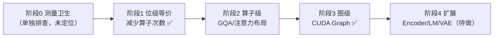

# VoxCPM2 三方性能对照与优化定位（2026-10-18）

后续复审、AudioVAE 图与被撤回的阶段 2 实验见
[优化审查与扩展验收](voxcpm-review-extension-2026-10-18.md)。本文的旧电源计划结论
已按复审证据纠正；新旧硬件条件下的绝对 RTF 不混算。

日期：2026-10-18。范围：`crates/voxcpm` Candle 计算链性能，保留的 `crates/voxcpm-sys`
（llama.cpp-omni / ggml）开发基准，以及官方 OpenBMB/VoxCPM PyTorch 实现。
关联：[Candle 移植验收](voxcpm-candle-acceptance.md)、[macOS 性能记录](voxcpm-macos-performance.md)、
模型来源 [crates/voxcpm/SOURCE.md](../../../crates/voxcpm/SOURCE.md)。

本文只记录本轮**新测量**与由其推出的定位结论；历史数字保留在验收记录中，不与本文混算。
本文不修改数值容差，不宣称通过严格数值、人工听感或 30 分钟播放门槛。

## 1. 环境与方法

Windows 11 / RTX 5070 12 GB（驱动 616.56，compute capability 12.0）/ CUDA 13.0.88 /
cuDNN 9.14 / Candle 0.11.0 release。

统一测量条件：

- 语料 `tools/tts/acceptance-corpus.txt`，经生产 `tts_core::text::preprocess_text(_, 180)`
  切分为 **11 段**（与 `round-1/index.json` 一致）。
- 参考音频：生产验收音色
  `…/2b-q8_0/169f64…/voices/voxcpm/2b-q8_0/169f64…/voice_acceptance/reference.wav`，
  转写取同一 `voice.json` 的 `你好，欢迎收听今天的故事。山风吹过松林，星光照亮归途。`
- seed 42、CFM 10 步、CFG 2.0、温度 1.0、上限 200 帧、48 kHz PCM。
- 每条路径 1 轮预热 + 5 轮热测，**串行执行**，测量期间无构建、无并行推理。
- RTF = 该轮实际输出音频时长换算的生成耗时；不按 seed 对齐 WAV 长度。

权重：

| 路径 | 权重 | 校验 |
| --- | --- | --- |
| Candle / C++ | `DennisHuang648/VoxCPM2-GGUF` revision `169f64d8…` | Q8 1727309920 B、Acoustic F16 1825096352 B，SHA-256 与 `SOURCE.md` 一致 |
| 官方 PyTorch | `openbmb/VoxCPM2` revision `32279eff…` | `model.safetensors` 4580080592 B、`audiovae.pth` 376951122 B，SHA-256 与 `SOURCE.md` 一致 |

官方原始权重由 `target/tmp/ranged-download.ps1` 分片下载（开发用途，落在用户目录，不入库）。

## 2. 三方吞吐结果

| 路径 | 5 轮 RTF | 均值 | 热首 PCM | 冷加载 | 参考编码 |
| --- | --- | ---: | ---: | ---: | ---: |
| Candle（本轮首次） | .537 / .570 / .582 / .601 / .592 | **0.576** | 81–91 ms | 3070 ms（device 81 + 权重 2989） | 235 ms |
| Candle（空闲复测） | .513 / .515 / .515 / .518 / .515 | **0.515** | 80–89 ms | 同上 | 同上 |
| C++ 原生（voxcpm-sys） | .255 / .256 / .258 / .255 / .258 | **0.256** | 226–243 ms | 2023 ms | 206 ms |
| 官方 PyTorch（eager） | .881 / .947 / .918 / .968 / .937 | **0.930** | 145–185 ms | 20941 ms | — |

每 100 秒音频的生成耗时：Candle 51.5 s、C++ 25.6 s、官方 93.0 s。

- Candle 稳态 vs C++ 原生：**2.01× 慢**，吞吐约 49.8%。
- Candle vs 官方 PyTorch：Candle **快 1.81×**（RTF 低 44.6%）。
- C++ 原生 vs 官方 PyTorch：原生快 3.63×。

输出音频时长分别为 Candle 54.40 s、C++ 53.76 s、官方 53.44 s。Rust 与 Torch 的
高斯噪声 RNG 不同，因此不按 seed 对齐 WAV，也不据此推断数值或听感等价。

### 与历史结论的差异

验收记录中「Candle 约为原生 2.07×、官方 PyTorch 未测」的结论，本轮补齐为：
**Candle 落后于 C++ 参考实现约 2 倍，但快于官方 eager PyTorch。**
「Candle 比官方慢」在官方 Windows eager 路径上不成立。

### 官方 torch.compile 未纳入

官方 `VoxCPMModel.optimize()` 需要 `triton`；Triton 无 Windows wheel，
`uv pip install triton` 在本机无解，官方会打印警告并回退 eager。
因此本文的官方数字是 **eager PyTorch**。
要在 Linux + Triton 上补 compiled 对照，需另机复测；不能把 IndexTTS 的官方
compiled 数字（0.456 RTF）搬用到 VoxCPM。

## 3. 成本定位（同步 profiling）

`VOXCPM_BENCH_PROFILE=1` 会开启模块边界 CUDA 同步，**只用于归因，不能计入吞吐**。

Candle 复测轮次 11 段累计（模块合计 28.107 s，与该轮 generate 28.229 s 吻合 99.6%）：

| 模块 | 累计耗时 | 占比 |
| --- | ---: | ---: |
| CFM（LocDiT，10 步中实际 9 次评估/帧） | 17.409 s | **61.9%** |
| BaseLM + FSQ（逐帧） | 4.057 s | 14.4% |
| AudioVAE 解码（逐帧） | 3.729 s | 13.3% |
| LocalEncoder（逐帧） | 1.790 s | 6.4% |
| ResidualLM（逐帧） | 0.800 s | 2.8% |
| Prefill | 0.323 s | 1.1% |

与验收记录的 62% 一致，CFM 仍是第一成本项。

## 4. 定位结论：本实现是 kernel launch bound

单帧产出 `patch_size × chunk_size` 个 48 kHz 样本；本轮 54.40 s 音频约 1360 帧，
即 **约 20.7 ms/帧**。

按源码逐层数出每帧算子数（**阶段 1 优化前的基线**；LocDiT 层为例，F16、t=11、
batch=2、non-causal、有 RoPE。RoPE 一项在阶段 1 后降为 7，其余不变）：

| 步骤 | 算子数 |
| --- | ---: |
| `input.clone()` | 1 |
| `rms_norm`（candle 融合 kernel，1 次） | 1 |
| q/k/v 投影 | 3 |
| **RoPE：`rotate(q)` + `rotate(k)`，各含 1 cast + 4 mul + 1 add/sub + 1 cat + 1 cast** | **18** |
| GQA `broadcast_as + reshape`（k、v 各一次物化拷贝） | 2 |
| `k.transpose().contiguous()` + scores matmul + `/√128` + `to_dtype(F32)` | 4 |
| `softmax_last_dim`（融合 kernel） | 1 |
| `to_dtype` + attn matmul + `transpose/reshape` 拷贝 | 3 |
| o 投影 + 残差加 | 2 |
| ffn `rms_norm` | 1 |
| gate + silu + up + mul + down + 残差加 | 6 |
| **合计** | **≈42** |

每帧合计：LocDiT 9×12×42 ≈ 4536、LocEnc 12×42 ≈ 504、BaseLM 28×38 ≈ 1064、
ResidualLM 8×36 ≈ 288、解码与杂项 ≈ 200，**约 6600 次算子/帧**。

20.7 ms / 6600 ≈ **3.1 µs/算子**，与「张量极小（M=22 行的 GEMM）、单算子耗时接近
launch 开销」一致。即：**减少算子次数几乎等价于减少时间**，而减少 FLOPs 收益有限。

这解释了与两条参照实现的差距来源：

- C++ `voxcpm2_runtime.cpp` 把 10 步 Euler + LocEnc + `enc_to_lm` + 停止预测编译成
  **单张 ggml 图**（4462 节点）并启用 CUDA Graph（日志 `CUDA Graph id N reused`），
  KV 为预分配 strided ring buffer；launch 次数被整体消除。
- 官方 PyTorch 用 `scaled_dot_product_attention(enable_gqa=True)` 融合注意力，
  `StaticKVCache` 预分配写入；但它仍是 eager 逐算子派发，本轮实测比 Candle 更慢。

KV cache 的 `Tensor::cat` 每层每步增长拷贝（C++ 为 ring buffer、官方为预分配写入），
但实测只占每帧约 72 次算子（BaseLM 28 层 + ResidualLM 8 层，各 2 次 cat），
且 candle 0.11 的 `slice_assign` 是「pad + mask + `where_cond`」实现，
单次写入比一次 `cat` 更贵，**因此环形 KV 缓存不作为首选方案**（见 §6）。

## 5. 与官方实现的语义对照（已核对源码）

固定官方源码 revision `f0c787f0937dc1c9a8f4f64d9a332d9c5da2e629`：

- `modules/minicpm4/model.py`：RMS 归约在 F32；RoPE 为
  `q*cos + rotate_half(q)*sin`（cos/sin 为 F32 缓存）；注意力走
  `F.scaled_dot_product_attention(..., enable_gqa=True)`；`forward_step` 写入预分配
  `StaticKVCache` 并用 `(arange <= position_id)` 掩码。
- `modules/locdit/unified_cfm.py`：host 侧 `t_span`，每步 `2*b` 输入、paired cond、
  拆正负支后 zero-star CFG；**不缓存时间表**（Rust 已缓存，见验收记录）。
- `modules/locenc/local_encoder.py`：每次一个 patch `(B,T=1,P,D)`，与 Rust 一致。

本轮未重跑严格 F32 oracle（阈值仍为 `atol=1e-5, rtol=1e-4`）；验收记录中
GGUF 路径 31 项、原始路径 397 项超差属于历史结果，未声称已解决。
本次优化的门槛因此采用**同 seed 语料 WAV 逐字节一致**作为位级等价判据。

## 6. 优化计划



**阶段 0（本次不做）**：首次五轮从 0.537 劣化到 0.601 的稳定性问题，
按用户要求**单独排查**，在定位原因前不与优化收益混算。

**阶段 1（位级等价，本轮已实施）**

| 编号 | 位置 | 改动 | 状态 |
| --- | --- | --- | --- |
| S1-a | `transformer.rs` `Rope::new` | 加载期预计算 `[cos,cos]` 与 `[-sin,sin]`（F32） | 已实施 |
| S1-b | `transformer.rs` `forward` | q(16 头)/k(2 头) 在 head 维 cat 后一次 RoPE 再 narrow 切回 | 已实施 |
| S1-b' | `transformer.rs` `rotate` | 表已含 `[-sin,sin]`，省掉内部重复 `cat` | 已实施 |
| ~~S1-c~~ | `transformer.rs` `forward` | 原计划去掉 `input.clone()` | **放弃**：读 candle 0.11 源码后确认 `Tensor` 内部是 `Arc<Tensor_>`，`clone()` 只是引用计数，O(1)，不是拷贝 |
| ~~S1-d~~ | `transformer.rs` `forward` | 原计划把 causal 掩码提到层循环外 | **放弃**：LocDiT/LocalEncoder 为 non-causal，BaseLM/ResidualLM 的掩码已在循环外构造，层内无重复构建 |
| ~~S1-e~~ | KV cache | 原计划环形 KV（预分配 + `slice_assign`） | **放弃**：candle 0.11 `slice_assign` 是「pad + mask + `where_cond`」，单次比一次 `cat` 更贵；KV `cat` 仅约 72 算子/帧 |

明确**不做**：降低 CFM 步数（改变质量）；QKV / gate-up 融合（改变浮点累加顺序）；
用 `slice_assign` 实现环形 KV。

### 6.1 阶段 1 实施与验收结果

改动仅限 `crates/voxcpm/src/transformer.rs`（`Rope::new`、`rotate`、`forward`
三处 + 一个单测），RoPE 每层算子数 **18 → 7**。

单测 `transformer::tests::fused_rotation_matches_per_head_formula`：
F32 / F16 两种精度下，融合后的第 0 / 16 号头与「官方逐头公式
`x*cos + rotate_half(x)*sin`」逐元素完全相等（F32 下按位相等）。
该单测在开发中抓到一个真实缺陷：`Rope::new` 曾误用 `cos` 构造 `[-sin,sin]`
（只有第二半输出才暴露），已修复。

**吞吐（ABBA 交替，8 进程 before/after/after/before/before/after/after/before，
每进程 1 预热 + 5 热轮，GPU 空闲串行，1.234× = −19.0%）：**

| 臂 | 各 run 热轮均值 | mean-of-means |
| --- | --- | ---: |
| before | 0.5693 / 0.5403 / 0.5445 / 0.5261 | **0.545** |
| after | 0.4434 / 0.4660 / 0.4339 / 0.4227 | **0.4415** |

两组 4 个 run 的热轮均值区间完全不重叠（before 最小 0.5261 > after 最大 0.4660）。
注意 before 今日均值 0.545 差于 §2 的 0.515，说明机器状态与历史测量不同；
**只有 ABBA 内部对照是可信数字**，绝对值不与 §2 直接比较。

**位级等价（同 seed 语料 WAV 逐字节 SHA-256，5 个 run × 66 wav，264/264 全等）：**

| 对照 | 相同 |
| --- | ---: |
| abba 01-before ↔ abba 02-after（同会话 A/B） | 66/66 |
| 历史 candle-hot-repeat ↔ abba 08-before | 66/66 |
| 历史 candle-hot-repeat ↔ abba 07-after | 66/66 |
| rope-fused-repeat ↔ abba 07-after | 66/66 |

**质量门禁（本轮全过）：** `cargo fmt --all --check`；
`cargo test --locked -p voxcpm --lib`（9 passed / 0 failed / 5 ignored）；
`cargo clippy --locked -p voxcpm --all-targets --all-features -- -D warnings`；
`RUSTDOCFLAGS=-D warnings cargo doc --locked --no-deps --document-private-items
--all-features -p voxcpm`。
全工作区 clippy 存在**既有失败**（非本次改动，见 §8）。

### 6.2 后续基准协议（劣化排查后固化）

单次「1 预热 + 5 热轮」不足以区分真实收益与机器状态波动（§2 首次五轮
0.537 → 0.601 的劣化至今未定位）。后续所有优化对照统一采用：

1. **ABBA 交替**：至少 8 个独立进程，每个臂 ≥ 4 个 run，顺序交错
   （before-after-after-before…），抵消进程间的机器状态漂移。
2. **锁频**：测量期间 `nvidia-smi -lgc` 固定 SM/显存频率，测完 `-rgc` 恢复。
3. **丢弃预热轮**：至少 1 轮预热且不计入统计；预热轮数随实验记录。
4. **报告口径**：同时给 mean-of-means 与各 run 明细；两组区间不重叠才算
   有效收益；落在重叠带内的差异按「无明确收益」处理（与 IndexTTS 撤回标准一致）。
5. **独占**：测量期间不编译、不并行推理、不跑其他 GPU 任务；前后记录
   `nvidia-smi --query-compute-apps`。

### 6.3 劣化排查（2026-10-18 晚）

问题重述：§2 记录首次五轮从 0.537 劣化到 0.601；§6.1 的 ABBA 中 before 臂
今日均值 0.545 也差于历史的 0.515。本节按 §6.2 的协议做归因。

探针改造（`crates/talechime-backends/examples/voxcpm_candle_probe.rs`）：
轮数上限 10 → 30，新增 `VOXCPM_BENCH_WARMUP`（默认 1，前 N 轮执行并记录但
不计入 `summary.measured`），`measured` 给出 mean/min/max。采样脚本在
`target/tmp/voxcpm-opt/degrade/`（gitignored），250 ms 一次
`nvidia-smi`（pstate / SM / mem / 功耗 / 温度 / 利用率 / 显存 / throttle 位）。

三次 20 轮独立进程实验（语料、seed、权重、参考音频完全一致；原先声称的电源
差异未成立，后续审查发现切换 GUID 错误且脚本未检查退出码）：

| 实验 | 电源计划 | 前 10 轮均值 | 后 10 轮均值 | 漂移 | 20 轮 mean | min–max |
| --- | --- | ---: | ---: | ---: | ---: | --- |
| E0 | 平衡 | 0.4195 | 0.4322 | **+3.0%** | 0.4258 | 0.4008–0.4565 |
| E2 | 原记录请求高性能，后审查发现 GUID 错误，未证明切换成功 | 0.4265 | 0.4261 | −0.1% | 0.4263 | 0.4178–0.4415 |
| E5 | 平衡（复现） | 0.4326 | 0.4269 | −1.3% | 0.4297 | 0.4236–0.4396 |

**已采集硬件指标未发现相应变化**（逐轮遥测，E0/E2/E5 三次一致；不能据此排除所有硬件或调度因素）：

| 观测量 | 三次实验的取值范围 | 结论 |
| --- | --- | --- |
| SM 时钟 | 2912–2920 MHz | 恒定，劣化的轮次没有降频 |
| 显存时钟 | 14001–14201 MHz | 未观测到与漂移一致的下降，不能归因于电源切换 |
| 功耗 | 87–90 W（上限 250 W） | 恒定，远未触顶 |
| 温度 | 52–57 °C | 无热降频（`HW/SW Thermal Slowdown` 全程 Not Active） |
| GPU 利用率 | 51.7%–55.2% | 取值接近；不能仅据利用率确定 host 或 GPU 归因 |
| 显存占用 | 5555 MiB 恒定（E5） | 无泄漏、无分配器膨胀 |
| CPU 频率 / 利用率 | 3800 MHz 恒定、约 21% | host 频率未降 |

**结论（审查后收敛）**：E0 的 +3.0% 漂移在 E5 未复现，现有遥测未支持明确的
时钟、功耗或温度归因；电源对照因切换失败而无效。机器常驻桌面 GPU/CPU 进程，
外部竞争是候选解释，但现有证据无法区分竞争、host 派发与内部状态，根因仍未定位。

因此基准协议按 §6.2 执行：电源计划用高性能、ABBA 交替、丢弃预热轮、
报告区间，区间重叠即判为无收益。原计划的 E1（锁频）与 E3
（`CUDA_MODULE_LOADING=EAGER`）**未执行**：E0 已在恒定时钟下出现漂移，
锁频无法解释该现象；模块加载只影响首轮，已被丢弃的预热轮覆盖。
E4（冷/暖启动）被「丢弃预热轮」规则取代。

产物：`target/tmp/voxcpm-opt/degrade/{e0,e2,e5}/`（含 `gpu-samples.csv`、
`rounds.log`、`summary.json`、前后 GPU 快照），分析脚本
`target/tmp/voxcpm-opt/degrade/analyze.py`。

**阶段 2 候选（需另立容差与试听门槛）**：GQA 用 `(b,2,8*len,d)` 分组 matmul 取代
`broadcast_as+reshape` 物化；`k.transpose().contiguous()` 改用 cuBLAS 原生转置布局。
两者都可能因 GEMM kernel 选择变化而改变累加顺序，不能默认位级等价。

**阶段 3（CUDA Graph）：已实施，仅覆盖每帧 CFM，验收通过。** 见 §6.4。

**阶段 4（扩展）：待做。** LocalEncoder `encode`（形状恒定，可直接套用同一条
路径）；BaseLM + FSQ / ResidualLM 需要预分配 KV 与设备端 offset；AudioVAE decode
需先实测 cuDNN 调用能否被 capture。三项各自独立 ABBA，收益 < 10% 即撤回。

### 6.4 CUDA Graph：每帧 CFM 单帧图（阶段 3，已验收）

**范围**：只录制 acoustic 的每帧 CFM 步（LocDiT 序列 `(2,11,1024)`，占 §3
成本的 61.9%）。BaseLM / ResidualLM / LocalEncoder / AudioVAE 仍走 eager。

**为什么这一段适合录制**：每帧调用一次，输入恒为 `mu (1,2,1024)` /
`prefix (1,64,4)` / `noise (1,64,4)`，序列长度恒定，RoPE offset 恒 0，
无 KV cache，图内无 d2h。candle 用函数式张量，cudarc 走
`cuMemAllocAsync`，因此录制期间**每个中间张量都会变成图中的一个分配节点**——
这一点是本次真正的难点，见下。

**关键发现（根因）**：**含未配对分配节点的图只能 launch 一次**，此后每次
`cuGraphLaunch` 都返回 `CUDA_ERROR_INVALID_VALUE`。该现象与 candle 无关，用纯
cudarc 最小复现即可观察到（真实流 + 关闭 event tracking，录一次
`memcpy_dtod`）：

| 图内容 | 第 1 次 launch | 第 2 次 launch | 第 3 次 launch |
| --- | --- | --- | --- |
| 录制前分配、图内不释放 | Ok | Ok | Ok |
| 录制内分配、图内**不**释放 | Ok | **INVALID_VALUE** | **INVALID_VALUE** |
| 录制内分配 + 图内释放 | Ok | Ok | Ok |
| 录制内分配 + `AUTO_FREE_ON_LAUNCH` | Ok | Ok | Ok |

candle 的函数式写法已经让每个中间张量在录制区间内释放，所以**唯一未配对的
分配就是被保活的输出张量**。落地做法：录制区间内把结果 d2d 拷进一块录制前
就分配好的常驻缓冲，随即释放结果张量，图因此配平，输出地址也稳定。录制只
记录不执行，所以未命中缓存的那一帧照常 eager 跑，下一帧起才是回放。

**与原方案的偏差（按证据调整）**：方案里为防御「录制期中间张量被提前回收」
准备的**私有 mempool 最终删除**。根因是分配节点未配平而非回收，配平后不需要
隔离 pool，去掉后少约 90 行 unsafe FFI，也不再改动设备默认内存池这一全局
状态。A/B 实测两种配置 RTF 与输出完全一致。

**另一处必要修正**：candle 只在 `enable_cuda_graph_htod_cache()` 生效期间填充
h2d 参数缓存，而录制中禁止未缓存上传。预热必须放在 guard **之内**，否则首次
录制会以 `h2d param cache miss` 失败。

**语义变化（如实记录）**：图内不轮询取消标志，改为**每帧 replay 前检查一次**，
取消粒度从「transformer 层内」变为「每帧」（PCM 仍在图外产出，被取消的帧不
出声）。探针里那条「prefill/CFM 取消不得出声」的用例阈值从 80 下调到 8，让它
落在两条路径一致的 prefill 区间；帧边界之后的取消由既有的 callback 用例覆盖。

**验收结果**：

| 项 | 结果 |
| --- | --- |
| 正确性 | 语料 11 段 × 6 轮 = **66 个 WAV 与 eager 基线 SHA-256 逐字节一致** |
| 探针回归 | 取消 / EOS / max_frames / 空文本 / 非法参数 全部通过（探针内置） |
| 性能协议 | ABBA 8 进程、请求锁频 2700 MHz、1 预热 + 5 热轮；原脚本电源 GUID 错误，高性能切换未验证，桌面 GPU 进程仍存在 |
| 性能（eager 臂） | mean-of-means **0.4289**，区间 [0.4203, 0.4332] |
| 性能（图臂） | mean-of-means **0.2978**，区间 [0.2970, 0.2984] |
| 收益 | **−30.6%**，两组区间不重叠（门槛 ≥ 10%） |
| 门禁 | `cargo fmt --check`、`cargo test -p voxcpm --lib`（9 passed）、clippy `-D warnings`、rustdoc `-D warnings`、`cargo check --workspace`、`cargo publish --dry-run --locked -p voxcpm` 全部通过 |

RTF 由 0.429 降到 0.298，已进入方案设定的 0.25–0.30 目标带，但**仍高于 C++
原生的 0.256**。剩余差距的归属要等阶段 4 拆完才知道。

**降级行为**：录制或回放出错 → tracing 警告 + 该 Model 实例永久回落 eager，
不向用户报错；`VOXCPM_CUDA_GRAPH=0` 关闭；`measure_modules` 打开时整段走
eager（profiling 在测量区间内同步，图里放不下）。探针每轮 JSON 新增
`cuda_graph` 字段，基准报告能如实反映当轮走的是哪条路径。

### 6.5 复审与后续扩展

后续复审修复了多 steps 图参数生命周期、视图复制、平台门控和取消边界。
AudioVAE 图在新的 ABBA 中从 0.2947 降到 0.2164（−26.6%），264/264 WAV 逐字节
一致，已在 GGUF CUDA 路径默认启用。LocalEncoder 两次初筛均低于 10% 门槛，
静态 KV 与阶段 2 算子候选未通过数值/收益门槛，均撤回运行时实现。
完整实验、cuDNN 验证及发布前置阻塞见[复审记录](voxcpm-review-extension-2026-10-18.md)。

## 7. Candle 上游 issue / PR 调研（2026-10-18）

调研目标：找 IndexTTS 当时用到的「上游 PR + 本地 fast path」手法在 VoxCPM 是否可复用。
本地源码：`candle-core-0.11.0`、`candle-nn-0.11.0`、`cudarc-0.19.10`
（cargo registry，`index.crates.io-1949cf8c6b5b557f`）。

| 主题 | 上游状态 | 对本项目的结论 |
| --- | --- | --- |
| CUDA Graph | issue **#3002**（2025-06 至今 open，candle 无 capture/replay 公共 API，维护者称无 roadmap）；PR **#3083** 至今 draft。**但 candle-core 0.11.0 已内置兼容层**：PR **#3564**（h2d 参数缓存）、PR **#3598**（2026-06-24 合并，0.11.0 发布前 2 天）公开 `CudaDevice::enable_cuda_graph_htod_cache()`，上游实测 A100 Llama-3.1-8B Q4K 收益 +3.59%~+14.63% | **已落地，见 §6.4**：仅用 candle-core 0.11 + cudarc 0.19 的**公开 API**（`CudaStream::begin_capture/end_capture`、`CudaGraph::launch`、`Device::Cuda(dev).cuda_stream()`）即可，无需私有 fork，也未新增 candle API。issue **#3728** 列的三类结构在 CFM 段都不存在（RoPE offset 恒 0、无 KV、噪声已移出图外）。真正的阻塞是**未配对的分配节点**（§6.4 表格），上游文档未提及。预热必须在 `enable_cuda_graph_htod_cache()` guard 之内，否则 `h2d param cache miss` |
| GQA 广播 | issue **#3253**（open）：`broadcast_matmul` 对 stride-0 广播报 "non-contiguous lhs"，workaround 是 `.broadcast_as(...).contiguous()` 物化整个 K/V。PR **#3872**（2026-08-13 合并）只修了 rank-2 RHS，高阶广播仍走物化 | **无可抄的 PR**。阶段 2 的分组 matmul 需自写，并自证容差（会改 GEMM kernel 选择与累加顺序） |
| depthwise conv | issue **#3389** / PR **#3531**（IndexTTS 当时采用的手法：pad + 逐 tap narrow·broadcast_mul 累加，绕开 cudarc group conv） | **本仓库已做**：`crates/voxcpm/src/codec.rs:53` 已有同一 fast path（`groups == c && weight.dim(0) == c && weight.dim(1) == 1`）。本轮无需再动 |
| 量化小批量 matmul | issue **#2074**；candle-core 0.11 已有 `src/quantized/fast_mmvq.rs`（batch 1–8）与 `fast_mmq.rs`（batch > 8），`cuda.rs:852` 在 `!FORCE_DMMV` 时优先尝试 | **已自动受益**：我们 Q8、M=22 走快路径，无需改代码 |
| GPU 融合注意力 | `candle_nn::attention` 的 `flash_attn` 只存在于 `cpu_flash`（`pub use cpu_flash::flash_attn`；`causal.rs` / `standard.rs` 都在 `cpu_flash/` 下），GPU 上无 SDPA / flash | **无法复用官方优势**：官方 PyTorch 走 `scaled_dot_product_attention(enable_gqa=True)`，我们只能靠自己减少算子数（阶段 1/2 的路线） |

## 8. 已知偏差与未完成项

- Candle 首次五轮（0.576）与复测（0.515）差 12%，原因未定位，按用户要求延后。
- 劣化同样污染了 §6.1 的绝对值（ABBA before 均值 0.545 差于历史 0.515）；
  ABBA 的相对结论不受影响。劣化排查按用户要求单独进行。
- §6.4 是仅覆盖 CFM 的历史结果。后续新增 AudioVAE 图，正式 ABBA RTF 为 0.2164；
  LocalEncoder 低于收益门槛撤回，静态 KV / 阶段 2 候选未通过数值/收益验收，
  详见复审记录。C++ 0.256 是历史数据，本轮未按新协议重测，不宣称同条件胜负。
- 图路径下取消粒度为每帧（eager 为每个 transformer 层）。PCM 与 EOS 判定仍在
  图外，语义未变，但取消的最大额外延迟是一个 CFM 步的时长。
- CUDA Graph 只在 CUDA 上验证（本机 RTX 5070 / 驱动 616.56 / CUDA 13.4）。
  分配节点配平这一约束是 CUDA 语义，与具体卡无关，但其他驱动未实测。
- 官方为 BF16 + LlamaTokenizerFast，Candle 为 Q8 + SentencePiece，数值路径不同。
- 官方 eager 与 Candle 的首 PCM 差异（145–185 ms vs 80–89 ms）来自
  `build_prompt_cache` 与逐段重编码策略不同，未做归因。
- 严格 F32 oracle 未在本轮重跑；本文所有优化结论以 WAV 逐字节一致为门槛。
- 人工听感、30 分钟连续播放、Linux CUDA / macOS Metal 未涉及。
- 全工作区 `cargo clippy --all-targets --all-features` 有一处**既有失败**：
  `crates/talechime-backends/src/moss/directml_probe.rs:172` 调用 `runtime.generate`
  少传第 4 个参数 `prefix: Option<ContinuationInput>`
  （`crates/talechime-backends/src/runtime.rs:387` 已改签名）。
  该文件与 `runtime.rs` 在本次改动中均未被触碰（`git status` 只有
  `crates/voxcpm/src/transformer.rs`），故判定为 HEAD 既有问题，本轮未修。

## 9. 复现命令

```powershell
$model = "$env:USERPROFILE\.talechime\resources\voxcpm\models\2b-q8_0\169f64d8b98bbaab1761e4ca3a83e6af653456cc"
$voice = "$model\voices\voxcpm\2b-q8_0\169f64d8b98bbaab1761e4ca3a83e6af653456cc\voice_acceptance"
$corpus = "tools\tts\acceptance-corpus.txt"
$text = "target\tmp\voxcpm-opt\ref-transcript.txt"

# Candle 热模型 1+5 轮
$env:VOXCPM_BENCH_ROUNDS = "5"
target\release\examples\voxcpm_candle_probe.exe $model cuda target\tmp\voxcpm-opt\candle-hot $corpus "$voice\reference.wav" $text

# Candle 模块归因（带同步，不计入吞吐）
$env:VOXCPM_BENCH_PROFILE = "1"
target\release\examples\voxcpm_candle_probe.exe $model cuda target\tmp\voxcpm-opt\candle-profile $corpus "$voice\reference.wav" $text

# C++ 原生 1+5 轮
target\release\examples\voxcpm_native_benchmark.exe $model cuda target\tmp\voxcpm-opt\native-hot $corpus "$voice\reference.wav" $text

# 每帧 CFM CUDA Graph（默认开启；VOXCPM_CUDA_GRAPH=0 回到 eager）
$env:VOXCPM_CUDA_GRAPH = "1"
$env:VOXCPM_BENCH_WARMUP = "1"
target\release\examples\voxcpm_candle_probe.exe $model cuda target\tmp\voxcpm-opt\graph-full $corpus "$voice\reference.wav" $text
```

阶段 1 的 ABBA 交替基准脚本：`target/tmp/voxcpm-opt/abba.ps1`
（用 `probe-before.exe` / `probe-after.exe` 两个预构建二进制交替执行，
输出 `target/tmp/voxcpm-opt/abba/abba.json` 与每 run 的 `summary.json` / WAV）。

阶段 3 的 ABBA 脚本：`target/tmp/voxcpm-opt/abba-graph.ps1`
（同一二进制、`VOXCPM_CUDA_GRAPH` 在 0/1 间按 ABBA ABBA 交替，锁频 2700 MHz、
原脚本请求高性能但 GUID 无效，`finally` 恢复 `-rgc` 与平衡电源；输出
`target/tmp/voxcpm-opt/abba-graph/{abba.json,summary-eager.json,summary-graph.json}`）。
逐字节校验（与 eager 基线目录比 SHA-256）：

```powershell
$base = "target\tmp\voxcpm-opt\rope-fused-repeat"   # eager 基线
$test = "target\tmp\voxcpm-opt\graph-full"         # 图路径
$bp = (Resolve-Path $base).Path; $tp = (Resolve-Path $test).Path
Get-ChildItem $base -Recurse -Filter *.wav | ForEach-Object {
  $rel = $_.FullName.Substring($bp.Length + 1)
  if ((Get-FileHash $_.FullName -Algorithm SHA256).Hash -eq
      (Get-FileHash (Join-Path $tp $rel) -Algorithm SHA256).Hash) { "same $rel" } else { "DIFF $rel" }
}
```

构建命令：

```powershell
cargo build --release --locked -p talechime-backends --no-default-features `
  --features voxcpm-cuda --example voxcpm_candle_probe -j 1
cargo build --release --locked -p voxcpm-sys --features cuda `
  --example voxcpm_native_benchmark -j 1
```

质量门禁：

```powershell
cargo fmt --all --check
cargo test --locked -p voxcpm --lib
cargo clippy --locked -p voxcpm --all-targets --all-features -j 1 -- -D warnings
$env:RUSTDOCFLAGS = "-D warnings"
cargo doc --locked --no-deps --document-private-items --all-features -p voxcpm -j 1
cargo publish --dry-run --locked --allow-dirty -p voxcpm
```

产物目录：
`target/tmp/voxcpm-opt/{candle-hot,candle-hot-repeat,candle-profile,native-hot,official-hot,rope-fused-repeat,abba,graph-full,abba-graph,degrade}/`。

