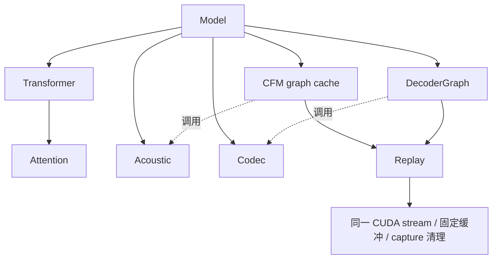

# VoxCPM 优化审查与扩展验收（2026-10-18）

本轮性能实验设备：Windows 11 / Ryzen 7 9700X / RTX 5070（约 12 GB 显存），CUDA。
MacBook Pro M4 Pro 的历史 Metal 结果另见 [macOS 性能记录](voxcpm-macos-performance.md)，
不使用本轮 CUDA 收益替代 Mac 实机复测。

接续 [首轮性能对照](voxcpm-performance-comparison-2026-10-18.md)。审查范围为
`59696d5...c501c41`，依据为已确认的阶段 A–F 与阶段 2 计划。权重、音频和日志
保存在 Git 忽略的 `target/tmp/voxcpm-opt/`。

## Standards

- **P1：资源所有权不完整。** 图未持有其引用的时间表；切换 steps 会释放旧图使用的
  设备张量。已让每个图显式保活对应时间表，遵守资源生命周期边界。
- **P2：平台路由遗漏。** CUDA feature 在 macOS 也尝试编译 CUDA 图依赖，绕过
  `tts-candle-platform` 的目标路由。已统一限制 cudarc、图模块和调用到 Windows/Linux。

## Spec

- **P1：多 steps 缓存不安全。** 与规范轴的同一所有权缺陷，违反计划要求的多特化
  缓存复用。已补 steps A→B→A、不同 cfg 和 LRU 淘汰测试。
- **P2：原始复制忽略视图。** 连续 narrow 的 `contiguous()` 可保留偏移，原实现复制
  整个 storage；旧尺寸检查会拒绝合法视图并关闭图，未证明已输出错误音频。
  现按布局偏移、逻辑长度复制，并核对设备身份。
- **P2：验收缺项。** 仅比较 WAV 不能覆盖噪声变化、时间表切换和失败路径。已补
  ignored CUDA 真模型测试，普通测试不下载模型。
- **P2：取消边界不完整。** replay 后缺少立即取消检查。现统一在图操作前后检查，
  并验证取消不关闭可复用图、同步失败后永久回落 eager 且结果不变。
- **P2：预热记录不准确。** 逐轮 warmup 标记写死 round=0，与配置 N 不一致。
  已改为 `round < warmup_rounds`；原 N=1 基准不受影响。

规范轴 2 项、计划轴 5 项；两轴最高均为 P1，均已修复，同一根因不重复计作独立 bug。

首次捕获直接返回已经算出的 warmup 结果，减少一次重复 eager CFM。
录制不执行，不能返回尚未执行的图输出。

同步录制/launch 拒绝可以回退；异步 GPU 错误可能到图外同步才暴露，非法访问
破坏上下文后不能保证恢复。因此不宣称“任何 GPU 故障都能静默恢复”。

## 模块与设计原则

按 KISS、DRY、YAGNI、SOLID 核对，重点落实单一职责、开闭、接口隔离与依赖倒置。
不引入跨模型框架或仅有一个实现的抽象接口。

- `transformer.rs` 拥有层、RoPE 和缓存；注意力布局独立于 `attention.rs`。
- `cuda_graph/replay.rs` 只负责固定缓冲、安全复制、录制和清理，通过闭包接收计算。
- CFM、decoder 分别管理自己的特化与状态；协议及适配器不感知这些细节。
  未通过门槛的 LM、LocalEncoder、GQA 候选不保留运行时开关。
- 图输出是同流复用缓冲，必须在下次 replay 前消费；不作为历史快照交付。
- eager 作为对照，profiling 保持 eager；CPU/Metal 不进入 CUDA 实验。



## 协议与官方对照

`tools/tts/voxcpm_perf.ps1` 使用预构建探针串行运行。正式比较为 ABBA ABBA
8 进程，每进程 1 预热 + 5 热轮，记录进程均值及区间；`-Screen` 仅作筛查。
请求锁频 2700 MHz、高性能电源，finally 恢复此前电源计划并解除锁频。
记录 GPU 状态与进程快照；桌面进程仍可能用 GPU，不宣称完全独占。
阶段 E 保留门槛仍为改善至少 10%、区间不重叠且 WAV 逐字节一致。
阶段 2 改变 GEMM 形状，需分别报告算子误差、波形差异和听感验收边界。

官方固定 revision `f0c787f0937dc1c9a8f4f64d9a332d9c5da2e629`：
`minicpm4/model.py` 使用 SDPA `enable_gqa=True`；查询头 h 对应 KV 头 h/8。
`cache.py::StaticKVCache` 与 `forward_step` 预分配 KV，设备位置写入并遮罩未来位置。
E2 实验据此实现，不能只预分配 KV 而忽略位置和 mask。

本轮逐位验收使用同权重的 Candle eager 作基准。官方 F32 oracle 没有重跑；
跨实现的量化、Tokenizer 与噪声 RNG 差异沿用移植验收记录，不由本轮 WAV 对照消除。

C++ 历史 RTF 0.256 见首轮报告；本轮未重测时不能当成同条件比较。
自动释放标志按 [NVIDIA 文档](https://docs.nvidia.com/cuda/cuda-driver-api/cuda_driver_api/group__CUDA__GRAPH.html)
在再次 launch 前释放未释放分配；已纠正知识库“launch 末尾释放”的旧表述。

## 本轮结果

初筛均使用 11 段语料、每进程 1 预热 + 2 热轮、两个独立进程。初筛不替代
正式 ABBA，也不宣称观察到的改善具有正式验收的置信度。

| 实验 | baseline RTF | candidate RTF | 初筛改善 | WAV 一致 | 决策 |
| --- | ---: | ---: | ---: | --- | --- |
| E1 LocalEncoder 图 | 0.300036 | 0.276410 | 7.87% | 33/33 | 未达 10%，不提升为默认 |
| E1 在 E3 新基线复测 | 0.209592 | 0.193832 | 7.52% | 33/33 | 仍未达 10%，撤回运行时实现 |
| 阶段 2 grouped GQA | 0.298219 | 0.288050 | 3.41% | 0/33，12 个长度变化 | 不通过音频不变门槛 |
| 阶段 2 grouped + K 转置视图 | 0.298542 | 0.283351 | 5.09% | 0/33，9 个长度变化 | 不通过音频不变门槛 |
| 阶段 2 仅 K 转置视图，保留 repeat-KV | 0.210546 | 0.214809 | −2.02% | 0/66，12 个长度变化 | 独立对照也未获益，撤回 |

两种算子布局的 CPU/CUDA F32/F16 小张量容差测试通过，但不能据此宣称生成音频
等价。等长文件中 grouped 最大绝对 PCM 差 0.427734，最小 SNR 0.209 dB；
grouped+transpose 分别为 0.330750、5.732 dB。SNR 是相同采样索引的差异统计，
不是感知质量评分；没有人工试听或回读验收，不能声称质量劣化已证明或已排除。

E2 静态 KV 原型使用已有 `scatter_set`、设备位置、RoPE `index_select` 和未来
位置 mask，不需要新增 Candle API。基础 scatter/padded attention 测试通过，
但真实 Q8 BaseLM 第 2 个 token 起失败，最大 hidden 差 0.345070。
基础 padded attention 已出现约 1e-7 的 F32 差异，可能被后续量化放大，但尚未
完成逐层归因，不能把推测写成 Candle 缺陷或据此提交上游 PR。

单独去除 K 转置拷贝的实验使用两个预构建二进制，均启用已通过验证的 CFM +
AudioVAE 图，每进程 1 预热 + 5 热轮。波形和 EOS 长度变化仍存在，且 RTF 更高，
不能把前述 grouped+transpose 的微小收益归因给转置视图。所有被撤回候选的源码、
实验二进制与脚本保存在 `target/tmp/voxcpm-opt/rejected-experiments/` 及邻近忽略目录，
不增加正式库的实验开关或新的公开 Candle API。

E3 dense conv1d 已能录制，8 次 replay 与 eager 逐位一致；完整 AudioVAE 通过
3 请求 × 8 帧的逐位对照，包含跨请求清零。

### E3 AudioVAE 正式 ABBA

8 个串行独立进程，每进程 1 预热 + 5 热轮，11 段语料。高性能计划已实际核验，
请求锁频 2700 MHz，进程前快照观测约 2692 MHz；不把请求值当作全程实测值。
硬件为 Ryzen 9700X / RTX 5070，Toolkit `nvcc 13.0.88`，驱动 616.56。

| 组 | 4 个进程均值 | mean-of-means | 进程均值范围 |
| --- | --- | ---: | --- |
| CFM 图，decoder eager | 0.298306 / 0.291416 / 0.293674 / 0.295223 | 0.294655 | [0.291416, 0.298306] |
| CFM + AudioVAE 图 | 0.223236 / 0.219251 / 0.211278 / 0.211780 | 0.216386 | [0.211278, 0.223236] |

改善 **26.56%**，区间不重叠；四个图进程各 66 WAV，合计 **264/264** 与同一
新基线逐字节一致。探针每进程的 cancel/EOS/max_frames/空文本/非法参数回归均通过。
真实数据：`target/tmp/voxcpm-opt/abba-decoder/{runs.json,statistics.json,wav-all.json}`。
观察到进程间漂移，仍不据此宣称劣化根因已定位。

GGUF CUDA 默认启用 AudioVAE 图；原始 Safetensors 权重路径仍 opt-in。
`VOXCPM_CUDA_GRAPH=0` 关闭全部图，`VOXCPM_DECODER_GRAPH=0` 单独关闭 decoder。
profiling 保持 eager。录制失败保留已经算出的本帧 warmup，不重复推进状态；
回放错误若状态可能部分更新则终止当前请求，不能重算并假装状态未变。

### 最终源码复核

撤回候选后，默认 GGUF CUDA 路径再次生成 11 段 × 6 轮，**66/66 WAV** 与正式
ABBA 的图输出逐字节一致；每轮 `cuda_graph` 与 `cuda_decoder_graph` 均为 true。
该单进程热轮均值 0.210546 仅作源码收敛后的复核，不替代正式 ABBA 的 0.216386。
另外实测 `VOXCPM_CUDA_GRAPH=0` 同时关闭 CFM/decoder，输出仍一致；N=0/N=2
预热标记与统计轮数准确。普通测试不下载权重。

| 检查 | 结果 |
| --- | --- |
| 默认 CPU `cargo test --locked -p voxcpm --lib -j 1` | 10 passed / 5 ignored |
| `--all-features` 普通单测 | 10 passed / 10 ignored |
| 独立 ignored CUDA 真模型 `cuda_graph::`，串行 | 4 passed，含多噪声/时间表/LRU、取消、回退、视图偏移、完整 decoder 状态与 reset |
| 显式开启 `tts-candle-platform/cuda-cudnn` | 2 passed，cuDNN 9.14.0.64 的 dense conv 捕获及完整 decoder 24 帧/reset 均逐位一致 |
| fmt / Clippy all-targets all-features / rustdoc 私有文档 `-D warnings` | 通过 |
| `cargo check --locked --workspace -j 1` | 通过 |
| CUDA release 构建、VoxCPM publish dry-run | 通过 |
| notices | 产物含 Candle Apache/MIT 许可 |

日志：`target/tmp/voxcpm-opt/final-checks/`。全部构建使用 `-j 1`，GPU 测量和模型
验证期间不编译、不并行推理。Windows CUDA SDK loader 的既有 LNK4098 仍可见，
未压制警告；Linux CUDA、macOS Metal 和人工试听未在本轮实机验收。

cuDNN 补测首次链接因找不到 `cudnn.lib` 失败；使用已安装 SDK，为该命令进程补上
`CUDNN_LIB`、`LIB` 和 DLL PATH 后通过，没有安装或修改系统 SDK。正式 ABBA 使用
普通 CUDA 卷积路径，cuDNN 合并 feature 的吞吐没有另作比较。

### fork 与发布边界

Candle 固定 fork revision 不变，没有功能性 fork 补丁，也未新增 Candle API；
继续轨道 A，未触发 `publish = false`。来源与政策见
[candle/SOURCE.md](../../legal/candle/SOURCE.md)。

补查 9 个 Candle 消费/平台库的 dry-run：7 个通过（VoxCPM、Qwen TTS/ASR、MOSS、
OmniVoice、CosyVoice3、tts-candle-platform），2 个存在 registry 发布前置条件：

- IndexTTS：已发布的 `tts-candle-platform 0.1.0` 没有本地新增的 `cuda-cudnn` feature。
- talechime-backends：crates.io 尚无 `cosyvoice3` 包，无法解析打包依赖。

这两项属于既有发布版本/顺序问题，不能记为已通过，更不能以 VoxCPM dry-run
成功代替整个发布链验收。没有执行真实上传，也没有修改其他库的版本号。

## 复现

先令 `$model`、`$wav`、`$text` 指向本地模型、参考 WAV 和准确转写。

```powershell
cargo build --release --locked -p talechime-backends --no-default-features `
  --features voxcpm-cuda --example voxcpm_candle_probe -j 1
./tools/tts/voxcpm_perf.ps1 -Model $model -ReferenceAudio $wav `
  -ReferenceText $text -Output target/tmp/voxcpm-opt/reproduce-e3
python tools/tts/compare_wav.py target/tmp/voxcpm-opt/reproduce-e3/baseline-0 `
  target/tmp/voxcpm-opt/reproduce-e3/candidate-1 target/tmp/voxcpm-opt/reproduce-e3/wav.json
$env:VOXCPM_TEST_MODELS = $model
$env:VOXCPM_CUDA_GRAPH = "1"
cargo test --locked -p voxcpm --lib --all-features -j 1 cuda_graph:: `
  -- --ignored --test-threads=1
```

脚本明确关闭/开启 decoder、核验图状态，记录请求时钟与桌面进程快照，并恢复
原电源计划、解除锁频。正式验收仍须同时检查性能统计与 WAV 对照结果。
