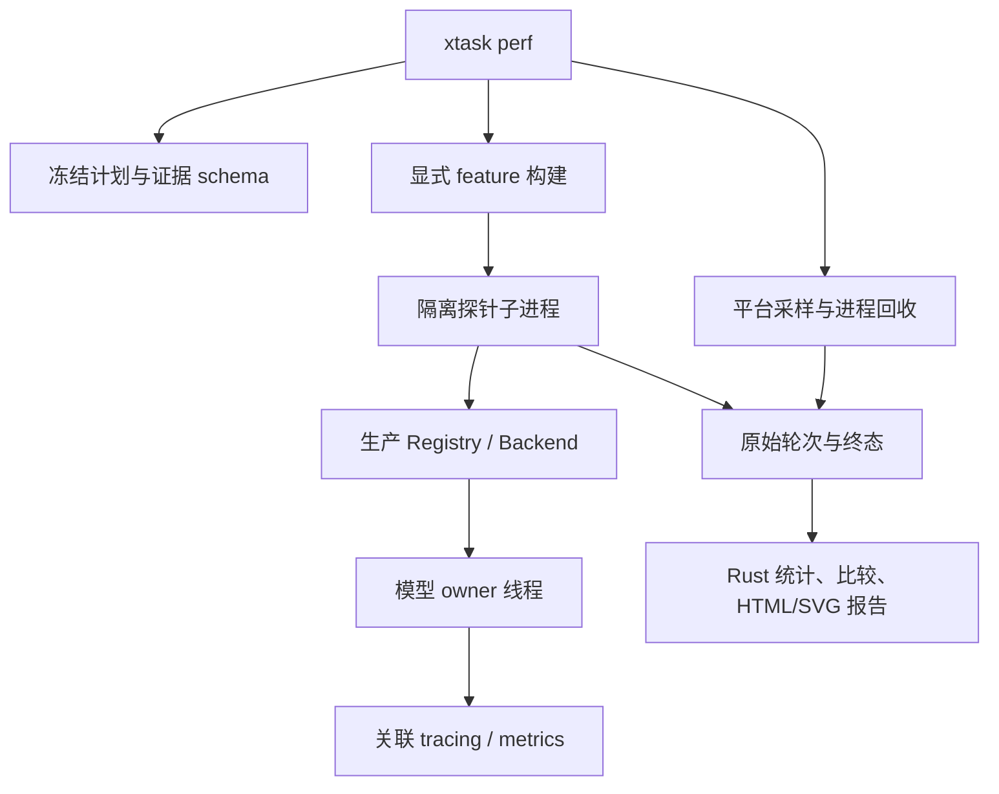

# Design

## Context

动机与范围见 proposal.md。当前 workspace 没有 xtask 或 `.cargo` alias；Qwen 已有可选 profiling 模块及大量 tracing span，其他探针计时口径不一。`tools/tts/probe_metrics.py` 采样进程 RSS 与整卡显存。进行中的 Windows change 已定义资源导入、覆盖矩阵和重复协议，应消费新框架而非再实现一套 Python runner。

该变更跨开发工具、生产适配器埋点、schema 和 CI，满足独立设计文档条件。当前约束以 README、architecture、development 和 `docs/knowledge/tts-performance.md` 为准。

## Goals / Non-Goals

**Goals:** 工具链纯 Rust，轻量入口与重模型构建隔离，原始事实可审计，跨平台 schema 从首版稳定；模型所有权、有界流、取消及音频内容不因采集改变。

**Non-Goals:** 不建设云观测服务，不统一模型算术/图/KV 状态，不改 v7 wire，不在本 change 下载或执行 Windows 全量矩阵，不在 Windows 声称 Mac collector/Metal 实机已验收，不重写所有官方 Python 模型转换器。

## Decisions

### 1. xtask 是开发入口，模型在独立探针中

新增未发布的 `xtask/` workspace member 与 Cargo alias，保留默认 member。建议命令族为 `cargo xtask perf plan|prepare|build|run|resume|compare|report|doctor`；`run` 只接受已经冻结且构建完成的计划，`prepare` 默认离线核验，获取资源需显式开启。CLI 帮助与 catalog 不加载模型。

xtask 不依赖模型库、ORT 或音频设备；通过 Cargo JSON artifact 信息定位具名 feature 构建的 backends example，不能猜测 `target/release` 文件名。每种 feature 组合使用独立构建目录并记录二进制摘要，CPU/Candle CUDA/ORT CUDA/Metal 不意外统一。探针调用 Registry/生产 Backend；LocalSet 和 owner 线程原样保留。不要为通用工具引入第二个产品 executable 或修改 cargo-dist 发行清单。

替代方案：把所有模型链接到 xtask 会使简单报告命令要求原生工具链；继续让 Python 编排又无法满足统一 Rust 入口。选择小 xtask + 可选重探针。

### 2. Rust 主链路与上游转换例外

计划/资源收据校验、子进程管理、采样、统计、CSV、HTML/SVG、WAV 导出和打包用 Rust 完成。优先现有 workspace 的 serde、tokio、sha2、hound；新增开发依赖集中声明并检查许可证/MSRV，不为工具改 Candle/ORT/CRT。

资源定位由调用 AppPaths 的探针 catalog/开发入口返回，xtask 接收解析结果，不重写 HOME 或触发产品迁移。目录使用 `<AppPaths.root>/benchmarks/<platform>/<run-id>/`。本 change 的 prepare 先消费既有资源和可验证收据；资源导入/下载的锁、复制和原子发布语义由 Windows 资源 change 实现并协调 Rust 复用，不能临时调用 Python 兜底。若导入尚未实现，明确 blocked。

已有 Python-only 转换仅在显式准备阶段执行，记录解释器、脚本/源码 revision、输入输出摘要及依赖；输出必须通过生产校验。执行、恢复和报告不调用 Python。历史对照脚本保留，无需本次批量迁移。

### 3. 平台是 schema 的一级维度，首批交付 Windows

公共记录包括 os/arch、稳定 machine 标识、硬件/OS/驱动、目标 triple、有效 math backend/provider、精度、线程、电源与温度的可用观察。时间使用单调时钟相对偏移，墙钟只用于溯源；不同进程时钟不直接相减。所有采样包含 source/unit/scope/interval/status，状态可为 available/unsupported/unavailable/deferred，运行证据与能力声明分开。

平台模块按实际需要分出 environment、process sampling、device sampling、process lifecycle、profiler adapter。先用具体平台模块和小数据契约，不预建跨模型 GraphBackend 或大量单实现 trait。

| 平台 | 首批状态 | 执行与采样边界 | 后续 native 验收 |
| --- | --- | --- | --- |
| Windows CPU/CUDA | 本 change 实现并以无模型/显式 smoke 验证 | RSS/OS peak/private bytes（可用时）；整卡 VRAM、功率等 | 全量模型批次在原 Windows change |
| macOS CPU | schema、计划模板和 deferred 状态交付 | 区分 Accelerate/BLAS 与其他有效实现，不只记录 cpu | 原生 RSS/高水位语义、线程与电源条件、真实模型 |
| macOS Metal | schema、计划模板和 deferred 状态交付 | 统一内存不等于独占显存；实际 owner 的完成边界 | Metal GPU、allocation 指标可用性、真实模型 |

Windows 初期可由 Rust 调用 `nvidia-smi` 采集，命令超时/失败输出 null+reason；不用 Python。原生进程采样避免每 500ms 启动 PowerShell，记录 OS high-water 与采样最大值的区别。Mac 预留 native collector 和 Instruments 产物描述；其 API 与权限细节在 Mac 实施时核实。未实现 collector 不使用 Windows 单位/含义硬套。

跨机器报告允许并列描述，默认回归仅在同机同执行路径内进行；Mac 后续实测独立 run 根和 baseline，不要求重新生成旧 Windows 数据。

### 4. 版本化事实与进程状态机

schema 分为 plan/run、case、attempt、round、observation、artifact，统一版本并在不支持版本时拒绝恢复/比较。case 固定语料原始字节摘要、参考/模式/有效参数、资源和构建配置。attempt 记录 source revision + dirty diff/untracked source 内容摘要、binary hash、运行环境和 observation profile；模型、用户音频与语料不进入 Git。

探针 stdout 为开发工具专用的版本化事件通道，stderr 为诊断，不是产品 worker 协议。事件包含 sequence、相关 ID、单调偏移和终态；父进程增量排空并写原始记录，设置帧大小/数量或磁盘预算，不无限积累 PCM/日志。事件缺口、无终态、截断、非有限 PCM 均不能当成功。

执行顺序为 prepared → running → draining → terminal → artifacts verified → committed。只有身份和所有必需证据匹配的 committed attempt 可复用。相同 run 的执行锁阻止双 runner；完成标记在音频/记录 flush 且摘要核验后原子发布。失败写新 attempt，绝不覆盖旧证据。超时先走已有取消/接收端释放流程，再终止本工具进程树；Windows 使用 Job Object 等受控机制，Mac 后续 process group 实现必须显式验证。任何平台未确认回收均停止调度。

### 5. 统一计时边界，不把 trace 当 GPU profiler

公共阶段为 verify、load、reference_prepare、request；request 内记录 owner PCM ready、adapter delivery、consumer first PCM、request completed；子阶段与 parent/包含关系显式记录。后端不可拆的阶段为 null+reason，不虚构统一流水线。模型私有 span 保留名称和 backend 命名空间，逐步复用 Qwen 既有埋点。

基线以请求外层 Instant 和生产完成事件为依据；首请求/懒缓存、warmup、hot 轮分开。owner 执行路径在必要请求边界验证设备工作完成，不使用另一个 context 同步；内部 span 不逐个同步。host wall/submission、device-native 时间分别命名。写 WAV 与导出放计时外；PCM 接收端固定 drain 行为，背压等待单独采集。队列水位用音频秒数，chunk gap 标明生产端或接收端；实际播放与 underrun 验收留给独立播放场景。

阶段重叠不求和解释端到端耗时；GPU events/Nsight 才能提供对应设备时间。替代方案“所有阶段都强制同步”会改变调度，不采用。

### 6. tracing、metrics 和原始结果职责分离

库层只发 tracing/metrics，不安装全局 subscriber/Recorder；探针 main 在 owner 创建前安装并控制生命周期。使用显式 span/context 关联 owner 线程，async future 用 instrument，不把 entered guard 跨 await。Recorder 必须覆盖发出指标的 owner 线程，不能只装在线程局部。每进程拥有独立采集状态；逐轮结果靠类型化 observation，不靠累计 histogram 反推。

metrics 仅用有界标签 backend/model/device/mode/stage/outcome；run/request/文本/音色身份在 trace 或原始 metadata。counter 记录请求/失败/样本数，gauge 记录队列音频秒数和资源快照，histogram 记录请求/阶段/发送等待分布。聚合内存有界，不为每帧永久注册标签。原始结果是报告与判定的权威输入。

tracing-subscriber 在开发入口组合过滤器和本地 Chrome trace 导出，落盘格式兼容现有 Qwen 分析流程。详细 trace 设置有界缓冲、明确丢弃策略与计数、退出 flush 及完整性标记；若现有 exporter 无法提供这些能力，添加有限 writer 适配或拒绝声称完整，不能默认其开销为零。此层不创建网络服务；OpenTelemetry 是未来可选 exporter，不在本轮强制实现。

### 7. 三种观测配置与平台 profiler 扩展

- baseline：必要边界和原始结果；低频资源采样单列配置与开销。
- trace：开启细粒度阶段/chunk/span，导出本地 trace，不并入正式基线。
- profile：独立运行并关联原生 artifact；Windows WPR/WPA、CUDA Nsight 为可选外部工具，缺失不阻塞 baseline；Mac Instruments/Metal 为后续 adapter。

工具版本、命令参数、采集配置、启用项与丢失状态组成 observation identity。无采集/基础/详细的开销比较使用同条件独立进程与输出核验，报告差值、分布、样本数，不设置未经实测的开销保证。不在测量进程中同步压缩、绘图或导出 telemetry；退出后排空与报告。

### 8. 统计与回归

Criterion 用于模型无关热点及基准 smoke，不把完整 TTS 请求强塞进自适应微基准循环。真实模型 runner 保留独立进程协议；Windows 基线沿用 3×(1 warmup+5 hot)，输出保持型 A/B 默认采用知识库既有 ABBAABBA 八进程协议。RTF 先以单请求总合成秒数/实际音频秒数计算，保留逐轮，再逐进程均值和 mean-of-means；不混淆 pooled RTF 与平均 RTF。

比较器把 source/binary 变化视为待比较变量，硬件/OS/驱动/provider/math/资源/输入/参数/feature/精度/线程/边界/观测模式作为兼容条件。feature 改变的优化可做显式描述性 A/B，但默认不自动放宽基线门禁。输出等价策略可为 codes/PCM hash 或有依据的数值容差，不能用吞字后缩短生成证明加速。

固定 policy 文件记录指标方向、最小绝对和相对变化、样本数与证据规则。默认真实模型决策以进程均值范围和实际阈值共同判定：越过两项阈值且区间分离才判定明确退化；反方向相同规则才宣称改善。完整且区间分离、方向有利或落于实际容忍带可 pass；覆盖不足 incomplete、条件不符 incomparable、其余 inconclusive。小样本 p95/p99 仅描述，不能作硬门禁。绝对和相对阈值由各 metric policy 显式配置，用于该指标的比较，不等于优化的保留决定。

优化保留不设置默认的整链改善百分比。经重复测量确认的算子或阶段显著改善，可结合实现复杂度、维护成本和其他阶段的影响保留，即使单项整链收益较小；整链提速未证明时必须明确标注。多项局部优化组合后重新验证整链效果与正确性，不直接相加改善百分比。输出与生命周期门禁不变，具体规则遵循性能知识库。

普通 CI 跑无模型契约、确定性假子进程/Backend、微基准可执行性与比较器夹具；不在共享 runner 按墙钟设置硬回归阈值。固定硬件真实模型基准显式触发，native CUDA/Metal 编译与性能证据分别登记。

### 9. Rust 离线报告与既有 change 协调

使用 Rust CSV 序列化与受控 HTML/SVG 模板，报告不依赖 JS fetch/CDN；无需额外 Python 绘图链。转义文本、拒绝路径穿越和输出根外链接，图表按平台/设备/模式分面，失败/不适用/缺指标可见。音频保留原采样率 F32 及可选 PCM16 派生关系；代表轮确定性选择，listening=pending。打包只含报告必要资产，限制目录大小并保留摘要。

不直接改写 Windows change；实施前列出其任务映射：资源准备保持既有安全契约，2/3/4 组工具任务复用新 Rust harness，5/6/7 组真实批次和交付仍由其拥有。原 Python 实现任务需要用户协调更新后再实施，不运行双套 runner 形成两份权威结果。

## Risks / Trade-offs

- [工具变成第二套业务框架] → 复用生产适配器，类型化证据只在开发侧，阶段无法拆分就披露。
- [采集扰动微小性能差异] → observation identity、独立诊断、开销对照；不从完整 trace 推导无采集基线。
- [Windows 可用被误称跨平台完成] → Mac deferred/unverified、平台缺失原因和后续原生清单独立交付。
- [资源采样漏峰值、WDDM 进程显存不可用] → scope/source/interval 与 OS high-water 分开，不把缺失写零。
- [框架与全量基线重复开发] → 实施前任务映射与依赖协调，只有一个原始结果协议。

## Migration Plan

先完成 schema/无模型夹具和轻量 xtask，再接 Windows 进程与资源采样、生产探针与埋点，最后比较/离线报告。为 Python-only prepare 生成明确依赖说明，已有资源可直接跑无 Python 链路。普通 CI 验证稳定后以显式本机短 smoke 验收，不自动下载；全量 Windows 批次交回既有 change。

本 change 交付 Mac schema/计划、deferred 测试与后续清单即可结束；后续 Mac change 在本机完成 lifecycle/采样/Metal 完成边界/可选 Instruments/真实模型与开销验收，然后逐项激活能力，CPU 与 Metal 建立各自基线。回滚工具不会删用户模型、批次或既有 Python 历史记录。

## Research References

选型依据来自上一轮官方资料调研；这是设计依据而非未经验证的本机能力声明。实施时重新核验依赖版本与目标平台支持。

- xtask 模式：<https://github.com/matklad/cargo-xtask>
- tracing 本地时间线：<https://docs.rs/tracing-chrome/latest/tracing_chrome/>
- metrics 门面/Recorder：<https://docs.rs/metrics/latest/metrics/>
- Criterion：<https://bheisler.github.io/criterion.rs/book/>
- NVIDIA Nsight：<https://docs.nvidia.com/nsight-systems/InstallationGuide/>
- Windows CPU 分析：<https://learn.microsoft.com/en-us/windows-hardware/test/wpt/cpu-analysis>
- 可选未来 OpenTelemetry：<https://opentelemetry.io/docs/languages/rust/>
