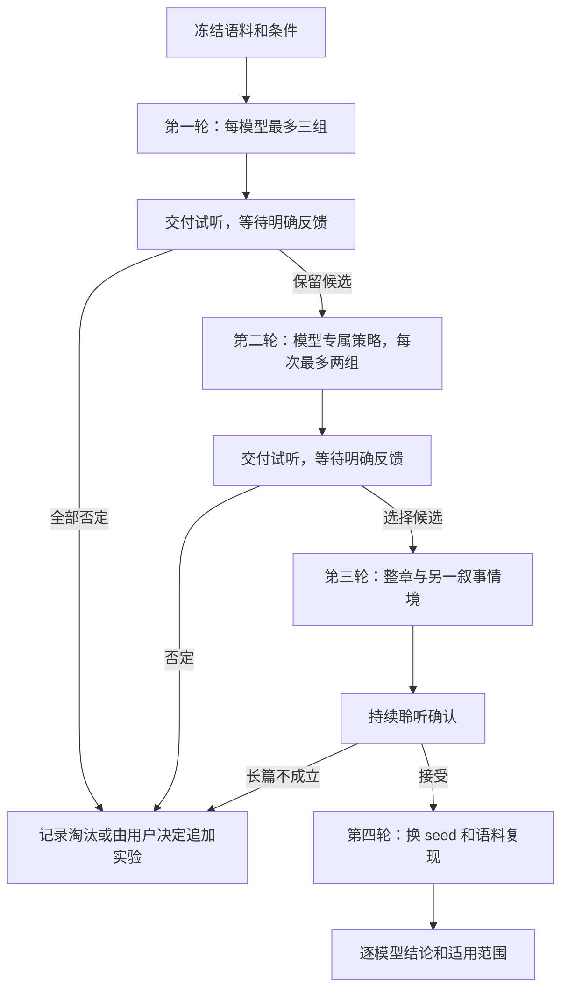

> 2026-10-27：本实验计划已终止，由 `official-reference-synthesis` 替代。未执行任务保持未完成；不再推进滚动、双参考或重锚候选。以下保留历史实验契约。

# Design

## Context

动机见 proposal.md。现有生产 producer 持有最近完整语音，默认接续预算 45 秒；无段落间隔时可到两倍预算再重锚，不能把预算称为精确重置周期。`talechime-core/tests/continuation.rs` 已覆盖接续、seed 和边界；实验必须记录真实重置点。

`talechime-backends/src/voxcpm/runtime.rs` 已有 feature 门控的 `generate_dual`，独立编码身份参考与滚动上下文；`moss/candle/runtime.rs` 已有实验身份锚定路径，默认仍可用上下文替代参考。它们是实验候选，不是稳定公开能力。MOSS 原生跨请求 KV 会话是否能安全接入当前 owner 仍需小型可行性检查。

`readback_corpus` 示例可通过公共 Engine 导出实际范围的 WAV 和报告，但尚无本计划所需的完整策略矩阵、匿名试听和反馈门禁。旧漂移脚本不能当作当前执行入口。`xtask/src/perf/` 已有不可覆盖构建收据、进程控制、资源采样与音频产物契约，应复用而不再建独立 Python runner。

已确认本机 `target/guzhenren-acceptance/corpus.json` 有五章条目，前两项所指派生文件存在且声明摘要；本次规划没有验证完整源文件、当前全部章节摘要或重新生成音频。历史原文件 SHA 和范围见 2026-10-09 验收记录，实施时须重新核验。

## Goals / Non-Goals

**Goals:**
- 用小批次、单因素对照和用户试听，得到逐模型的单旁白小说策略结论。
- 区分身份漂移、韵律平淡、分块收尾、语速累积变化和内容错误，允许不同模型选择不同路径。
- 保留可靠复现证据与明确的停止点，使被中断或否定的实验不会伪装为成功。

**Non-Goals:**
- 不做角色分析、多音色调度、权重训练、新模型接入或完整 TRNovel 播放集成。
- 不用后处理强行统一音高、语速或句末轮廓，不承诺固定参考必然更生动。
- 不在本变更中推广生产默认或新协议字段；模型策略产品化另行规划。

## Decisions

### 1. 使用既有小说快照，但重新建立本轮身份

只读定位 TRNovel 的《蛊真人》原文件及章节来源，核验当前内容，再从源 UTF-8 范围提取自然段快照。既有五章清单是候选来源，不是免校验凭据。短样选取约 800–1200 字且含平静叙述、剧情转折、对白与长短句的连续内容；3–5 分钟只是估算，不按生成时长裁正文。后续整章挑选两种叙事情境，目标每份 15–30 分钟；实际章长不足时保留全章并明确时长，不补字凑数。

源路径、全文、WAV、转写、完整反馈资产映射保存在 `target/narration-experiments/<run-id>/`，公开记录仅含非正文结论、摘要与相对证据路径。每次运行采用新目录，禁止覆盖历史产物或原小说。提取不调用 TRNovel 业务类型，不扫描迁移历史用户目录。

### 2. 采用单因素筛选，不展开笛卡尔积

每个模型第一轮最多三组：A 当前接续，B 固定原始参考且使用与 A 相同的冻结分块，C 固定参考且预算内合并相邻句。A/B 比接续；B/C 比组段。记录生产自适应组段基线，并冻结 A/B 的实际范围；若探针无法控制实际模型分段，应先补开发入口或标记该对照不可解释，不宣称已隔离变量。

同模型内保持参考、采样、root seed、风格、精度、后处理一致。改变组段会改变 seed 派生序列，B/C 不承诺逐位可比；通过后再换 seed 复核。保留生产边界处理和响度对齐一致，不独立调速或额外插入静音。必要的响度匹配试听副本必须标记且保留原 PCM。

放弃所有模型统一滚动规则：已有反馈表明它对音色、语速、韵律的作用不同。也不把首个生成片段冻结等同于原始参考；冻结锚点仅作为第二轮有理由的候选。

### 3. 按模型逐批迭代

| 顺序 / 模型 | 第二轮候选 | 明确的退路 |
| --- | --- | --- |
| 1 Nano Candle | 固定原始音色的多句组段、短链接续；若用户认为有价值才复查冻结生成锚点 | 滚动漂移或漏读则淘汰；固定策略仍平淡可判不适合本目标 |
| 2 VoxCPM2 Q8 | 固定参考与已有双参考，比较有限上下文及自然边界重锚 | 双参考无收益就保留固定策略或淘汰，不以声纹相似代替听感 |
| 3 Qwen 0.6B / 1.7B Base | 各自复用原始 prompt，多句组段与短链接续 | 两尺寸独立决策，重点观察链内语速；不伪造独立双参考 |
| 4 MOSS Realtime | 固定身份 + 近期上下文；原生持续会话另做有界可行性检查后才列候选 | 若需要大幅重构或无法保证取消/状态边界则记 deferred，不阻塞其他模型 |
| 后续 OmniVoice / CosyVoice3 / IndexTTS | 在用户确认继续这些模型后，固定参考与实际支持的多句预算；有收益再测稳定旁白指令 | 不支持的策略保留理由；缺资源、转换或设备记 blocked/deferred |

第一轮不混入人工情绪指令。第二轮若声音稳定但太平，仅对原生支持风格的模型增加一条稳定旁白指令，作为单独对照，不逐句人工导演。所有合并均遵守模型 token/音频预算和同一音色范围。

2026-10-26 用户在 Nano 较长试听全部否定后，同意转向 VoxCPM 双参考验证。因此 VoxCPM 当前批次直接比较固定原始参考、普通滚动与双参考，三组全部冻结为相同分块；双参考不依赖 Nano 或尚不存在的 VoxCPM 偏好。VoxCPM 多句组段不混入此批次，后续按其独立反馈决定。原计划的首轮 VoxCPM 任务据此更新，数值对照与整章门禁继续保留。

首轮以当前 Mac M4 Pro 的可用 Metal/CPU 路径为建议起点，显式记录实际选择；已知设备缺失不得静默 fallback。按模型加载和生成串行执行。只有已准备资源才能直接运行，新增下载或转换在独立准备阶段显式列出体积、来源与资源目录。规划本身不触发下载。

### 4. 用户试听是阶段推进依据

沿用 CLI/文件产物与当前聊天交付，不新建实验 Web 服务。每批提供完整 WAV、可用时的压缩试听副本和相同正文位置的短摘录；匿名 A/B/C 顺序随机且保存映射，收集反馈后揭示。反馈明确绑定 run、模型、资产摘要、用户选择、具体问题和决定；缺反馈状态为 awaiting_feedback，自动指标不能解锁。每次只交一个模型的少量版本，用户随时可停止，未回应时不代其选择。

评价维度：身份稳定、叙事起伏、句间承接、语速演变、停顿自然、长时间舒适度。另有内容完整性标记。可以记录“均不满意”“接近但需再试”“仅短文本适合”，不强制数值平均分选胜者。整体结论允许只有一部分模型适合目标；无胜者也是完成了有证据的探索。

### 5. 轻量扩展现有开发工具，保护生产链路

新增显式 narration 实验计划与报告路径，复用 xtask 的构建、进程、资源和资产校验，将质量筛选与正式性能 ABBA 基准区分。需要的策略选择留在 `performance-tools` 或现有实验 feature 下；不加入生产 CLI/wire 参数。局部调整 core 必须默认不变、保持 LocalSet 与 owner，取消先解除有界 PCM 发送再等待模型退出。

每份 run 清单包含源/二进制/模型 revision 与摘要、features、设备精度、参考与转写摘要、参数、seed 策略、选段范围、实际分段、接续候选/重置记录和音频摘要；运行与试听状态分开保存。失败和取消保留证据，不复用不完整 WAV。已有工具中的失败状态不应为此另建通用调度框架。

### 6. 内容与韵律分开检查

生成对照默认关闭自动重试，离线 ASR 仅报告疑点；保留其输入对应的原始音频摘要。计算分段语速（区分含停顿与有效语音口径）、块间停顿、响度和首 PCM/RTF，重锚点对齐显示。整体字符/秒是粗指标，不能否定链内加速听感。声纹/F0 等新增诊断仅在确有定位价值时显式加入，不因此下载额外模型或设通用通过阈值；中文声调和清浊音会干扰简单 F0 指标。

用户确认的漏读、重复或截断不得进入“长篇推荐”；ASR 疑点先人工复核，不自动判模型失败。整章通过后使用另一个 seed 和另一叙事情境复现；已完成第三轮第二章可以复用。跨设备复验按计划显式 deferred 或运行，不把 Mac 结果外推 CUDA。完整长期推荐至少需要两种叙事情境、完整章反馈与 seed 复现；只有局部证据则降级为有条件/待验证结论。

## Risks / Trade-offs

- [组段更长导致漏读或超预算] → 逐模型限定预算，导出真实范围和 End，内容异常保留并淘汰，不能用完整 End 证明逐字正确。
- [自然段普遍很短，仍反复收尾] → 将原段落保留为身份信息，单独比较预算内跨相邻段组块；标题/场景边界不盲目合并，实验变换写入清单。
- [固定参考稳定但无起伏] → 用户整体听感否决，允许该模型只适合平静文本，不以身份指标抵消缺陷。
- [滚动或原生缓存积累偏差和显存] → 有限窗口/自然边界重置；无法保持 owner 与取消边界的方案 deferred。
- [旧探针或旧音频代表过时实现] → 本轮固定构建收据，旧实验仅为假设和候选来源。
- [试听成本过高] → 每批最多三组，第二轮最多两组，先短样淘汰再整章，不批量生成所有模型全部组合。
- [语料摘要不符或本机资源不足] → 该组合 blocked；报告准确缺口，允许其他独立模型继续，不能修改摘要让旧材料冒充新源。

## Migration Plan

仅增加开发实验能力和记录，无用户格式迁移或部署。普通入口关闭实验路径；必要时通过移除实验配置或回退开发代码停用，用户音色库、TRNovel 数据与历史实验资产不自动删除。最终将模型、推荐/退路、证据和局限写入 `docs/records/voice-drift/`，如需产品化再单独提出稳定行为变更。

## Open Questions

- 精确选段、章节与导入音色在资源核验后确定，绑定摘要；不影响单因素和单旁白实验设计。
- 最优分块预算和重锚窗口由逐模型对照决定，不预先规定通用秒数。
- 原生持续会话是否值得进一步接入，取决于 MOSS 可行性检查与首轮听感，不作为全计划前置依赖。

## Evidence References

- 本地：`docs/records/voice-drift/voice-drift-experiment-2026-10-14.md`、`voice-drift-qwen-moss-2026-10-14.md`；`docs/readback.md`；`docs/performance-harness.md`。
- [ElevenLabs request stitching](https://elevenlabs.io/docs/eleven-api/guides/how-to/text-to-speech/request-stitching)：跨请求上下文改善韵律的产品实例，不代表本地模型具备同接口。
- [ContextSpeech](https://arxiv.org/abs/2307.00782)：跨句文本上下文与记忆复用的研究依据，不将其训练结构当作现有模型推理开关。
- [VoxCPM2 官方实现](https://github.com/OpenBMB/VoxCPM/blob/main/src/voxcpm/model/voxcpm2.py)、[MOSS Realtime 模型卡](https://github.com/OpenMOSS/MOSS-TTS/blob/main/docs/moss_tts_realtime_model_card.md)：仅用于候选能力依据，正式实验记录实际使用的 pinned revision。
