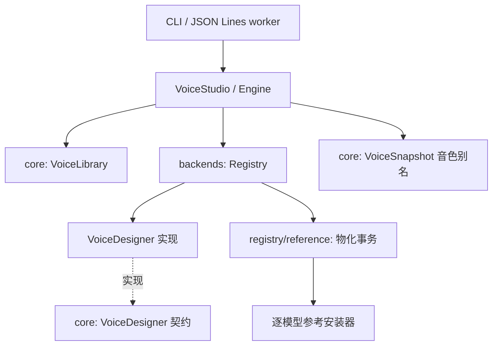

# Design

## Context

现状（见 proposal.md 的动因）：音色创建逻辑分散在 CLI `voices.rs`、库 `voice_import.rs` 与四个后端 `design.rs` 三处且已漂移；音色身份绑定 `(backend, model, revision)` 并存于模型资源目录。已有的可复用资产：

- `talechime-core::voices::VoiceStore`：原子的 per-model 音色存储（staging + rename + 锁），落盘 `voice.json` + `reference.wav`。
- 四个设计内核签名几乎同构：`(directory/根, device, text, description) -> 写 WAV`，且都已实现「receiver 关闭即取消」。
- `reference::load` 已做通用重采样（8..192 kHz → 目标采样率）。
- Backend/Registry 的静态登记 + `ModelAdapter` 模式运转良好，可作为设计引擎的模板。
- `1.7b-voicedesign` 已从产品目录撤下（本 change 前置，已落地），设计模型现为内部资源。

仓库约束：路径集中在 `talechime-core/src/paths.rs`；会话留在 Tokio LocalSet，推理与音频对象归属 owner；取消与有界流是公共行为；不扫描/迁移旧用户数据。

## Goals / Non-Goals

**Goals:**

- 库 API 两层（自动/显式）共享一条内部路径，外部宿主三个调用完成「设计→合成」。
- 设计引擎可插拔：新增引擎 = 新实现 + 一行登记，宿主与 core 流程零改动。
- 音色库为唯一事实源；per-model `VoiceStore` 降级为可再生缓存，后端 crate 改动最小化。
- 协议 v7 加法式扩展，计划格式零改动（`SpeechSpan.voice` 直引用库 id）。

**Non-Goals:**

- 不迁移、不读取旧 per-model 自定义音色；不做「库同步/云共享」。
- 不改合成内核、设备选择、校准与缓存身份机制。
- 协议面不提供导出/导入包命令（机器宿主走文件系统）。
- 不做真人音色克隆能力（法律边界不变）。

## Decisions

### D1 分层与归属：core 定义契约，backends 提供实现，facade 组合



core 保存模型无关的契约与资产；backends 拥有模型差异和缓存事务；facade 只组合。
`ReferenceVoice` 将元数据与 WAV 作为一组传入，所有物化只走异步入口。

理由：与 Backend trait 完全同构的依赖倒置结构，`1.7b-voicedesign` 撤目录那一步已验证该模式。备选「全部塞进 facade」被否——facade 会重新长出 match 臂，回到三处维护。

### D2 音色库存储格式

`~/.talechime/voices/<id>/` 下 `voice.json`（id、显示名、转写、描述、来源：引擎或用户导入、创建时间）+ `reference.wav`（原样字节）。写入复用现有 staging+rename+锁 模式；`paths.rs` 新增 `voices()`。id 规则与现有 `custom:` id 相同的字符集（1..64 ASCII 字母/数字/-/_），自动 slug 由门面生成并查重。

备选「库记录直接软链到模型目录」被否：用户资产不得依赖模型缓存生命周期。

### D3 物化：per-model `VoiceStore` 原样复用，身份降级为缓存

`Registry::install_reference(backend, model, library_voice)`：读取库 WAV → 走各后端现有导入校验（时长/采样率/mono 检查，即今天 voice_import.rs 每个 match 臂里调用的那组函数，收敛为 adapter 方法）→ 写入该模型 `VoiceStore`（沿用 `custom:` 命名空间）。模型侧相邻 `.library` 标记包含库 id、内容指纹（转写+描述+WAV hash）和缓存内容摘要；目录型和 Nano 文件型缓存共用事务。损坏/过期时只替换归属明确的缓存；同名未标记用户数据报冲突。替换前保留旧缓存，失败或取消恢复旧值。隐式物化（会话启动发现 span.voice 是库 id 且缓存缺失/过期）与显式 `install_voice` 调用同一函数。

MOSS Nano 例外：其导入本就编码为 codes，物化走其现有 `import_voice`；库中 WAV 始终保留，故可再次物化或导出，反向（从 Nano 导出）不需要。

### D4 设计引擎契约与登记

```rust
trait VoiceDesigner {
    fn id(&self) -> &'static str;            // "qwen-voicedesign" | "moss-voicedesign" | "voxcpm" | "omnivoice"
    fn info(&self, root: &Path) -> EngineInfo;  // 设备、输入约束、额外下载字节数、是否已就绪
    fn prepare(&self, root, progress) -> Future;
    fn design(&self, root, request, cancel) -> Future<DesignOutput>; // 产物 = WAV 字节 + 转写 + 描述
}
```

四个实现各自包装现有内核；现有内核的参数校验（文本 60/100 字符、描述 200 字符/4096 字节、括号禁用等）上提进 `EngineInfo.input_constraints`，facade 在调引擎前统一前置校验（满足 spec「加载权重前校验」）。`design` 的取消沿用「future drop → 内核观察 receiver 关闭」既有语义，不发明新机制。

自动选择策略（facade 内可覆盖的函数，默认实现）：已就绪主模型引擎（voxcpm/omnivoice，零额外下载）→ 按设备可用性排序的专用引擎（qwen 优先，跨平台 CPU 可用；moss 设计仅 CUDA）。

### D5 `VoiceId` 与合成入口解析

facade 导出新类型 `VoiceId(String)`（serde 透明）。合成路径解析顺序：能力目录音色 → 音色库 id（物化为 `custom:<id>`）。Engine 的流合成与计划构造为 async，统一调用同一物化路径。`VoiceSnapshot` 冻结成功安装后的音色集和库 id 别名，首次及增量 span 在 core append 时统一转换；CLI 与协议不再各自维护别名表。

备选「计划新增 voiceRef 字段」被否：v7 允许加法但零改动更简，且字符串语义天然向后兼容。

### D6 协议面

`Command::DesignVoice { name, description, text?, engine?, device?, seed? }`（新变体，加法式）；进度复用 `Event::ModelProgress`；完成 `Event::VoiceReady { voice }`（新变体）。同一 worker 进程内设计后即可在计划中引用返回 id。worker 内设计任务与合成任务互斥（单 owner 线程原则），资源命令按最多 16 项的有界队列排队，活动会话控制可通过。取消与已完成设计竞态时，完成获胜返回 `VoiceReady`，避免隐藏已入库的结果。

### D7 CLI

`voices` 子命令树全部改为库操作（design/import/list/rename/remove/export/import-bundle/engines），不再依赖 `--backend`；朗读入口 `--voice <库id>`。试音文本默认值沿用现有固定句。

### D8 错误面

`VoiceStudioError`：自动层显示文本不泄露引擎内部模型名，原生失败保留 error source 供显式诊断（「设计引擎暂不可用」，引擎名仅在显式层与 `engines` 清单出现）。

## Risks / Trade-offs

- [自动策略下了 4GB 专用引擎而用户预期免费] → 策略优先零下载引擎；`engines` 清单明示代价；协议/CLI 在开始下载前进度事件可见，可取消。
- [隐式物化在会话启动写盘，宿主可能意外] → 物化仅写模型资源目录下的可再生缓存；发出状态事件；显式层可提前 `install_voice`。
- [旧音色「消失」引发用户困惑] → CLI/文档明示新库从空开始、旧目录原样保留；提供一次性重新导入即可恢复。
- [库与模型缓存不一致（WAV 更新后缓存陈旧）] → 缓存键含内容指纹，启动时检测过期重物化。
- [设计任务与合成争抢 GPU] → 同进程一次一个设计任务（与现状 CLI 一致），协议 worker 排队。
- [导出格式被当作长期归档格式演进] → 包格式带版本字段，读取端只承诺当前版本 + 明确报错（与仓库「不支持的数据显式失败」一致）。

## Migration Plan

无用户数据迁移。落地顺序：core 契约与库 → backends 引擎包装与登记 → facade 门面与物化 → 协议 → CLI 重写 → 删除 `voice_import.rs` 与旧 CLI 路径 → 文档。回滚 = revert（旧目录未被触碰，回滚后旧 CLI 立即可用）。

## Open Questions

- 导出文件的扩展名与 slug 生成算法细节（实现时定，不影响契约）。
- `voices list` 是否附带「各模型已物化」状态列（增强项，可后补）。
