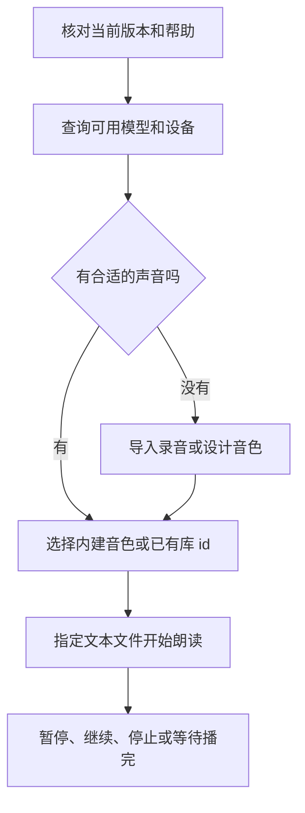

# Talechime 命令行

最常见的任务是“用某个声音朗读一个文件”。完整流程是：
**确认安装 → 查模型和音色 → 必要时创建音色 → 朗读 → 控制播放和检查结果**。
已有模型和声音时，可以直接从朗读开始；只管理音色时，不必准备合成模型。



## 第一步：确认使用的是哪个程序

```sh
talechime --version
talechime --help
```

使用现有安装，不自动升级、换产品或从源码重建。此 skill 跟随仓库源码，旧安装包可能
没有下文的命令；遇到差异先核对实际 help。用户要求构建时再选择模型 feature。

默认读写用户数据。若是一次性试验或应用专用数据，先选好独立路径，后续命令一致使用：

```sh
talechime voices list --config ./speech-data/config.json --model-dir ./speech-data/resources
```

--config、--model-dir、--checkpoint-dir 可放在子命令前后。音色库跟随 config 文件，
位于其父目录的 voices/；只改 model-dir 不会搬动音色库。

## 第二步：查询模型、设备和声音

```sh
talechime models
talechime voices list
```

这两个目录各有用途：

| 命令 | 看什么 | 这一步要作出的选择 |
| --- | --- | --- |
| `models` | 编入的合成模型、可用设备、内建音色、参数名 | 选 backend/model 和当前可用设备 |
| `models --backend qwen --json` | 某后端的完整能力、参数范围和默认值 | 确认克隆、风格及高级参数是否支持 |
| `voices list` | 用户导入或设计的库音色 | 已有合适音色时，记下它的 id |
| `voices engines` | 设计引擎的设备、资源就绪状态和下载代价 | 只有要设计新音色时才需要选择 |

查询不下载权重。目录中的模型不一定已经下载；编入的设备也不一定在本机可用。
内建音色属于具体模型，库音色跨支持参考克隆的模型复用。库音色的 id 直接用于 --voice。

## 第三步：没有合适的声音时，选一种创建方式

已有声音则跳过本步。下面两种方式任选其一。

### 有参考录音：导入

准备原始 WAV 和录音中准确说出的文字，然后运行：

```sh
talechime voices import reference.wav --name "朗读者" --text "参考录音的准确文字" --id reader
```

成功后库中出现 reader。转写必须对应录音，不能用准备朗读的章节替代；超出目标模型的
音频限制会在使用时明确失败。

### 只有文字描述：设计

先看 `voices engines` 是否有可用引擎及下载代价，再执行：

```sh
talechime voices design --description "低沉温和的中年男声" --id reader
```

名称可省略，需要时加 --name；默认自动选引擎，也可用 --engine 指定清单中的 id。
设计可能下载数 GB 并执行推理，等待保存成功后才使用返回的 id。自动选择优先就绪的
主模型资源，其次专用设计引擎；资源就绪不代表复用已加载的推理对象。
没有可用引擎/设备时，说明当前构建缺少什么，不擅自更换安装或反复重试下载。

两种方式都以成功返回的实际 id 为准。省略 --id 会自动生成；同名 id 拒绝覆盖，
需要保留两条时使用新 id。可用 `voices list` 确认结果。

## 第四步：朗读 UTF-8 文件

最短命令使用已保存的默认模型和声音：

```sh
talechime chapter.txt
```

首次使用或要明确选择时，给出第二步查到的模型、设备和声音。例如，只有当前目录确实
支持 MOSS Nano/CPU 时，才使用下面这组选择：

```sh
talechime chapter.txt --backend moss --model nano-candle --tts-device cpu --voice reader
```

reader 也可换成该模型清单中的内建声音。首次朗读会准备缺失的模型；首次使用库音色
还会生成参考缓存，Nano 可能先准备编码器。显示错误时保留原始诊断，不悄悄换设备。

先按用户意图决定播放方式：

| 意图 | 命令变化 |
| --- | --- |
| 从上次可靠播放位置继续 | 默认行为 |
| 明确从头开始 | 加 `--restart` |
| 整章生成成功后才播放 | 加 `--after-chapter`，需要临时磁盘 |
| 使用宿主已生成的多音色计划 | 加 `--plan chapter-plan.json`，正文必须与文件完全一致 |

模型、声音、风格和设备选择会保存为后续朗读默认值；一次性操作用独立 --config。
计划自带模型和声音，CLI 按计划选择；显式 backend/model 必须一致，不能再混用
--voice、--style 或 --after-chapter。

## 第五步：控制播放并确认结果

交互终端中，Space 暂停/继续，s 停止，q 退出。默认进度按实际播放提交检查点；停止后
下一次默认续读，想重听则 --restart。非交互终端不接管键盘。

--after-chapter 的“生成完成”只是开始播放的条件，不是已经播完。错误退出或主动停止
都不能当作成功完成。CLI 当前用于文件播放；若用户要生成 WAV 文件，使用 Rust PCM
API 或用户指定的上层工具，不能拿 voices export 充当朗读音频导出。

## 按需：调整效果或搬运音色

先跑通基本朗读，再按需要增加选项：--param name=value 可重复，名称/类型/范围从
models --json 读取；--seed 固定采样输入，不承诺跨设备逐位相同；--style 只用于支持的
模型。所有后端使用所选音色的固定参考，不使用滚动或双参考策略。

音色管理与播放独立：

```sh
talechime voices rename reader --name "新的名字"
talechime voices export reader --output reader.voice
talechime voices import-bundle reader.voice --id reader-copy
```

.voice 包含参考 WAV 和元数据，供另一台机器导入使用，不是媒体文件。
`voices remove <id>` 删除库资产，只在用户要求删除时执行。模型缓存可再生，用户资产
不是缓存，不要清理资产来修复模型，也不要扫描、迁移或删除旧音色目录。

## 出错后先定位到哪一步

| 现象 | 下一步 |
| --- | --- |
| unknown/unavailable model 或 device | 回到第二步，核对当前构建的目录与可用设备 |
| 未知声音或参考限制 | 核对 id、目标模型的 cloning 支持、原始录音和转写 |
| 配置损坏 | 保留文件和错误，按用户意图修复；不用默认设置覆盖 |
| revision conflict | 读取当前设置后按用户意图重建更新，不循环覆盖 |
| 想接入程序、控制事件或拿 PCM | 使用 talechime-integration；--protocol 不是 PCM 管道 |

默认配置 ~/.talechime/config.json、资源 ~/.talechime/resources/、音色
~/.talechime/voices/、检查点 ~/.talechime/checkpoints/。独立路径按第一步的规则解释。
