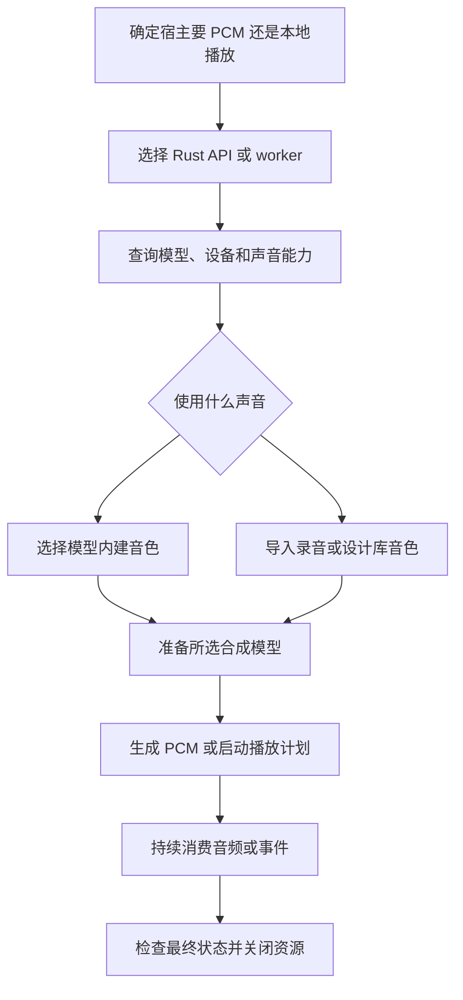

# Talechime 应用接入

接入的目标是：宿主交给 Talechime 一份文本和声音选择，Talechime 生成 PCM，或负责把
文本播放出来。宿主继续负责获取正文、分析角色、绑定音色和决定下一章。

一次完整接入分为六步：**选入口 → 查能力 → 选音色 → 准备模型 → 执行 → 确认完成并关闭**。
先跑通一段单音色短文本，再按需求增加多音色、增量文本或检查点。

## 第一步：选择接入入口

| 宿主需要什么 | 使用哪个入口 | 接下来读什么 |
| --- | --- | --- |
| Rust 应用获取 PCM，自己播放、编码或保存 | `Engine` 合成 API | [Rust 接入流程](references/rust.md) |
| Rust 应用让 Talechime 播放并控制进度 | `Engine` + `Listening` | [Rust 接入流程](references/rust.md) |
| 非 Rust 应用，或需要独立进程控制本地播放 | JSON Lines v7 worker | [worker 接入流程](references/worker.md) |

worker 返回播放状态和事件，不传 PCM。只对已有音频做回读时，直接用 `Verifier::report`，
无需创建 TTS Engine 或播放器。

先核对调用方使用的 revision/版本和 feature。本 skill 跟随仓库源码；当前源码里的新 API
不一定已在同版本 crates.io 包或安装包中发布。以实际解析的源码、rustdoc 和 `--help` 为准。

## 第二步：查清楚这次能用什么

Rust 用 `model_catalog(resources)`；worker 用 `hello` 返回的目录，也可先运行
`talechime models --json`。这一步不下载权重，产出的是可供本次选择的模型、设备、音色和参数。

从目录选定准确的 backend/model，再检查：

- `available_devices` 或设备状态：当前机器能使用哪个设备。`compiled_devices` 仅说明编入支持。
- `voices`：该模型已有的声音；为空时需要准备参考音色。
- `cloning`、`style`、`parameters`：能否使用库音色，以及接受哪些风格和生成参数。

目录存在不代表权重已经准备好。显式设备不可用时，返回具体错误，不暗中换模型或设备。

## 第三步：确定声音

内建音色和库音色是两条可选路径，选一条即可：

| 选择 | 做什么 | 交给后续合成的值 |
| --- | --- | --- |
| 模型已有声音 | 从该模型的 `voices` 中选择 | 对应声音 id |
| 用户已有参考录音 | 导入原始 WAV，并提供准确转写 | 返回的 `VoiceAsset.id` |
| 用户用文字描述新声音 | 查询设计引擎，再发起设计，等完整产物入库 | 返回的 `VoiceAsset.id` |

Rust 使用独立的 `VoiceStudio` 管理库音色；worker 使用设计/清单命令。设计不要求先准备
合成模型，但设计引擎本身可能需要下载资源并执行推理。具体调用见选定入口的参考文件。

库 id 直接交给合成或 span，不用手工拼 `custom:`。目标模型必须支持参考克隆；首次使用
时自动校验并生成模型参考缓存，Nano 可能准备编码器资源。`.voice` 是参考资产搬运包，
不是生成的朗读音频；不要直接修改缓存或扫描、迁移旧音色目录。

## 第四步：准备合成模型

Rust 调用 `Engine::prepare` 并等待返回；worker 发 `prepare_model` 并等待 `model_ready`。
这一步才让所选合成模型进入可执行状态，可能下载权重。进度和错误要传给宿主。

先明确数据归属。Rust 的 `VoiceStudio::at(resources, voices)` 与 Engine 的
`ModelOptions.resources`、`voices` 使用同一组目录；只有主动选择用户默认数据时才用
`VoiceStudio::open(None, None)`。worker 的音色库位于 config 文件旁的 voices/。

## 第五步：执行并持续消费结果

- 生成 PCM：启动合成，边接收边交给宿主 sink 或编码器；块用完就释放，不囤积长文的 `SpeechAudio`。
- 播放：建立文本计划，启动 Listening 或发送 start；同时消费事件和处理控制命令。
- 多音色/增量文本：固定一份不可变 UTF-8 正文和声音集合，按连续字节范围 append，覆盖全文后 seal；分析失败用 fail_input。

Rust 的模型、流和 Listening 留在宿主 Tokio LocalSet；`run_local` 可建立它。
跨线程传控制句柄，不移动 Rc 模型。每个 Engine 同时只有一个直接合成或 Listening owner。

## 第六步：区分完成、取消和失败

| 当前路径 | 什么才算成功 | 如何结束资源 |
| --- | --- | --- |
| 直接 PCM 合成 | 流消费结束，且 `SynthesisState::Completed` | 收完或 `cancel().await` 后，再关闭 Engine |
| 本地播放 | `SessionEnded` 的 reason 为 Completed | 关闭 Listening，再关闭 Engine |
| worker 播放 | `session_ended` 的 reason 为 `completed` | 发 shutdown，持续读输出并等待进程退出 |

生成完成、chapter_ready、accepted 或 EOF 都不能替代播放完成。Listening 控制与事件消费
要并发，避免有界事件队列堵住确认。显式 cancel/close 等待清理；Drop 只请求取消。

先用确定性 Backend/Playback 或只读 worker 握手验证接入代码，再在任务授权范围内做
真实模型验证。交付时说明实际测过的设备、音频和完成行为，不把编译成功当成试听验收。
